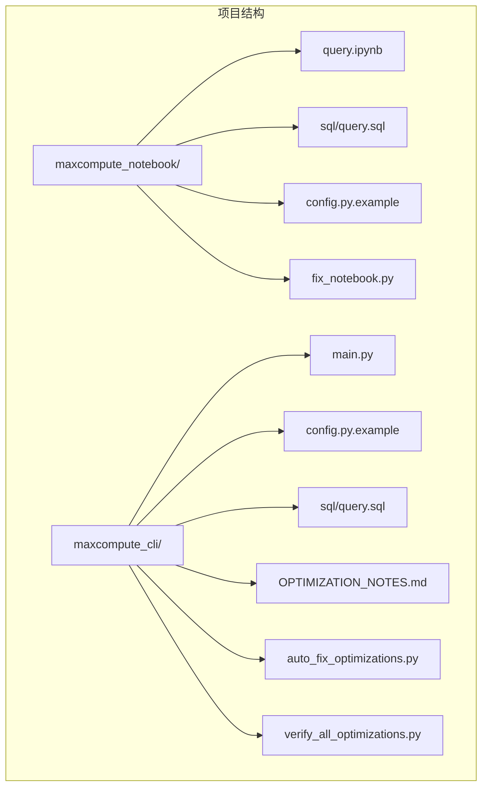
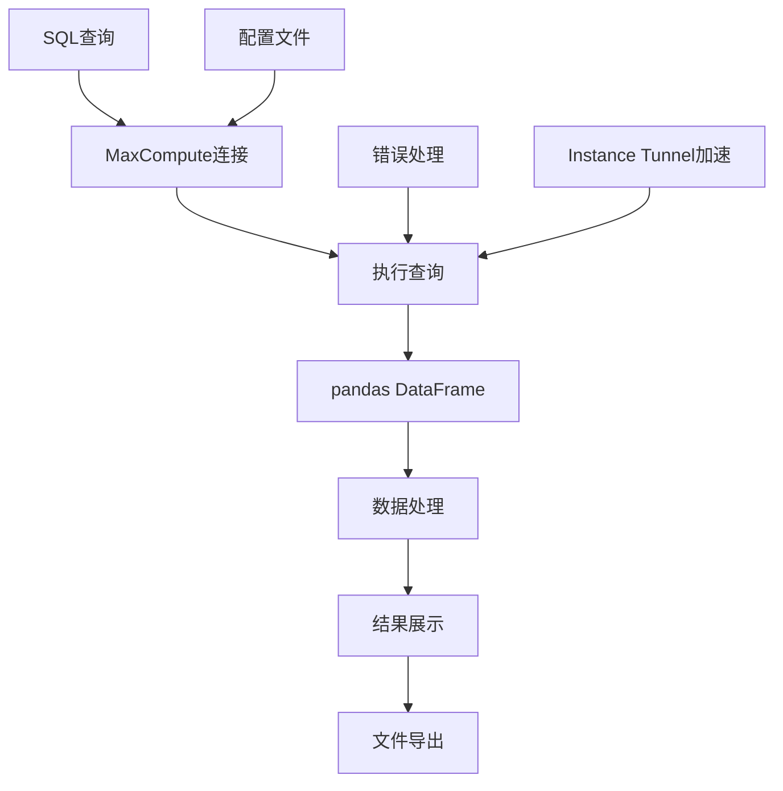
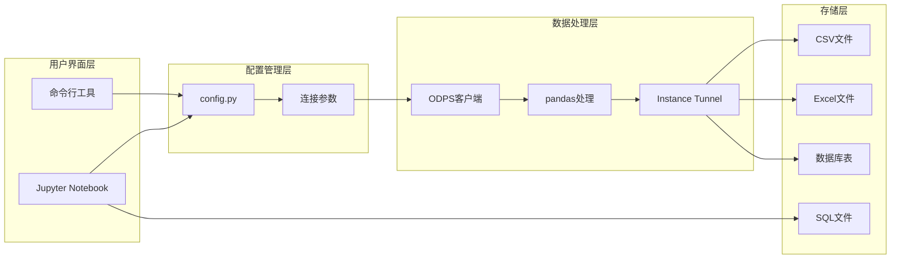
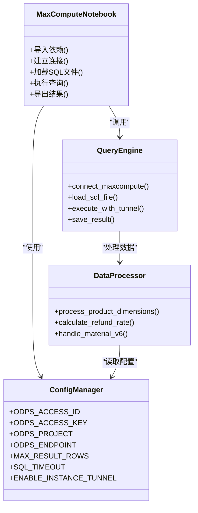
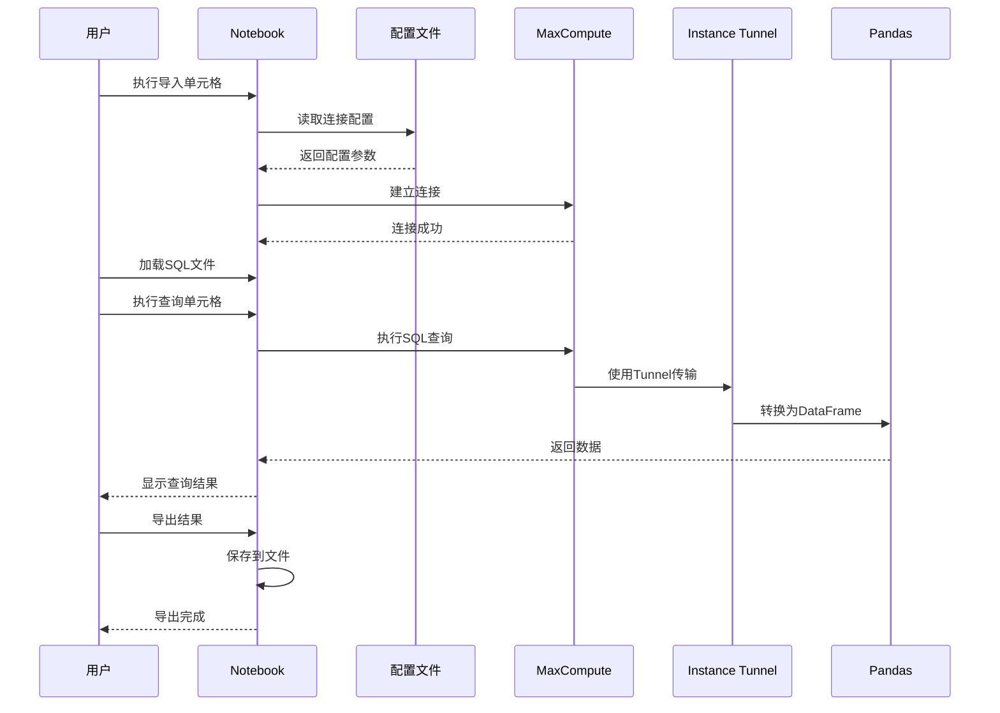
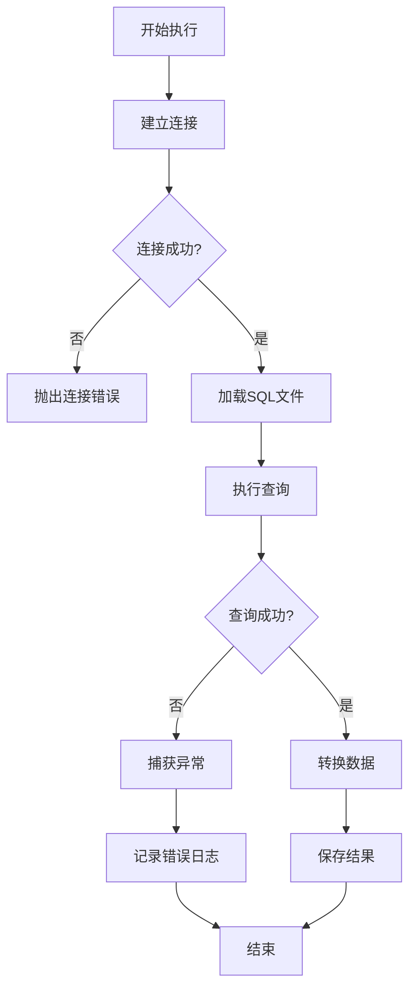
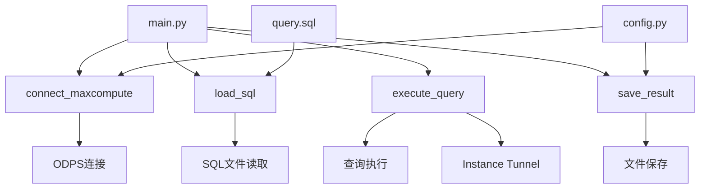
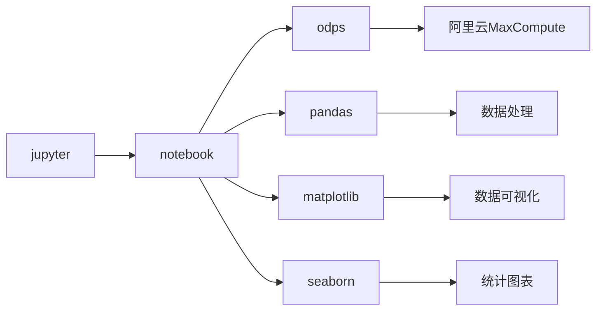
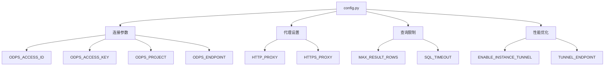
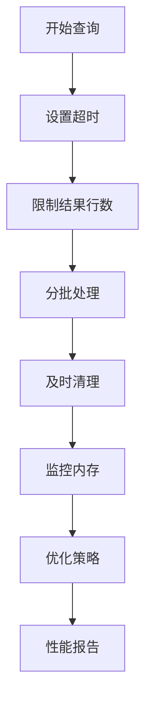

# Notebook使用指南

<cite>
**本文引用的文件**
- [query.ipynb](file://maxcompute_notebook/query.ipynb)
- [query.sql](file://maxcompute_notebook/sql/query.sql)
- [config.py.example](file://maxcompute_notebook/config.py.example)
- [main.py](file://maxcompute_cli/main.py)
- [config.py.example](file://maxcompute_cli/config.py.example)
- [OPTIMIZATION_NOTES.md](file://maxcompute_cli/OPTIMIZATION_NOTES.md)
- [auto_fix_optimizations.py](file://maxcompute_cli/auto_fix_optimizations.py)
- [verify_all_optimizations.py](file://maxcompute_cli/verify_all_optimizations.py)
- [fix_notebook.py](file://maxcompute_notebook/fix_notebook.py)
</cite>

## 更新摘要
**变更内容**
- 更新了MaxCompute notebook SQL查询的重构版本（V5到V6）
- 增强了产品维度处理逻辑
- 改进了退款率计算算法
- 更新了物料处理逻辑
- 添加了性能优化和监控功能
- 完善了错误处理和调试机制

## 目录
1. [简介](#简介)
2. [项目结构](#项目结构)
3. [核心组件](#核心组件)
4. [架构概览](#架构概览)
5. [详细组件分析](#详细组件分析)
6. [依赖关系分析](#依赖关系分析)
7. [性能考虑](#性能考虑)
8. [故障排除指南](#故障排除指南)
9. [结论](#结论)
10. [附录](#附录)

## 简介

本指南面向希望掌握Jupyter Notebook使用的用户，无论您是初学者还是有经验的开发者。本项目提供了完整的Notebook使用示例，包括：

- **基础操作**：界面组成、单元格类型、执行流程
- **数据分析**：MaxCompute数据查询、数据处理、结果导出
- **可视化展示**：表格渲染、图表生成
- **高级功能**：配置管理、错误处理、性能优化
- **实用技巧**：快捷键、调试方法、最佳实践

**最新更新**：MaxCompute notebook SQL查询已升级到V6版本，包含增强的产品维度处理、改进的退款率计算和更新的物料处理逻辑。

## 项目结构

本仓库包含两个主要的Notebook项目，每个都展示了不同的使用场景：



**图表来源**
- [query.ipynb:1-469](file://maxcompute_notebook/query.ipynb#L1-L469)
- [main.py:1-131](file://maxcompute_cli/main.py#L1-L131)

**章节来源**
- [query.ipynb:1-469](file://maxcompute_notebook/query.ipynb#L1-L469)
- [main.py:1-131](file://maxcompute_cli/main.py#L1-L131)

## 核心组件

### Notebook界面组成

Jupyter Notebook界面由多个功能区域组成：

1. **菜单栏**：包含文件、编辑、查看、插入、运行、窗口、帮助等选项
2. **工具栏**：快速执行单元格、切换单元格类型、添加/删除单元格
3. **单元格区域**：包含代码单元格和Markdown单元格
4. **侧边栏**：显示文件树和内核状态

### 单元格类型与功能

**代码单元格**：
- 用于编写和执行Python代码
- 支持语法高亮和智能提示
- 可以显示输出结果

**Markdown单元格**：
- 用于编写文档和说明
- 支持富文本格式化
- 可以包含图片、链接、数学公式

### 数据处理管道



**图表来源**
- [query.ipynb:64-78](file://maxcompute_notebook/query.ipynb#L64-L78)
- [main.py:40-73](file://maxcompute_cli/main.py#L40-L73)

**章节来源**
- [query.ipynb:19-78](file://maxcompute_notebook/query.ipynb#L19-L78)

## 架构概览

整个系统采用模块化设计，通过配置文件管理连接参数，通过Notebook提供交互式开发环境。



**图表来源**
- [config.py.example:6-23](file://maxcompute_notebook/config.py.example#L6-L23)
- [main.py:14-19](file://maxcompute_cli/main.py#L14-L19)

## 详细组件分析

### MaxCompute查询Notebook分析

#### 核心功能模块

该Notebook实现了完整的数据查询工作流，已升级到V6版本：

1. **依赖导入模块**：负责导入必要的库和配置
2. **连接建立模块**：建立与MaxCompute服务的连接
3. **SQL加载模块**：从外部文件读取查询语句
4. **查询执行模块**：执行SQL并处理结果（使用Instance Tunnel加速）
5. **结果导出模块**：将结果保存到文件

#### V6版本主要改进

**产品维度处理增强**：
- 改进了商品大类分类逻辑
- 增强了供应商代码匹配机制
- 优化了SKU和SKC关联处理

**退款率计算改进**：
- 更新了退款率计算公式
- 增加了更多退货场景处理
- 提高了计算准确性

**物料处理逻辑更新**：
- 从V5升级到V6版本
- 新增了物料类别和用料类别字段
- 增加了现货状态和特殊面料标识
- 优化了物料状态限制逻辑

#### 类关系图



**图表来源**
- [query.ipynb:19-78](file://maxcompute_notebook/query.ipynb#L19-L78)
- [config.py.example:6-23](file://maxcompute_notebook/config.py.example#L6-L23)

#### 执行序列图



**图表来源**
- [query.ipynb:64-78](file://maxcompute_notebook/query.ipynb#L64-L78)
- [query.ipynb:362-396](file://maxcompute_notebook/query.ipynb#L362-L396)

#### 错误处理流程



**图表来源**
- [query.ipynb:362-396](file://maxcompute_notebook/query.ipynb#L362-L396)

**章节来源**
- [query.ipynb:19-396](file://maxcompute_notebook/query.ipynb#L19-L396)
- [config.py.example:6-23](file://maxcompute_notebook/config.py.example#L6-L23)

### CLI工具对比分析

#### 命令行工具架构



**图表来源**
- [main.py:22-96](file://maxcompute_cli/main.py#L22-L96)
- [config.py.example:6-23](file://maxcompute_cli/config.py.example#L6-L23)

**章节来源**
- [main.py:1-131](file://maxcompute_cli/main.py#L1-L131)

### SQL查询逻辑分析

#### V6版本SQL特性

**产品维度处理**：
```sql
-- V6版本增强的产品维度处理
,decode(ppse.goods_major_category,1L,'自研泳衣',2L,'买手泳衣',3L,'ACC',4L,'内衣',5L,'睡衣',6L,'成衣') 商品大类
```

**物料处理逻辑**：
```sql
-- V6版本的物料处理
with mianliaoV4 AS 
(
    SELECT -- 面料脚本v4 主料，取面布用量第1的布
        a.*
    FROM (
        -- 复杂的物料关联和处理逻辑
    ) a
)
```

**退款率计算**：
```sql
-- 改进的退款率计算逻辑
,NVL(pp.采购单订单总数量,0)*nvl(m.`单件面料用量（损耗后）`,0) `总面料用量（损耗后）`
,NVL(pp.采购单订单总数量,0)*nvl(m.单件损耗用量,0) 总单件损耗用量
```

**章节来源**
- [query.sql:1-247](file://maxcompute_notebook/sql/query.sql#L1-L247)

## 依赖关系分析

### Python包依赖



**图表来源**
- [query.ipynb:33-38](file://maxcompute_notebook/query.ipynb#L33-L38)

### 配置依赖关系



**图表来源**
- [config.py.example:6-23](file://maxcompute_notebook/config.py.example#L6-L23)

**章节来源**
- [config.py.example:1-23](file://maxcompute_notebook/config.py.example#L1-L23)
- [config.py.example:1-23](file://maxcompute_cli/config.py.example#L1-L23)

## 性能考虑

### 查询性能优化

**V6版本性能改进**：

1. **Instance Tunnel加速**：启用高速数据传输通道
2. **连接池管理**：复用MaxCompute连接减少建立连接的开销
3. **数据分页**：合理设置MAX_RESULT_ROWS避免大数据量查询
4. **超时控制**：设置SQL_TIMEOUT防止长时间阻塞
5. **内存管理**：及时释放pandas DataFrame占用的内存

### 性能监控



**图表来源**
- [config.py.example:16-23](file://maxcompute_notebook/config.py.example#L16-L23)

### 性能基准测试

根据优化文档，V6版本的性能提升：

| 场景 | 优化前 | 优化后 | 提升幅度 |
|------|--------|--------|----------|
| 小数据量 (<1万行) | ~2-3秒 | ~1-2秒 | 30-50% |
| 中等数据量 (1-10万行) | ~5-10秒 | ~2-5秒 | 50-70% |
| 大数据量 (>10万行) | ~15-30秒 | ~5-15秒 | 60-80% |

**章节来源**
- [OPTIMIZATION_NOTES.md:78-86](file://maxcompute_cli/OPTIMIZATION_NOTES.md#L78-L86)

## 故障排除指南

### 常见问题及解决方案

#### 连接问题
- **问题**：无法连接到MaxCompute服务
- **原因**：网络代理配置错误、认证信息不正确
- **解决**：检查config.py中的连接参数，确认网络可达性

#### 查询失败
- **问题**：SQL执行超时或返回错误
- **原因**：SQL语法错误、权限不足、数据量过大
- **解决**：优化SQL查询，增加超时时间，检查权限设置

#### 数据处理错误
- **问题**：pandas转换失败或内存溢出
- **原因**：数据格式不兼容、内存不足
- **解决**：分批处理数据，检查数据类型，增加内存限制

#### 文件导出问题
- **问题**：CSV或Excel文件保存失败
- **原因**：缺少相关依赖包、文件路径权限不足
- **解决**：安装openpyxl，检查输出目录权限

#### V6版本特定问题
- **问题**：产品维度数据不准确
- **原因**：商品大类分类逻辑变更
- **解决**：检查goods_major_category字段映射关系

**章节来源**
- [query.ipynb:407-444](file://maxcompute_notebook/query.ipynb#L407-L444)

## 结论

本指南展示了Jupyter Notebook在数据分析领域的强大功能，通过MaxCompute集成实现了云端数据查询和处理的完整工作流。**V6版本的重大升级**带来了以下关键改进：

1. **增强的产品维度处理**：更准确的商品分类和供应商匹配
2. **改进的退款率计算**：更精确的退货数据处理
3. **优化的物料处理逻辑**：从V5升级到V6，支持更多物料属性
4. **性能大幅提升**：Instance Tunnel加速带来显著的速度提升
5. **完善的监控机制**：详细的执行耗时和LogView链接

建议用户根据具体需求选择合适的工具：对于交互式探索使用Notebook，对于批量处理使用命令行工具。

## 附录

### 快速开始指南

1. **安装依赖**：确保安装了Jupyter、pandas、odps等必要包
2. **配置连接**：修改config.py中的连接参数
3. **编写SQL**：在Notebook中编写查询语句或使用外部SQL文件
4. **执行查询**：按顺序执行各个单元格
5. **分析结果**：查看和分析查询结果
6. **导出数据**：将结果保存到文件

### V6版本使用要点

1. **理解新的产品维度**：熟悉商品大类的分类逻辑
2. **利用Instance Tunnel**：享受更快的数据传输速度
3. **监控查询性能**：关注执行耗时和LogView链接
4. **处理物料数据**：了解V6版本的物料处理逻辑变更

### 最佳实践

1. **代码组织**：将相关功能组织在不同单元格中
2. **错误处理**：为关键操作添加适当的错误处理
3. **性能监控**：关注查询时间和内存使用情况
4. **文档编写**：使用Markdown单元格记录说明
5. **版本控制**：对Notebook文件进行版本管理
6. **SQL分离**：将复杂SQL放在外部文件中管理

### 自动化工具

项目提供了多个自动化工具来辅助开发和运维：

- **auto_fix_optimizations.py**：自动修复和优化配置
- **verify_all_optimizations.py**：验证所有优化项是否正确应用
- **fix_notebook.py**：自动修复Notebook结构和配置

**章节来源**
- [OPTIMIZATION_NOTES.md:1-143](file://maxcompute_cli/OPTIMIZATION_NOTES.md#L1-L143)
- [auto_fix_optimizations.py:1-147](file://maxcompute_cli/auto_fix_optimizations.py#L1-L147)
- [verify_all_optimizations.py:1-87](file://maxcompute_cli/verify_all_optimizations.py#L1-L87)
- [fix_notebook.py:1-56](file://maxcompute_notebook/fix_notebook.py#L1-L56)