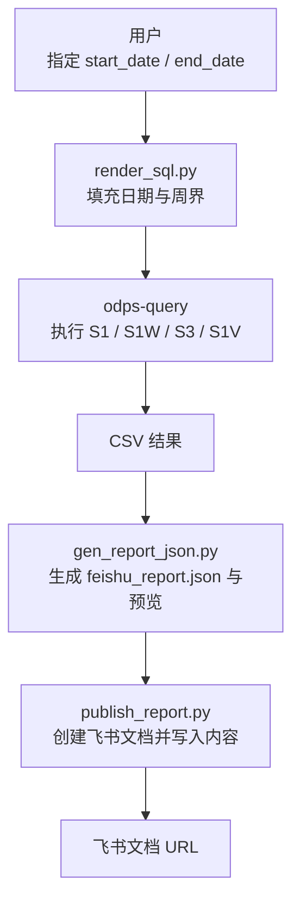
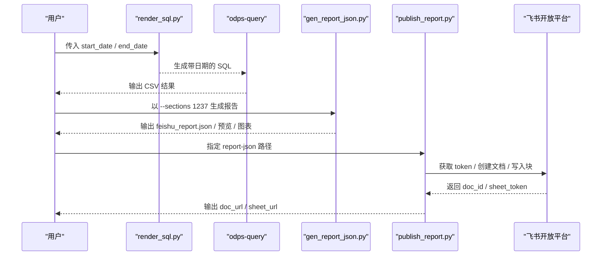
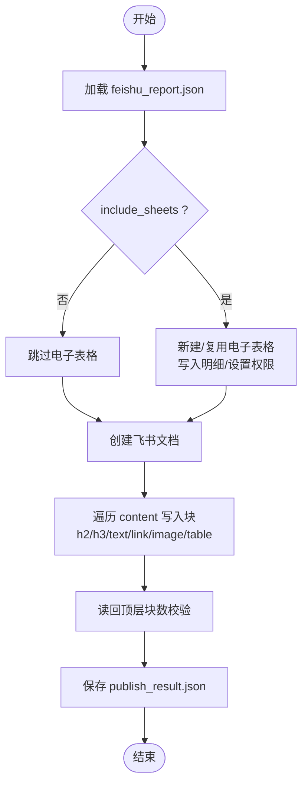
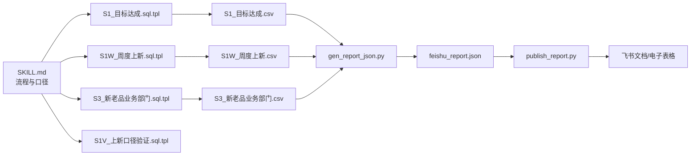

# 周度运营报告模块

<cite>
**本文引用的文件**   
- [SKILL.md](file://skills/ops-weekly-report/SKILL.md)
- [publish_report.py](file://skills/ops-weekly-report/scripts/publish_report.py)
- [config.py.example](file://skills/ops-weekly-report/scripts/config.py.example)
- [S1_目标达成.sql.tpl](file://skills/ops-weekly-report/sql/S1_目标达成.sql.tpl)
- [S1W_周度上新.sql.tpl](file://skills/ops-weekly-report/sql/S1W_周度上新.sql.tpl)
- [S1V_上新口径验证.sql.tpl](file://skills/ops-weekly-report/sql/S1V_上新口径验证.sql.tpl)
- [S3_新老品业务部门.sql.tpl](file://skills/ops-weekly-report/sql/S3_新老品业务部门.sql.tpl)
</cite>

## 目录
1. [引言](#引言)
2. [项目结构](#项目结构)
3. [核心组件](#核心组件)
4. [架构总览](#架构总览)
5. [详细组件分析](#详细组件分析)
6. [依赖关系分析](#依赖关系分析)
7. [性能与稳定性考虑](#性能与稳定性考虑)
8. [故障排查指南](#故障排查指南)
9. [结论](#结论)

## 引言
本模块是“周度运营报告”能力，面向经营分析报告的第 1、2、3、7 章：分析说明、目标达成总览、新老品与业务部门结构、口径附录。它不包含品类拆解、业绩原因与改善策略等归因内容，发布时也不创建或复用电子表格，仅生成飞书文档。

该模块由三类资产组成：
- 数据层 SQL 模板：负责从数仓取数并聚合出目标达成、周度上新、新老品与业务部门指标。
- 报告编排层：根据时间窗口生成报告 JSON、图表与预览文本。
- 发布层：将报告写入飞书文档，并在需要时处理电子表格（本 skill 默认跳过）。

## 项目结构
ops-weekly-report 采用“脚本 + SQL 模板”的清晰分层：
- scripts：运行期 Python 脚本，包括发布、配置示例等。
- sql：SQL 模板，按章节维度命名，便于按需执行与校验。
- SKILL.md：流程规范、参数约定、口径速查与部署说明。

**图示来源**
- [SKILL.md:38-87](file://skills/ops-weekly-report/SKILL.md#L38-L87)
- [SKILL.md:111-132](file://skills/ops-weekly-report/SKILL.md#L111-L132)

**章节来源**
- [SKILL.md:1-184](file://skills/ops-weekly-report/SKILL.md#L1-L184)

## 核心组件
- 数据查询模板
  - S1_目标达成.sql.tpl：产出第 2 章全部指标与表 2-1。
  - S1W_周度上新.sql.tpl：产出第 2.4 节“本周/上周/本月累计/上月同期/去年同期”上新款数。
  - S3_新老品业务部门.sql.tpl：产出第 3 章销售、流量、结构与达成对比。
  - S1V_上新口径验证.sql.tpl：可选辅助查询，用于核对上新口径。
- 发布脚本
  - publish_report.py：读取 feishu_report.json，创建飞书文档，按顺序写入标题、文本、表格、图片与链接；在 include_sheets=false 时跳过电子表格。
- 配置模板
  - config.py.example：飞书应用凭证与 OAuth 回调地址示例。

**章节来源**
- [SKILL.md:40-87](file://skills/ops-weekly-report/SKILL.md#L40-L87)
- [publish_report.py:1-11](file://skills/ops-weekly-report/scripts/publish_report.py#L1-L11)
- [config.py.example:1-12](file://skills/ops-weekly-report/scripts/config.py.example#L1-L12)

## 架构总览
周度运营报告的端到端流程如下：

**图示来源**
- [SKILL.md:52-87](file://skills/ops-weekly-report/SKILL.md#L52-L87)
- [SKILL.md:111-132](file://skills/ops-weekly-report/SKILL.md#L111-L132)
- [publish_report.py:386-476](file://skills/ops-weekly-report/scripts/publish_report.py#L386-L476)

## 详细组件分析

### 数据查询模板

#### S1_目标达成.sql.tpl
- 作用：计算各业务部门与全品类的 GMV、新品 GMV、上新数、爆款相关指标、成功率、款均成本等，并按月度口径汇总，供第 2 章使用。
- 关键逻辑要点：
  - 组合品与单品去重：通过组合 SKU 映射修正重复计算。
  - 部门归属：对缺失 business_group_name 的场景按二级/一级品类回推部门。
  - 目标类型拆分：区分“正常目标”与“无库存测试款”。
  - 多指标 UNION 聚合：GMV、新品 GMV、上新数、大爆款/超爆款/畅销等计数与比率。
- 复杂度与风险：
  - 大量条件分支与 UNION，适合在数仓侧完成聚合，避免下游重复计算。
  - 需关注分母为 0 的比率保护（代码中多处使用条件判断与 NVL）。

**章节来源**
- [S1_目标达成.sql.tpl:1-757](file://skills/ops-weekly-report/sql/S1_目标达成.sql.tpl#L1-L757)

#### S1W_周度上新.sql.tpl
- 作用：统计“本周/上周/本月累计/上月同期/去年同期”的新款式数，按部门与大类汇总。
- 关键逻辑要点：
  - 周界自动派生：基于 END 所在自然周与上一周。
  - 渠道与状态过滤：独立站渠道、非赠品、非无库存测试款、当月上架。
  - 周期 UNION ALL：统一输出 5 行周期结果。
- 复杂度与风险：
  - 周界计算依赖外部 render_sql.py 填充占位符，避免手工错误。
  - 行数固定为 5，便于运行时校验。

**章节来源**
- [S1W_周度上新.sql.tpl:1-242](file://skills/ops-weekly-report/sql/S1W_周度上新.sql.tpl#L1-L242)

#### S1V_上新口径验证.sql.tpl
- 作用：辅助核对第 2.4 节上新口径，输出截至某日与之后的登记款数区间分布。
- 关键逻辑要点：
  - 与 S1W 一致的过滤条件，但侧重时间区间切分与最早/最晚日期。
  - 用于当数字存疑时快速定位是否包含测试款或超出窗口。

**章节来源**
- [S1V_上新口径验证.sql.tpl:1-195](file://skills/ops-weekly-report/sql/S1V_上新口径验证.sql.tpl#L1-L195)

#### S3_新老品业务部门.sql.tpl
- 作用：按“是否当年新品/当月新品 × 大类 × 业务部门”维度，计算销售额、销量、UV、CTR/CVR、款效、库存与成功款占比等，并输出环比/同比及占比变化。
- 关键逻辑要点：
  - 周期定义：本期、环比上一周期（上月同期）、同比上一周期（回拨 1 年）。
  - 指标聚合：在架 SKC、在架天数、销售额、销量、退货数量、退款总额、商列/详情页 UV、加车率、退件率、日均库存、平均售价、款效、成功款占比等。
  - 透视与同环比：先聚合再透视到“本期/环比/同比”，最后计算同环比增长率与占比差。
- 复杂度与风险：
  - 大量窗口函数与 CASE 透视，建议在数仓侧执行，避免下游内存压力。
  - 注意分母为 0 的保护与占比环比/同比的计算方式。

**章节来源**
- [S3_新老品业务部门.sql.tpl:1-588](file://skills/ops-weekly-report/sql/S3_新老品业务部门.sql.tpl#L1-L588)

### 发布脚本 publish_report.py
- 职责：
  - 加载 feishu_report.json，解析 title、content、include_sheets 等元信息。
  - 当 include_sheets=true 时，创建或复用电子表格，写入 L2/L3 明细，设置协作者与分享权限。
  - 创建飞书文档，按 content 顺序写入 h2/h3/text/link/image/table 等块。
  - 输出 publish_result.json，包含 doc_url、sheet_url、doc_id 等。
- 认证与权限：
  - 优先使用本地缓存的 user_access_token；过期则走浏览器 OAuth 授权。
  - 新建电子表格时使用 tenant_access_token（应用身份），确保应用为 owner；复用旧表时使用用户身份。
  - 支持将当前授权用户添加为协作者，并设置“组织内获得链接的人可阅读”。
- 容错与降级：
  - 电子表格权限读取失败时尝试应用身份降级读取。
  - 写入权限失败时给出手动设置提示，不阻断文档发布。

**图示来源**
- [publish_report.py:386-476](file://skills/ops-weekly-report/scripts/publish_report.py#L386-L476)

**章节来源**
- [publish_report.py:1-116](file://skills/ops-weekly-report/scripts/publish_report.py#L1-L116)
- [publish_report.py:118-301](file://skills/ops-weekly-report/scripts/publish_report.py#L118-L301)
- [publish_report.py:304-379](file://skills/ops-weekly-report/scripts/publish_report.py#L304-L379)
- [publish_report.py:382-476](file://skills/ops-weekly-report/scripts/publish_report.py#L382-L476)

### 配置模板 config.py.example
- 提供飞书应用 App ID、App Secret、OAuth 回调地址与本地服务端口示例。
- 首次使用时复制为 config.py 并填入真实值；config.py 被 .gitignore 排除，不应提交。

**章节来源**
- [config.py.example:1-12](file://skills/ops-weekly-report/scripts/config.py.example#L1-L12)

## 依赖关系分析
- 外部依赖
  - 飞书开放平台 API：文档、电子表格、媒体上传、权限与分享。
  - 数仓 SQL 引擎：执行 .sql.tpl 模板生成的正式 SQL。
- 内部依赖
  - SKILL.md 定义流程与参数约束。
  - SQL 模板之间相互独立，分别对应不同章节。
  - publish_report.py 依赖 feishu_report.json 的结构与字段。

**图示来源**
- [SKILL.md:40-87](file://skills/ops-weekly-report/SKILL.md#L40-L87)
- [publish_report.py:386-476](file://skills/ops-weekly-report/scripts/publish_report.py#L386-L476)

**章节来源**
- [SKILL.md:40-87](file://skills/ops-weekly-report/SKILL.md#L40-L87)
- [publish_report.py:386-476](file://skills/ops-weekly-report/scripts/publish_report.py#L386-L476)

## 性能与稳定性考虑
- SQL 侧
  - 复杂聚合与透视集中在数仓侧执行，避免下游内存与网络开销。
  - 比率计算普遍使用分母保护，防止除零异常。
- 发布侧
  - 普通块（text/heading/link）批量追加，减少 API 调用次数。
  - 表格按 MAX_TABLE_CELLS 限制分块写入，避免单次块数过大导致失败。
  - 图片采用三步法：建空图块 → 上传媒体 → 替换 token，保证稳定嵌入。
  - 电子表格写入按行列分片，降低单次请求体积。
- 认证与权限
  - token 缓存与自动刷新，减少重复授权。
  - 电子表格权限读写具备降级与告警机制，不阻塞文档发布。

[本节为通用指导，不直接分析具体文件]

## 故障排查指南
- 无法获取 token
  - 检查本地缓存是否存在且未过期；若过期，按提示完成浏览器 OAuth 授权。
  - 确认 config.py 中的 App ID、App Secret 与回调地址正确。
- 电子表格权限问题
  - 若应用身份写入失败，脚本会尝试应用身份降级；仍失败时按提示手动设置“组织内获得链接的人可阅读”。
  - 复用旧表时，确保当前授权用户已被添加为协作者。
- 文档内容不完整
  - 检查 feishu_report.json 的 content 数组是否完整。
  - 发布后运行校验脚本，核对顶层块数量与关键字段。
- 上新数口径不一致
  - 执行 S1V_上新口径验证.sql.tpl，核对是否包含测试款或超出窗口。
  - 确认 S1W 的周界由 render_sql.py 自动派生，不要手工修改。

**章节来源**
- [SKILL.md:122-157](file://skills/ops-weekly-report/SKILL.md#L122-L157)
- [publish_report.py:202-281](file://skills/ops-weekly-report/scripts/publish_report.py#L202-L281)
- [publish_report.py:359-379](file://skills/ops-weekly-report/scripts/publish_report.py#L359-L379)

## 结论
周度运营报告模块以“SQL 模板 + 报告编排 + 发布脚本”的分层设计，实现了从数据取数到飞书文档发布的闭环。其特点包括：
- 明确的章节边界：仅覆盖第 1/2/3/7 章，不含归因分析。
- 严格的口径约束：双口径（月度/窗口）、同环比公式、比率保护与分母保护。
- 稳健的发布流程：token 缓存、批量写入、分块表格、图片三步法与权限降级。
- 可验证性：行数校验、预览文本与发布后块数校验，降低人工出错概率。

在实际使用中，建议严格遵循 SKILL.md 的流程与参数约定，优先通过脚本派生日期与周界，避免手工计算带来的口径偏差；发布前务必进行预览与关键字校验，确保文档内容与预期一致。