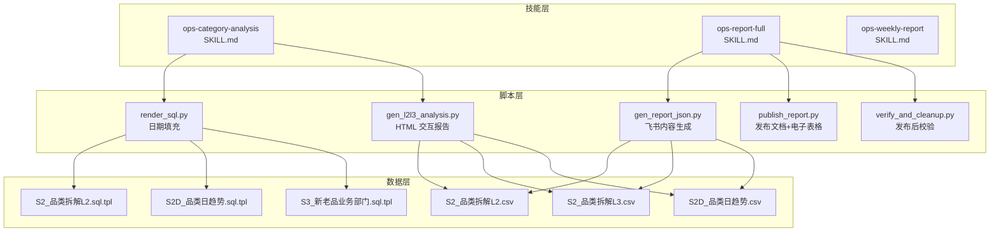
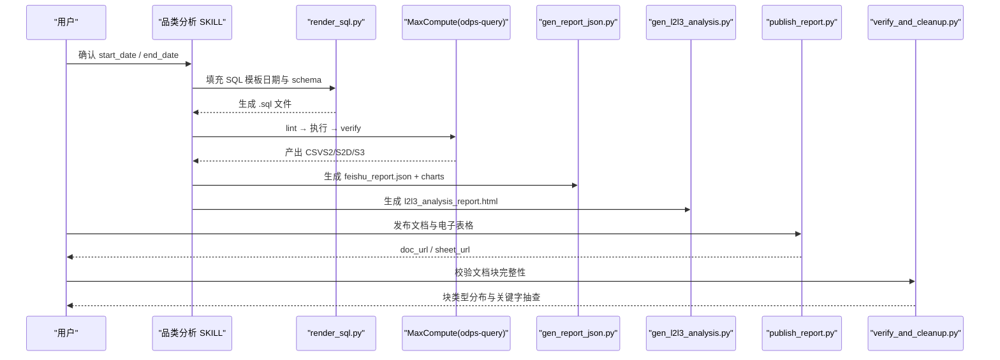
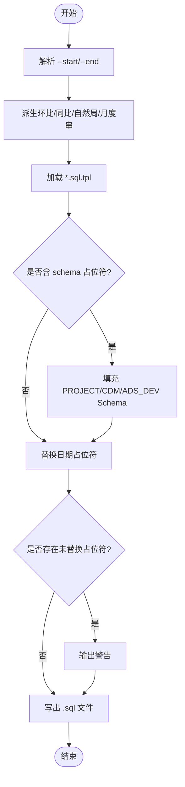
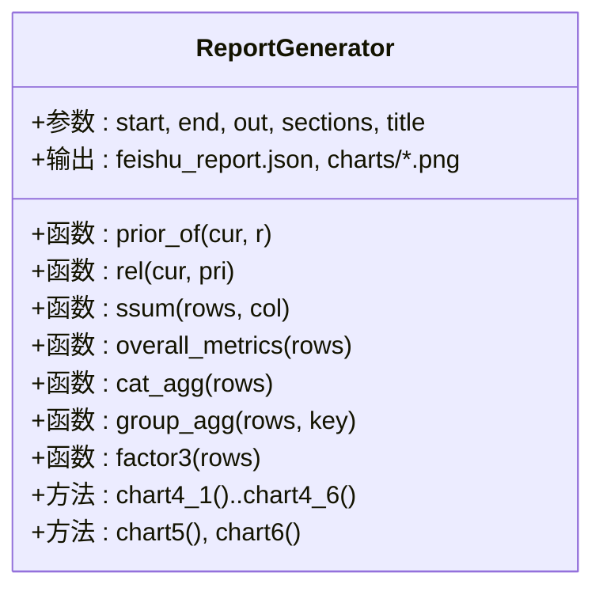
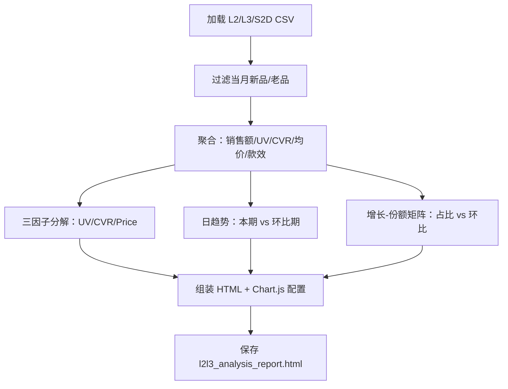
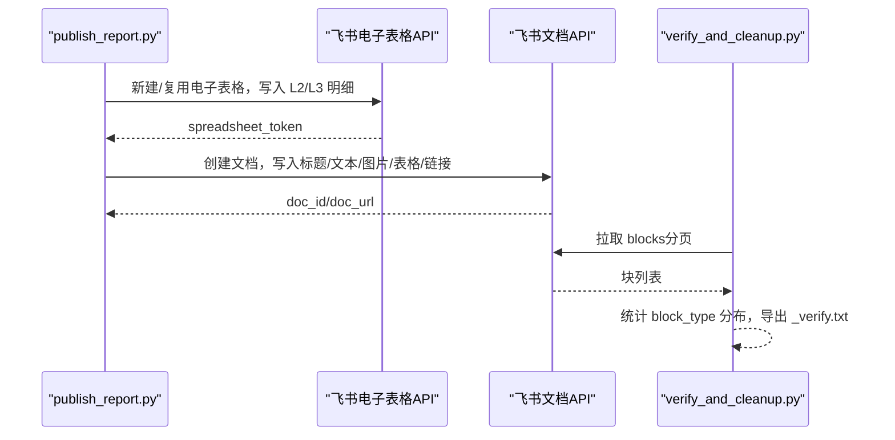
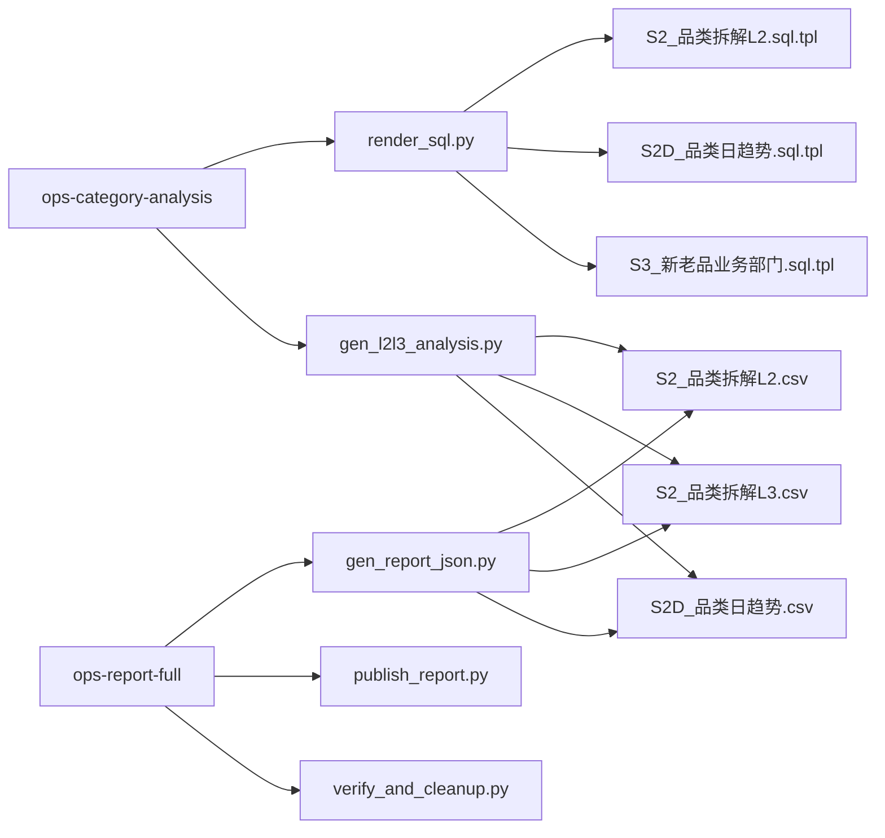
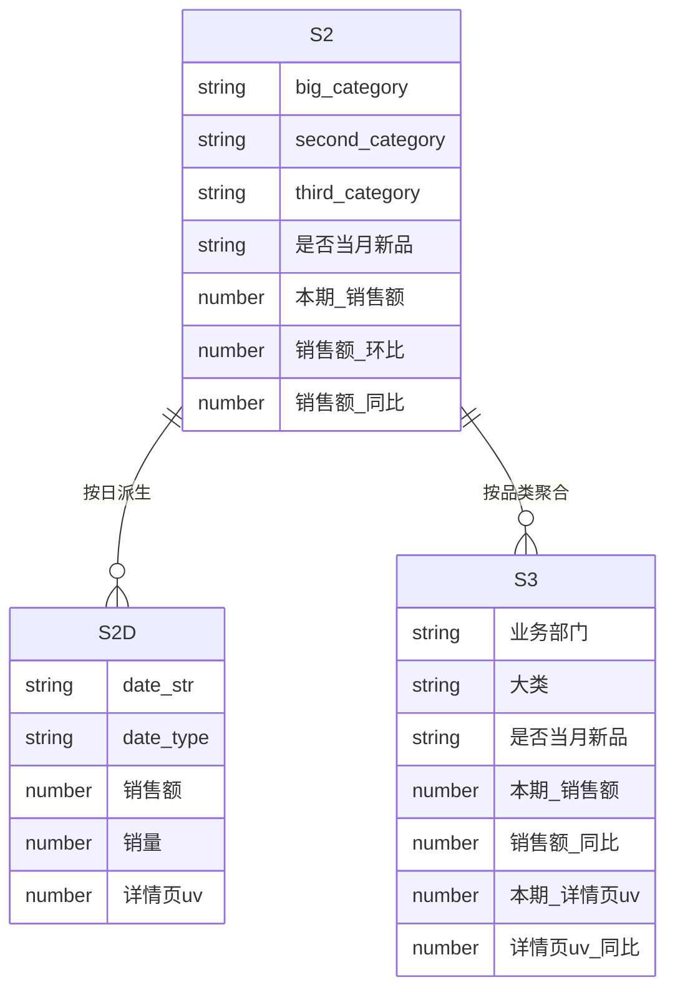

# 品类分析模块

<cite>
**本文引用的文件**   
- [skills/ops-category-analysis/SKILL.md](file://skills/ops-category-analysis/SKILL.md)
- [skills/ops-report-full/SKILL.md](file://skills/ops-report-full/SKILL.md)
- [skills/ops-weekly-report/SKILL.md](file://skills/ops-weekly-report/SKILL.md)
- [skills/ops-category-analysis/scripts/render_sql.py](file://skills/ops-category-analysis/scripts/render_sql.py)
- [skills/ops-report-full/scripts/gen_report_json.py](file://skills/ops-report-full/scripts/gen_report_json.py)
- [skills/ops-report-full/scripts/publish_report.py](file://skills/ops-report-full/scripts/publish_report.py)
- [skills/ops-report-full/scripts/verify_and_cleanup.py](file://skills/ops-report-full/scripts/verify_and_cleanup.py)
- [skills/ops-report-full/scripts/gen_l2l3_analysis.py](file://skills/ops-report-full/scripts/gen_l2l3_analysis.py)
- [skill_sql_catalog.md](file://skill_sql_catalog.md)
</cite>

## 目录
1. [引言](#引言)
2. [项目结构](#项目结构)
3. [核心组件](#核心组件)
4. [架构总览](#架构总览)
5. [详细组件分析](#详细组件分析)
6. [依赖关系分析](#依赖关系分析)
7. [性能与稳定性考量](#性能与稳定性考量)
8. [故障排查指南](#故障排查指南)
9. [结论](#结论)
10. [附录：口径与数据模型](#附录口径与数据模型)

## 引言
本“品类分析模块”聚焦经营分析报告的第 4 章（品类拆解）与第 5 章（业绩原因分析），提供从 MaxCompute 取数、品类聚合、L2→L3 下钻、日趋势、增长-份额矩阵到三因子分解的完整能力，并产出飞书章节内容与交互式 HTML 报告。该模块与“经营周报”和“全流程报告”两个 skill 协同：前者负责无归因的 1/2/3/7 章，后者负责端到端全流程（含发布与电子表格）。

## 项目结构
品类分析模块以 skills 目录下的三个 skill 为核心组织方式：
- ops-category-analysis：专注品类拆解与业绩归因（第 4/5 章），包含 SQL 模板、SQL 渲染脚本、HTML 交互报告生成器。
- ops-report-full：端到端全流程，复用 gen_report_json.py 生成飞书内容，publish_report.py 发布文档与电子表格，verify_and_cleanup.py 校验发布结果。
- ops-weekly-report：无归因周报（第 1/2/3/7 章），与品类分析模块形成互补。

图表来源
- [skills/ops-category-analysis/SKILL.md:1-179](file://skills/ops-category-analysis/SKILL.md#L1-L179)
- [skills/ops-report-full/SKILL.md:1-211](file://skills/ops-report-full/SKILL.md#L1-L211)
- [skills/ops-weekly-report/SKILL.md:1-184](file://skills/ops-weekly-report/SKILL.md#L1-L184)
- [skills/ops-category-analysis/scripts/render_sql.py:1-111](file://skills/ops-category-analysis/scripts/render_sql.py#L1-L111)
- [skills/ops-report-full/scripts/gen_report_json.py:1-800](file://skills/ops-report-full/scripts/gen_report_json.py#L1-L800)
- [skills/ops-report-full/scripts/gen_l2l3_analysis.py:1-570](file://skills/ops-report-full/scripts/gen_l2l3_analysis.py#L1-L570)
- [skills/ops-report-full/scripts/publish_report.py:1-476](file://skills/ops-report-full/scripts/publish_report.py#L1-L476)
- [skills/ops-report-full/scripts/verify_and_cleanup.py:1-72](file://skills/ops-report-full/scripts/verify_and_cleanup.py#L1-L72)

章节来源
- [skills/ops-category-analysis/SKILL.md:1-179](file://skills/ops-category-analysis/SKILL.md#L1-L179)
- [skills/ops-report-full/SKILL.md:1-211](file://skills/ops-report-full/SKILL.md#L1-L211)
- [skills/ops-weekly-report/SKILL.md:1-184](file://skills/ops-weekly-report/SKILL.md#L1-L184)

## 核心组件
- SQL 模板与日期填充：通过 render_sql.py 将 {{START}}/{{END}}、{{PM_*}}、{{PY_*}}、{{MONTH}}、{{W_CUR_*}} 等占位符替换为具体日期，并支持 {{PROJECT_SCHEMA}}/{{CDM_SCHEMA}}/{{ADS_DEV_SCHEMA}} 等 schema 占位符。
- 飞书报告内容生成：gen_report_json.py 读取 CSV 产物，按章节拼装文本、图片、表格与链接，输出 feishu_report.json 与 charts/*.png。
- 交互式 HTML 报告：gen_l2l3_analysis.py 基于 Chart.js 生成单文件 HTML，覆盖整体概览、下钻、趋势、对比、同环比、交叉与三因子分解。
- 发布与校验：publish_report.py 创建飞书文档与电子表格，写入内容；verify_and_cleanup.py 拉取文档块进行完整性校验。

章节来源
- [skills/ops-category-analysis/scripts/render_sql.py:1-111](file://skills/ops-category-analysis/scripts/render_sql.py#L1-L111)
- [skills/ops-report-full/scripts/gen_report_json.py:1-800](file://skills/ops-report-full/scripts/gen_report_json.py#L1-L800)
- [skills/ops-report-full/scripts/gen_l2l3_analysis.py:1-570](file://skills/ops-report-full/scripts/gen_l2l3_analysis.py#L1-L570)
- [skills/ops-report-full/scripts/publish_report.py:1-476](file://skills/ops-report-full/scripts/publish_report.py#L1-L476)
- [skills/ops-report-full/scripts/verify_and_cleanup.py:1-72](file://skills/ops-report-full/scripts/verify_and_cleanup.py#L1-L72)

## 架构总览
品类分析模块的整体流程如下：用户确认时间窗口 → 生成带日期的 SQL → 执行取数（odps-query）→ 生成飞书 JSON 与图表 → 本地预览 → 发布至飞书（含电子表格）→ 发布后校验。

图表来源
- [skills/ops-category-analysis/SKILL.md:28-60](file://skills/ops-category-analysis/SKILL.md#L28-L60)
- [skills/ops-report-full/SKILL.md:45-86](file://skills/ops-report-full/SKILL.md#L45-L86)
- [skills/ops-report-full/scripts/gen_report_json.py:1-800](file://skills/ops-report-full/scripts/gen_report_json.py#L1-L800)
- [skills/ops-report-full/scripts/gen_l2l3_analysis.py:1-570](file://skills/ops-report-full/scripts/gen_l2l3_analysis.py#L1-L570)
- [skills/ops-report-full/scripts/publish_report.py:381-476](file://skills/ops-report-full/scripts/publish_report.py#L381-L476)
- [skills/ops-report-full/scripts/verify_and_cleanup.py:26-72](file://skills/ops-report-full/scripts/verify_and_cleanup.py#L26-L72)

## 详细组件分析

### SQL 模板与日期填充（render_sql.py）
- 功能：解析 --start/--end，自动派生环比期、同比期、自然周、月度串，并替换模板中的日期与 schema 占位符。
- 关键逻辑：
  - shift_month：回拨月份并夹到目标月最大天数。
  - MAP：集中定义所有占位符映射。
  - 残留检查：对非注释行中仍存在的 {{...}} 发出警告。
- 复杂度：O(N) 遍历模板行数，N 为模板行数。

图表来源
- [skills/ops-category-analysis/scripts/render_sql.py:23-111](file://skills/ops-category-analysis/scripts/render_sql.py#L23-L111)

章节来源
- [skills/ops-category-analysis/scripts/render_sql.py:1-111](file://skills/ops-category-analysis/scripts/render_sql.py#L1-L111)

### 飞书报告内容生成（gen_report_json.py）
- 功能：读取 S1/S1W/S2/S2D/S3 CSV，组装飞书文档内容（标题、文本、图片、表格、链接），并生成 matplotlib 静态图。
- 关键逻辑：
  - 窗口派生：计算时间进度、环比/同比区间文字。
  - 汇总口径：明细加总；对比期还原 = 本期/(1+增长率)，缺失或 ≤-100% 按 0。
  - 品类聚合：大类/L2/L3 聚合，Top12/Top8 增量/缩减，日趋势折线，三因子分解。
  - 图表：使用 Agg 后端，dpi=150，中文字体 Microsoft YaHei。
- 复杂度：主要受 CSV 行数影响，聚合与排序为 O(M log M)。

图表来源
- [skills/ops-report-full/scripts/gen_report_json.py:1-800](file://skills/ops-report-full/scripts/gen_report_json.py#L1-L800)

章节来源
- [skills/ops-report-full/scripts/gen_report_json.py:1-800](file://skills/ops-report-full/scripts/gen_report_json.py#L1-L800)

### 交互式 HTML 报告（gen_l2l3_analysis.py）
- 功能：基于 Chart.js 生成单文件 HTML，展示六类分析：整体概览、下钻、趋势、对比、同环比、交叉与三因子分解。
- 关键逻辑：
  - 聚合：BASE_COLS 基础量加总，比率指标由基础量重算。
  - 三因子分解：UV→CVR→价格序贯替代法。
  - 诊断与建议：动态计算 Top 增/减项、新品占比、退货率异常品类，生成建议表。
- 复杂度：O(K) 遍历 L2/L3 与日趋势数据，K 为行数。

图表来源
- [skills/ops-report-full/scripts/gen_l2l3_analysis.py:1-570](file://skills/ops-report-full/scripts/gen_l2l3_analysis.py#L1-L570)

章节来源
- [skills/ops-report-full/scripts/gen_l2l3_analysis.py:1-570](file://skills/ops-report-full/scripts/gen_l2l3_analysis.py#L1-L570)

### 发布与校验（publish_report.py 与 verify_and_cleanup.py）
- publish_report.py：
  - 电子表格：新建或复用，写入 L2/L3 全量明细，设置权限与协作者。
  - 文档：按 content 顺序写入标题/文本/图片/表格/链接，处理 descendant API 分块。
  - 幂等：sheet1 改名、链接分享权限、协作者添加均幂等。
- verify_and_cleanup.py：
  - 拉取文档全部块，统计 block_type 分布，导出 _verify.txt 供人工核对。
  - 支持 cleanup 模式删除旧版文档/表格。

图表来源
- [skills/ops-report-full/scripts/publish_report.py:118-476](file://skills/ops-report-full/scripts/publish_report.py#L118-L476)
- [skills/ops-report-full/scripts/verify_and_cleanup.py:11-72](file://skills/ops-report-full/scripts/verify_and_cleanup.py#L11-L72)

章节来源
- [skills/ops-report-full/scripts/publish_report.py:1-476](file://skills/ops-report-full/scripts/publish_report.py#L1-L476)
- [skills/ops-report-full/scripts/verify_and_cleanup.py:1-72](file://skills/ops-report-full/scripts/verify_and_cleanup.py#L1-L72)

## 依赖关系分析
- 模块内依赖：
  - ops-category-analysis 依赖 render_sql.py 与 gen_l2l3_analysis.py。
  - ops-report-full 依赖 gen_report_json.py、publish_report.py、verify_and_cleanup.py。
  - 三者共享 SQL 模板（S2/S2D/S3）与 CSV 产物。
- 外部依赖：
  - MaxCompute（odps-query）用于取数。
  - 飞书开放平台 API（文档、电子表格、媒体上传）。
  - matplotlib（静态图）、Chart.js（HTML 交互图）。

图表来源
- [skills/ops-category-analysis/SKILL.md:163-179](file://skills/ops-category-analysis/SKILL.md#L163-L179)
- [skills/ops-report-full/SKILL.md:194-211](file://skills/ops-report-full/SKILL.md#L194-L211)
- [skill_sql_catalog.md:1-24](file://skill_sql_catalog.md#L1-L24)

章节来源
- [skill_sql_catalog.md:1-24](file://skill_sql_catalog.md#L1-L24)

## 性能与稳定性考量
- Instance Tunnel 加速：参考根 README 的性能优化说明，确保 pyodps 使用 open_reader(tunnel=True) 提升下载速度。
- 图表渲染：matplotlib 使用 Agg 后端，避免 GUI 依赖；dpi=150 保证清晰度。
- 大数据集处理：descendant API 建表时按 MAX_TABLE_CELLS 分块，避免单次请求过大。
- 错误恢复：publish_report.py 对权限设置采用双通道（用户身份与应用身份降级），增强鲁棒性。

章节来源
- [README.md:165-193](file://README.md#L165-L193)
- [skills/ops-report-full/scripts/publish_report.py:233-281](file://skills/ops-report-full/scripts/publish_report.py#L233-L281)

## 故障排查指南
- 常见陷阱：
  - AGG_SEC['泳衣'] KeyError：泳衣是大类，需用 sec_mom('泳衣') 降级查询。
  - S2D 无 MAPJOIN hint：必须保留 /* +MAPJOIN(b)*/，否则无法运行。
  - Windows GBK 终端打印：需包 TextIOWrapper(encoding='gbk', errors='replace')。
  - 飞书原生表格超列：大表一律转图片（render_table_image）。
- 排查步骤：
  1. 检查 odps-query 三步验收（lint → 执行 → verify）退出码是否为 0。
  2. 核对 CSV 行数（S2_L2=70、S2_L3=242、S1W=5）。
  3. 查看 LogView 分析执行计划，确认是否启用 Instance Tunnel。
  4. 发布后运行 verify_and_cleanup.py，核对块数量与关键字。

章节来源
- [skills/ops-category-analysis/SKILL.md:145-155](file://skills/ops-category-analysis/SKILL.md#L145-L155)
- [skills/ops-report-full/SKILL.md:176-186](file://skills/ops-report-full/SKILL.md#L176-L186)
- [skills/ops-report-full/scripts/verify_and_cleanup.py:26-72](file://skills/ops-report-full/scripts/verify_and_cleanup.py#L26-L72)

## 结论
品类分析模块以清晰的 skill 分工与可复跑的脚本链，实现了从取数到发布的端到端闭环。通过严格的口径约束（在线调整、排除赠品与测试款）、严谨的聚合逻辑（还原法对比期、比率重算）与健壮的发布机制（双通道权限、分块建表），确保了报告的可信度与可维护性。建议在后续迭代中持续完善自动化验证与可视化标准，进一步提升用户体验。

## 附录：口径与数据模型
- 口径锚点：
  - 在线调整口径（is_online_adjustment=1），排除无库存测试款与赠品。
  - 对比期还原：本期值 ÷ (1+增长率)，缺失或 ≤-100% 按 0。
  - 比率指标：CVR=销量/详情页UV，CTR=商列点击UV/商列浏览UV，均价=销售额/销量，聚合层由基础量重算。
- 数据模型（简化）：
  - S2：二级品类维度（big_category × second_category × 是否当年新品 × 是否当月新品），含本期值与环比/同比。
  - S2D：按日粒度（date_str × date_type），含销售额/UV/销量等。
  - S3：新老品 × 业务部门，含销售/流量/转化率等。

图表来源
- [skill_sql_catalog.md:6-12](file://skill_sql_catalog.md#L6-L12)
- [skills/ops-category-analysis/SKILL.md:30-40](file://skills/ops-category-analysis/SKILL.md#L30-L40)

章节来源
- [skill_sql_catalog.md:1-24](file://skill_sql_catalog.md#L1-L24)
- [skills/ops-category-analysis/SKILL.md:62-92](file://skills/ops-category-analysis/SKILL.md#L62-L92)