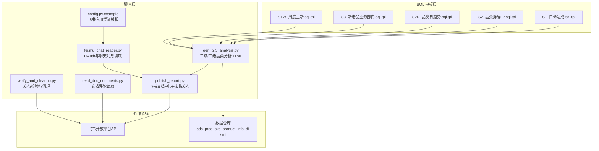
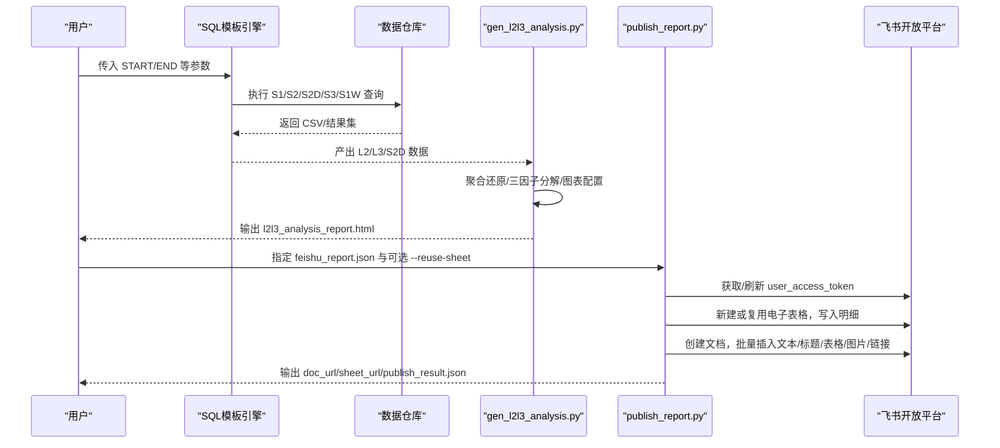
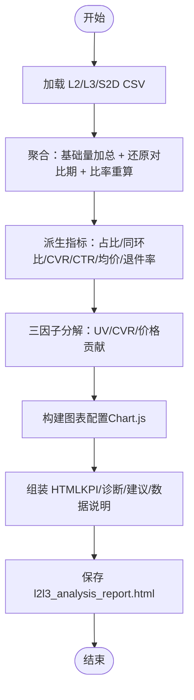
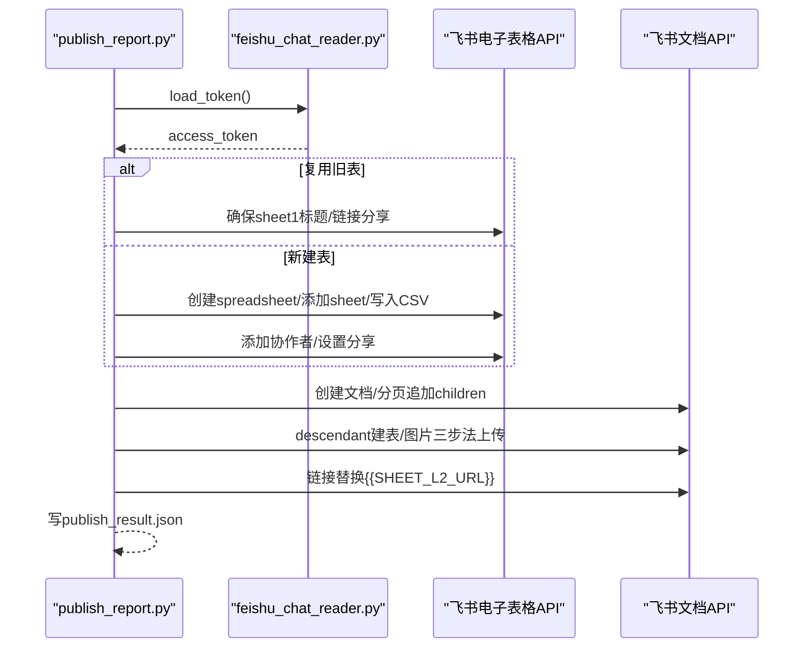
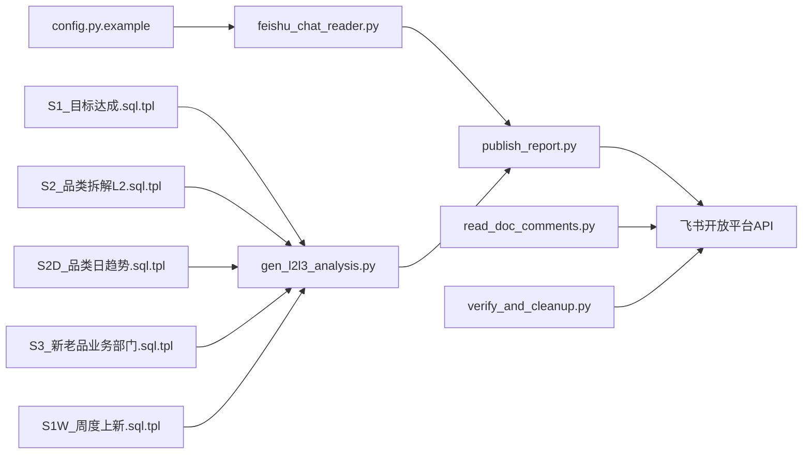

# 完整运营报告模块

<cite>
**本文引用的文件**   
- [publish_report.py](file://skills/ops-report-full/scripts/publish_report.py)
- [gen_l2l3_analysis.py](file://skills/ops-report-full/scripts/gen_l2l3_analysis.py)
- [feishu_chat_reader.py](file://skills/ops-report-full/scripts/feishu_chat_reader.py)
- [read_doc_comments.py](file://skills/ops-report-full/scripts/read_doc_comments.py)
- [verify_and_cleanup.py](file://skills/ops-report-full/scripts/verify_and_cleanup.py)
- [config.py.example](file://skills/ops-report-full/scripts/config.py.example)
- [S1_目标达成.sql.tpl](file://skills/ops-report-full/sql/S1_目标达成.sql.tpl)
- [S2_品类拆解L2.sql.tpl](file://skills/ops-report-full/sql/S2_品类拆解L2.sql.tpl)
- [S2D_品类日趋势.sql.tpl](file://skills/ops-report-full/sql/S2D_品类日趋势.sql.tpl)
- [S3_新老品业务部门.sql.tpl](file://skills/ops-report-full/sql/S3_新老品业务部门.sql.tpl)
- [S1W_周度上新.sql.tpl](file://skills/ops-report-full/sql/S1W_周度上新.sql.tpl)
</cite>

## 目录
1. [引言](#引言)
2. [项目结构](#项目结构)
3. [核心组件](#核心组件)
4. [架构总览](#架构总览)
5. [详细组件分析](#详细组件分析)
6. [依赖关系分析](#依赖关系分析)
7. [性能与稳定性](#性能与稳定性)
8. [故障排查指南](#故障排查指南)
9. [结论](#结论)
10. [附录：指标口径与数据流](#附录指标口径与数据流)

## 引言
本模块为“完整运营报告”自动化流水线，覆盖从数据准备、指标计算、可视化分析到飞书文档与电子表格发布的端到端流程。其目标是：
- 以 SQL 模板生成多口径经营数据（目标达成、品类拆解、日趋势、新老品与业务部门）。
- 基于二级/三级品类数据产出交互式 HTML 分析报告。
- 将报告内容结构化写入飞书文档，并将全量明细写入飞书电子表格。
- 提供授权、评论读取、发布校验与清理等配套工具。

该模块强调可复用、幂等与可观测性：通过 token 缓存、分批写入、块级校验与权限降级策略，保障在复杂协作环境下的稳定发布。

## 项目结构

图表来源
- [publish_report.py:1-476](file://skills/ops-report-full/scripts/publish_report.py#L1-L476)
- [gen_l2l3_analysis.py:1-570](file://skills/ops-report-full/scripts/gen_l2l3_analysis.py#L1-L570)
- [feishu_chat_reader.py:1-690](file://skills/ops-report-full/scripts/feishu_chat_reader.py#L1-L690)
- [read_doc_comments.py:1-66](file://skills/ops-report-full/scripts/read_doc_comments.py#L1-L66)
- [verify_and_cleanup.py:1-72](file://skills/ops-report-full/scripts/verify_and_cleanup.py#L1-L72)
- [config.py.example:1-12](file://skills/ops-report-full/scripts/config.py.example#L1-L12)
- [S1_目标达成.sql.tpl:1-846](file://skills/ops-report-full/sql/S1_目标达成.sql.tpl#L1-L846)
- [S2_品类拆解L2.sql.tpl:1-540](file://skills/ops-report-full/sql/S2_品类拆解L2.sql.tpl#L1-L540)
- [S2D_品类日趋势.sql.tpl:1-49](file://skills/ops-report-full/sql/S2D_品类日趋势.sql.tpl#L1-L49)
- [S3_新老品业务部门.sql.tpl:1-588](file://skills/ops-report-full/sql/S3_新老品业务部门.sql.tpl#L1-L588)
- [S1W_周度上新.sql.tpl:1-242](file://skills/ops-report-full/sql/S1W_周度上新.sql.tpl#L1-L242)

章节来源
- [publish_report.py:1-476](file://skills/ops-report-full/scripts/publish_report.py#L1-L476)
- [gen_l2l3_analysis.py:1-570](file://skills/ops-report-full/scripts/gen_l2l3_analysis.py#L1-L570)
- [feishu_chat_reader.py:1-690](file://skills/ops-report-full/scripts/feishu_chat_reader.py#L1-L690)
- [read_doc_comments.py:1-66](file://skills/ops-report-full/scripts/read_doc_comments.py#L1-L66)
- [verify_and_cleanup.py:1-72](file://skills/ops-report-full/scripts/verify_and_cleanup.py#L1-L72)
- [config.py.example:1-12](file://skills/ops-report-full/scripts/config.py.example#L1-L12)
- [S1_目标达成.sql.tpl:1-846](file://skills/ops-report-full/sql/S1_目标达成.sql.tpl#L1-L846)
- [S2_品类拆解L2.sql.tpl:1-540](file://skills/ops-report-full/sql/S2_品类拆解L2.sql.tpl#L1-L540)
- [S2D_品类日趋势.sql.tpl:1-49](file://skills/ops-report-full/sql/S2D_品类日趋势.sql.tpl#L1-L49)
- [S3_新老品业务部门.sql.tpl:1-588](file://skills/ops-report-full/sql/S3_新老品业务部门.sql.tpl#L1-L588)
- [S1W_周度上新.sql.tpl:1-242](file://skills/ops-report-full/sql/S1W_周度上新.sql.tpl#L1-L242)

## 核心组件
- SQL 模板层：S1/S2/S2D/S3/S1W 五类模板，统一使用占位符注入时间窗口与月度口径，输出目标达成、品类拆解（L2/L3）、日趋势、新老品×业务部门、周度上新等数据集。
- 分析脚本：gen_l2l3_analysis.py 读取 L2/L3/S2D CSV，进行聚合还原、三因子分解、趋势与矩阵分析，并渲染 Chart.js 交互式 HTML 报告。
- 发布脚本：publish_report.py 负责飞书文档与电子表格的创建、权限设置、分块写入、图片三步法上传、链接替换与结果落盘。
- 授权与聊天：feishu_chat_reader.py 实现 OAuth2 本地回调、user_access_token 获取与缓存；同时提供 IM 消息读取能力。
- 辅助工具：read_doc_comments.py 拉取文档评论；verify_and_cleanup.py 校验文档块分布并清理旧资源。
- 配置：config.py.example 提供飞书应用 App ID/Secret、回调地址与本地端口模板。

章节来源
- [S1_目标达成.sql.tpl:1-846](file://skills/ops-report-full/sql/S1_目标达成.sql.tpl#L1-L846)
- [S2_品类拆解L2.sql.tpl:1-540](file://skills/ops-report-full/sql/S2_品类拆解L2.sql.tpl#L1-L540)
- [S2D_品类日趋势.sql.tpl:1-49](file://skills/ops-report-full/sql/S2D_品类日趋势.sql.tpl#L1-L49)
- [S3_新老品业务部门.sql.tpl:1-588](file://skills/ops-report-full/sql/S3_新老品业务部门.sql.tpl#L1-L588)
- [S1W_周度上新.sql.tpl:1-242](file://skills/ops-report-full/sql/S1W_周度上新.sql.tpl#L1-L242)
- [gen_l2l3_analysis.py:1-570](file://skills/ops-report-full/scripts/gen_l2l3_analysis.py#L1-L570)
- [publish_report.py:1-476](file://skills/ops-report-full/scripts/publish_report.py#L1-L476)
- [feishu_chat_reader.py:1-690](file://skills/ops-report-full/scripts/feishu_chat_reader.py#L1-L690)
- [read_doc_comments.py:1-66](file://skills/ops-report-full/scripts/read_doc_comments.py#L1-L66)
- [verify_and_cleanup.py:1-72](file://skills/ops-report-full/scripts/verify_and_cleanup.py#L1-L72)
- [config.py.example:1-12](file://skills/ops-report-full/scripts/config.py.example#L1-L12)

## 架构总览

图表来源
- [gen_l2l3_analysis.py:1-570](file://skills/ops-report-full/scripts/gen_l2l3_analysis.py#L1-L570)
- [publish_report.py:1-476](file://skills/ops-report-full/scripts/publish_report.py#L1-L476)
- [feishu_chat_reader.py:1-690](file://skills/ops-report-full/scripts/feishu_chat_reader.py#L1-L690)
- [S1_目标达成.sql.tpl:1-846](file://skills/ops-report-full/sql/S1_目标达成.sql.tpl#L1-L846)
- [S2_品类拆解L2.sql.tpl:1-540](file://skills/ops-report-full/sql/S2_品类拆解L2.sql.tpl#L1-L540)
- [S2D_品类日趋势.sql.tpl:1-49](file://skills/ops-report-full/sql/S2D_品类日趋势.sql.tpl#L1-L49)
- [S3_新老品业务部门.sql.tpl:1-588](file://skills/ops-report-full/sql/S3_新老品业务部门.sql.tpl#L1-L588)
- [S1W_周度上新.sql.tpl:1-242](file://skills/ops-report-full/sql/S1W_周度上新.sql.tpl#L1-L242)

## 详细组件分析

### 组件A：二级/三级品类分析器（gen_l2l3_analysis.py）
职责
- 读取 S2_品类拆解L2.csv、S2_品类拆解L3.csv、S2D_品类日趋势.csv。
- 按维度聚合：整体概览、大类结构、L2/L3 排行、新老品交叉、日趋势。
- 对比期还原：用“本期/(1+增长率)”还原环比/同比基期值，比率指标在聚合层重算。
- 三因子分解：销售额=UV×CVR×价格，采用序贯替代法拆分流量/转化/价格贡献。
- 渲染 HTML：Chart.js 图表 + 服务端表格 + KPI/诊断/建议/自查/数据说明。

关键流程

图表来源
- [gen_l2l3_analysis.py:98-180](file://skills/ops-report-full/scripts/gen_l2l3_analysis.py#L98-L180)
- [gen_l2l3_analysis.py:183-218](file://skills/ops-report-full/scripts/gen_l2l3_analysis.py#L183-L218)
- [gen_l2l3_analysis.py:232-345](file://skills/ops-report-full/scripts/gen_l2l3_analysis.py#L232-L345)
- [gen_l2l3_analysis.py:348-444](file://skills/ops-report-full/scripts/gen_l2l3_analysis.py#L348-L444)
- [gen_l2l3_analysis.py:447-570](file://skills/ops-report-full/scripts/gen_l2l3_analysis.py#L447-L570)

复杂度与优化点
- 聚合阶段对每条明细行做数值解析与还原，时间复杂度 O(N)。
- 日趋势按日期分组聚合，注意大表场景下可考虑预聚合或分区裁剪。
- HTML 渲染为一次性拼接字符串，适合中等规模报告；若扩展更多图表，可引入模板引擎减少内存占用。

章节来源
- [gen_l2l3_analysis.py:1-570](file://skills/ops-report-full/scripts/gen_l2l3_analysis.py#L1-L570)

### 组件B：飞书发布器（publish_report.py）
职责
- 管理两种身份 token：user_access_token（用户身份）与 tenant_access_token（应用身份）。
- 电子表格：新建/复用、双 sheet 命名、批量写入 CSV 明细、权限与分享设置。
- 文档：创建文档、批量追加 children、descendant 建表、图片三步法上传、链接替换。
- 幂等与健壮性：协作者检查、分享权限降级、异常告警不阻断。

关键流程

图表来源
- [publish_report.py:32-116](file://skills/ops-report-full/scripts/publish_report.py#L32-L116)
- [publish_report.py:139-301](file://skills/ops-report-full/scripts/publish_report.py#L139-L301)
- [publish_report.py:317-378](file://skills/ops-report-full/scripts/publish_report.py#L317-L378)
- [publish_report.py:381-476](file://skills/ops-report-full/scripts/publish_report.py#L381-L476)
- [feishu_chat_reader.py:57-163](file://skills/ops-report-full/scripts/feishu_chat_reader.py#L57-L163)

错误处理与边界
- 表格写入分块控制：列块与行块上限避免 API 限制。
- 图片三步法：先建空 image block，再上传 media，最后 replace_image。
- 权限降级：当用户身份不可用时回退至应用身份读取/写入，失败仅告警。

章节来源
- [publish_report.py:1-476](file://skills/ops-report-full/scripts/publish_report.py#L1-L476)
- [feishu_chat_reader.py:57-163](file://skills/ops-report-full/scripts/feishu_chat_reader.py#L57-L163)

### 组件C：飞书授权与聊天读取（feishu_chat_reader.py）
职责
- 本地 HTTP 服务接收 OAuth 回调，换取 user_access_token 并缓存。
- 提供 IM 聊天列表与消息读取能力（群聊/私聊），支持合并转发展开。
- 导出 JSON/Markdown 表格，便于离线分析。

关键点
- 缓存有效期提前 5 分钟失效，避免边界问题。
- 回调线程等待超时保护，避免阻塞主进程。
- 消息类型解析覆盖 text/post/image/file/audio/media/sticker/interactive/system/merge_forward。

章节来源
- [feishu_chat_reader.py:1-690](file://skills/ops-report-full/scripts/feishu_chat_reader.py#L1-L690)

### 组件D：文档评论读取（read_doc_comments.py）
职责
- 调用 drive/v1/files/{doc}/comments 与 docx/v1/documents/{id}/comments 两种方式拉取评论及回复。
- 输出可读文本与原始 JSON，便于人工核对。

章节来源
- [read_doc_comments.py:1-66](file://skills/ops-report-full/scripts/read_doc_comments.py#L1-L66)

### 组件E：发布校验与清理（verify_and_cleanup.py）
职责
- 分页拉取文档 blocks，统计 block_type 分布，提取文本与链接。
- 支持删除旧版文档/电子表格，避免资源堆积。

章节来源
- [verify_and_cleanup.py:1-72](file://skills/ops-report-full/scripts/verify_and_cleanup.py#L1-L72)

### 组件F：SQL 模板族（S1/S2/S2D/S3/S1W）
共性
- 统一占位符：START/END、PM_*、PY_*、MONTH/W_CUR_* 等。
- 过滤条件：在线调整口径、排除无库存测试款与赠品。
- 组合品处理：skc 与 combination_skc 去重逻辑一致。

差异
- S1：目标达成（GMV/新品GMV/上新数/爆款相关/成功率/成本等）。
- S2：品类拆解L2（多维同环比、占比、库存与转化指标）。
- S2D：品类日趋势（按日粒度聚合销售额/销量/UV）。
- S3：新老品×业务部门（侧重组织视角的同环比与占比变化）。
- S1W：周度上新（本周/上周/本月累计/上月同期/去年同期）。

章节来源
- [S1_目标达成.sql.tpl:1-846](file://skills/ops-report-full/sql/S1_目标达成.sql.tpl#L1-L846)
- [S2_品类拆解L2.sql.tpl:1-540](file://skills/ops-report-full/sql/S2_品类拆解L2.sql.tpl#L1-L540)
- [S2D_品类日趋势.sql.tpl:1-49](file://skills/ops-report-full/sql/S2D_品类日趋势.sql.tpl#L1-L49)
- [S3_新老品业务部门.sql.tpl:1-588](file://skills/ops-report-full/sql/S3_新老品业务部门.sql.tpl#L1-L588)
- [S1W_周度上新.sql.tpl:1-242](file://skills/ops-report-full/sql/S1W_周度上新.sql.tpl#L1-L242)

## 依赖关系分析

图表来源
- [config.py.example:1-12](file://skills/ops-report-full/scripts/config.py.example#L1-L12)
- [feishu_chat_reader.py:1-690](file://skills/ops-report-full/scripts/feishu_chat_reader.py#L1-L690)
- [publish_report.py:1-476](file://skills/ops-report-full/scripts/publish_report.py#L1-L476)
- [gen_l2l3_analysis.py:1-570](file://skills/ops-report-full/scripts/gen_l2l3_analysis.py#L1-L570)
- [read_doc_comments.py:1-66](file://skills/ops-report-full/scripts/read_doc_comments.py#L1-L66)
- [verify_and_cleanup.py:1-72](file://skills/ops-report-full/scripts/verify_and_cleanup.py#L1-L72)
- [S1_目标达成.sql.tpl:1-846](file://skills/ops-report-full/sql/S1_目标达成.sql.tpl#L1-L846)
- [S2_品类拆解L2.sql.tpl:1-540](file://skills/ops-report-full/sql/S2_品类拆解L2.sql.tpl#L1-L540)
- [S2D_品类日趋势.sql.tpl:1-49](file://skills/ops-report-full/sql/S2D_品类日趋势.sql.tpl#L1-L49)
- [S3_新老品业务部门.sql.tpl:1-588](file://skills/ops-report-full/sql/S3_新老品业务部门.sql.tpl#L1-L588)
- [S1W_周度上新.sql.tpl:1-242](file://skills/ops-report-full/sql/S1W_周度上新.sql.tpl#L1-L242)

## 性能与稳定性
- 表格写入分块：列块与行块上限控制，降低单次请求体大小，避免 API 限流。
- 文档追加批量化：普通块按 CHILDREN_BATCH 分批提交，表格按 MAX_TABLE_CELLS 分块。
- Token 缓存：user_access_token 本地缓存，减少重复授权开销。
- 幂等操作：协作者与分享权限检查，避免重复写入。
- 降级策略：权限读取/写入失败时降级到应用身份，失败仅告警不阻断发布。
- 日志与校验：发布后读回顶层块数，辅助定位缺失或截断。

[本节为通用指导，无需具体文件引用]

## 故障排查指南
常见问题与对策
- OAuth 授权失败
  - 确认 config.py 中 APP_ID/APP_SECRET/REDIRECT_URI/LOCAL_PORT 已正确填写。
  - 检查浏览器是否成功打开授权页并完成回调。
  - 查看 .token_cache.json 是否存在且未过期。
- 飞书 API 报错
  - 检查 access_token 是否有效；必要时重新授权。
  - 关注 code/msg 字段，结合 publish_report.py 的错误抛出信息定位。
- 电子表格写入失败
  - 检查 reuse_sheet 是否为空或无效；如需复用，确保当前用户有编辑权限。
  - 观察 write_csv_to_sheet 的分块参数与 updatedCells 计数。
- 文档内容不完整
  - 使用 verify_and_cleanup.py 校验 blocks 分布与链接。
  - 检查 append_table 分块逻辑与 descendant 建表参数。
- 图片上传失败
  - 确认图片三步法顺序：创建空 image → upload_all → replace_image。
  - 检查 parent_node 与 size 参数是否正确。

章节来源
- [feishu_chat_reader.py:57-163](file://skills/ops-report-full/scripts/feishu_chat_reader.py#L57-L163)
- [publish_report.py:32-116](file://skills/ops-report-full/scripts/publish_report.py#L32-L116)
- [publish_report.py:283-301](file://skills/ops-report-full/scripts/publish_report.py#L283-L301)
- [publish_report.py:359-378](file://skills/ops-report-full/scripts/publish_report.py#L359-L378)
- [verify_and_cleanup.py:11-23](file://skills/ops-report-full/scripts/verify_and_cleanup.py#L11-L23)

## 结论
完整运营报告模块以 SQL 模板为基础，结合 Python 脚本完成从数据聚合、指标计算、可视化到飞书发布的闭环。其设计强调：
- 数据口径一致性：SQL 模板统一过滤与组合品处理。
- 发布稳健性：分块写入、幂等权限、降级策略与校验工具。
- 分析深度：二/三级品类下钻、日趋势、增长-份额矩阵与三因子分解。
建议在后续迭代中：
- 将 HTML 渲染迁移至模板引擎以提升可扩展性。
- 对超大 CSV 写入增加进度与重试机制。
- 完善错误码映射与告警通道（如邮件/IM）。

[本节为总结性内容，无需具体文件引用]

## 附录：指标口径与数据流
- 对比期还原：对比期 = 本期 / (1 + 增长率)，增长率缺失或 ≤ -100% 视为对比期为 0。
- 比率指标：CVR = 销量 / 详情页UV；CTR = 商列点击UV / 商列浏览UV；均价 = 销售额 / 销量；均在聚合层由基础量重算。
- 三因子分解：UV 贡献 = (UV₁ - UV₀) × CVR₀ × P₀；CVR 贡献 = UV₁ × (CVR₁ - CVR₀) × P₀；价格贡献 = UV₁ × CVR₁ × (P₁ - P₀)。
- 时间窗口：本期 START~END；环比期 PM_START~PM_END（各回拨1个月）；同比期 PY_START~PY_END（各回拨1年）。
- 数据源：ads_prod_skc_product_info_di/mi，排除无库存测试款与赠品。

章节来源
- [gen_l2l3_analysis.py:98-180](file://skills/ops-report-full/scripts/gen_l2l3_analysis.py#L98-L180)
- [gen_l2l3_analysis.py:436-444](file://skills/ops-report-full/scripts/gen_l2l3_analysis.py#L436-L444)
- [S2_品类拆解L2.sql.tpl:1-540](file://skills/ops-report-full/sql/S2_品类拆解L2.sql.tpl#L1-L540)
- [S2D_品类日趋势.sql.tpl:1-49](file://skills/ops-report-full/sql/S2D_品类日趋势.sql.tpl#L1-L49)
- [S3_新老品业务部门.sql.tpl:1-588](file://skills/ops-report-full/sql/S3_新老品业务部门.sql.tpl#L1-L588)
- [S1_目标达成.sql.tpl:1-846](file://skills/ops-report-full/sql/S1_目标达成.sql.tpl#L1-L846)
- [S1W_周度上新.sql.tpl:1-242](file://skills/ops-report-full/sql/S1W_周度上新.sql.tpl#L1-L242)