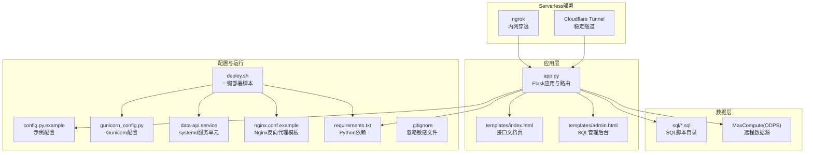
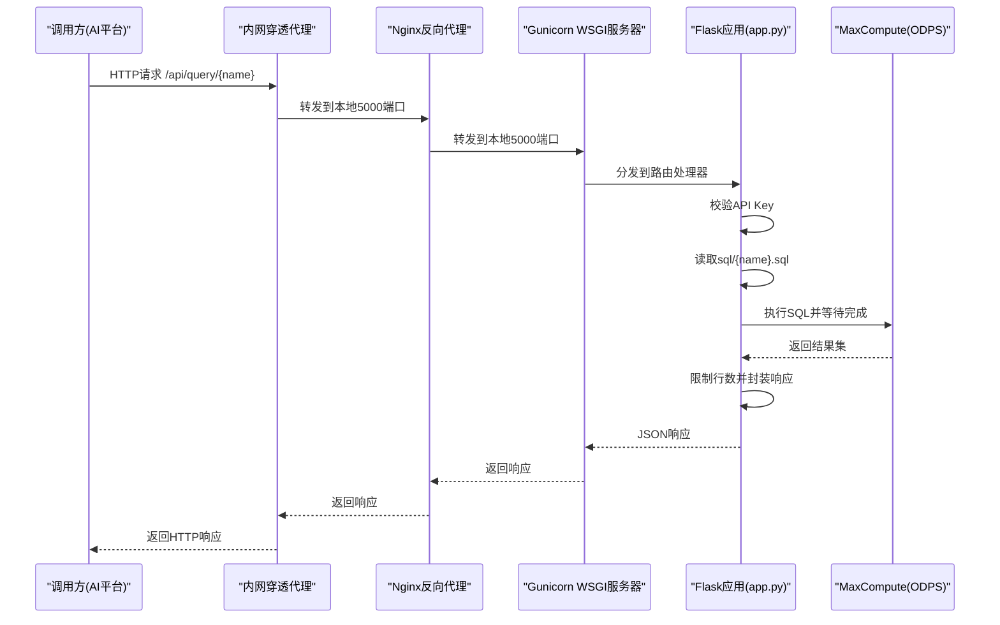
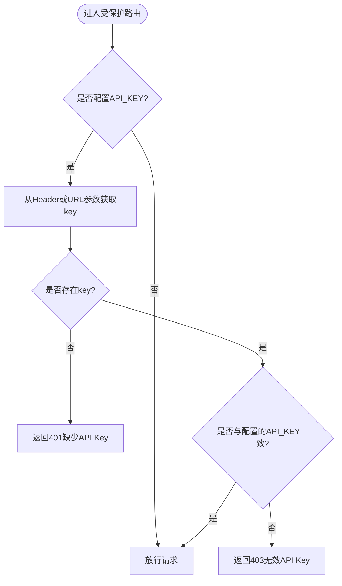
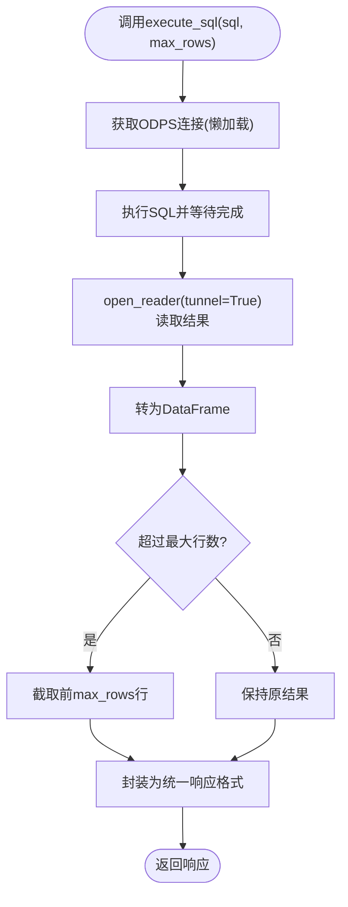
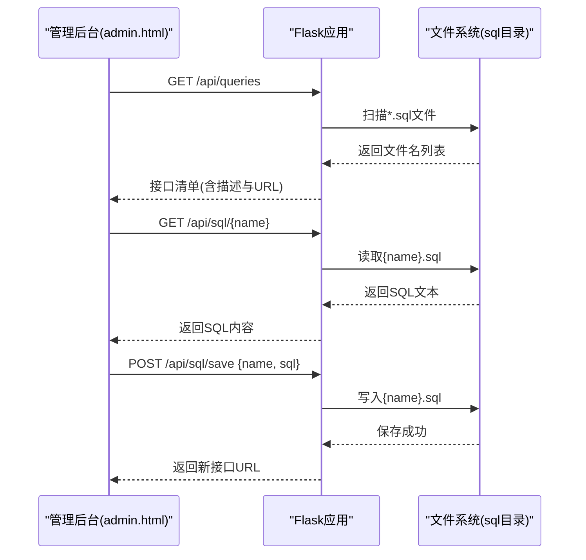
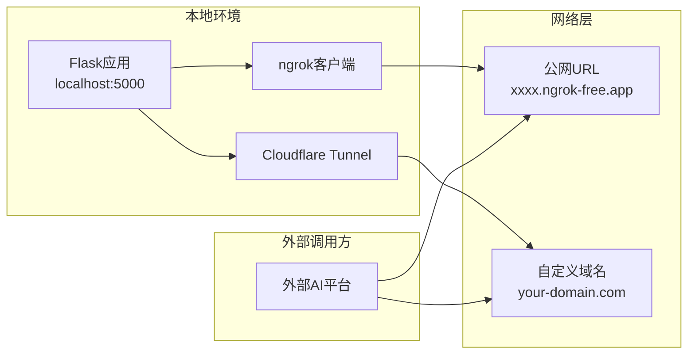
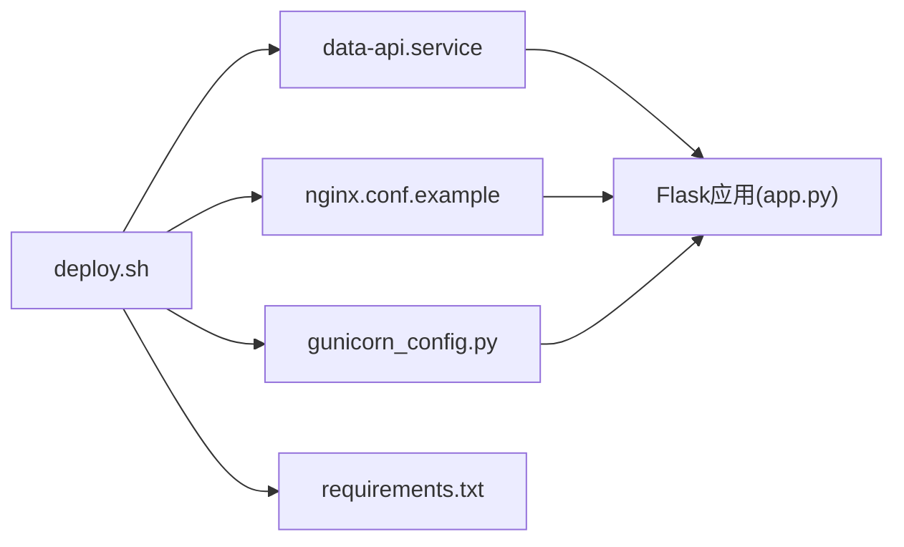
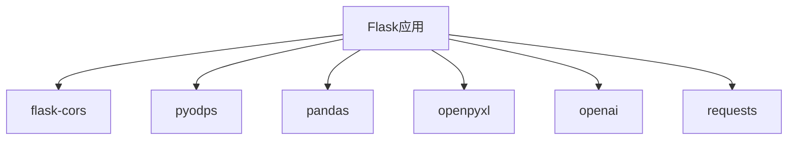

# 数据接口API服务

<cite>
**本文引用的文件**   
- [app.py](file://数据接口-for冬冬/app.py)
- [config.py.example](file://数据接口-for冬冬/config.py.example)
- [requirements.txt](file://数据接口-for冬冬/requirements.txt)
- [gunicorn_config.py](file://数据接口-for冬冬/gunicorn_config.py)
- [deploy.sh](file://数据接口-for冬冬/deploy.sh)
- [data-api.service](file://数据接口-for冬冬/data-api.service)
- [nginx.conf.example](file://数据接口-for冬冬/nginx.conf.example)
- [templates/index.html](file://数据接口-for冬冬/templates/index.html)
- [templates/admin.html](file://数据接口-for冬冬/templates/admin.html)
- [sql/query.sql](file://数据接口-for冬冬/sql/query.sql)
- [.gitignore](file://数据接口-for冬冬/.gitignore)
- [README.md](file://数据接口-for冬冬/README.md)
</cite>

## 更新摘要
**变更内容**   
- 新增Serverless部署章节，包含ngrok内网穿透和Cloudflare Tunnel两种部署方案
- 为开发者提供无需专用服务器的本地API暴露解决方案
- 补充了无服务器场景下的快速启动指南和使用建议

## 目录
1. [简介](#简介)
2. [项目结构](#项目结构)
3. [核心组件](#核心组件)
4. [架构总览](#架构总览)
5. [详细组件分析](#详细组件分析)
6. [依赖关系分析](#依赖关系分析)
7. [性能与扩展性](#性能与扩展性)
8. [故障排查指南](#故障排查指南)
9. [结论](#结论)
10. [附录：API参考](#附录api参考)

## 简介
本项目提供"数据接口API服务"，将MaxCompute（ODPS）中的SQL查询以REST API形式对外暴露，供外部AI平台或业务系统调用。数分人员可通过内置的Web管理后台编写、保存SQL，并自动生成对应的数据接口；调用方通过统一的认证机制访问接口获取结构化数据。

**更新** 新增了Serverless部署方案，支持在本地开发环境中通过内网穿透工具快速暴露API接口，无需购买和维护专用服务器。

## 项目结构
- 应用入口与路由：Flask应用定义、路由、认证装饰器、ODPS连接与SQL执行逻辑
- 配置与环境：示例配置、生产部署配置、依赖清单、忽略规则
- 前端页面：接口文档与管理后台
- SQL目录：存放可被API调用的SQL脚本
- 部署相关：Gunicorn配置、systemd服务单元、Nginx反向代理模板、一键部署脚本
- **新增** Serverless部署：ngrok和Cloudflare Tunnel内网穿透方案

**图示来源**
- [app.py:1-350](file://数据接口-for冬冬/app.py#L1-L350)
- [templates/index.html:1-214](file://数据接口-for冬冬/templates/index.html#L1-L214)
- [templates/admin.html:1-286](file://数据接口-for冬冬/templates/admin.html#L1-L286)
- [config.py.example:1-33](file://数据接口-for冬冬/config.py.example#L1-L33)
- [gunicorn_config.py:1-36](file://数据接口-for冬冬/gunicorn_config.py#L1-L36)
- [data-api.service:1-30](file://数据接口-for冬冬/data-api.service#L1-L30)
- [deploy.sh:1-94](file://数据接口-for冬冬/deploy.sh#L1-L94)
- [nginx.conf.example](file://数据接口-for冬冬/nginx.conf.example)
- [requirements.txt:1-8](file://数据接口-for冬冬/requirements.txt#L1-L8)
- [.gitignore:1-5](file://数据接口-for冬冬/.gitignore#L1-L5)
- [README.md:38-111](file://数据接口-for冬冬/README.md#L38-L111)

**章节来源**
- [app.py:1-350](file://数据接口-for冬冬/app.py#L1-L350)
- [config.py.example:1-33](file://数据接口-for冬冬/config.py.example#L1-L33)
- [requirements.txt:1-8](file://数据接口-for冬冬/requirements.txt#L1-L8)
- [gunicorn_config.py:1-36](file://数据接口-for冬冬/gunicorn_config.py#L1-L36)
- [deploy.sh:1-94](file://数据接口-for冬冬/deploy.sh#L1-L94)
- [data-api.service:1-30](file://数据接口-for冬冬/data-api.service#L1-L30)
- [nginx.conf.example](file://数据接口-for冬冬/nginx.conf.example)
- [templates/index.html:1-214](file://数据接口-for冬冬/templates/index.html#L1-L214)
- [templates/admin.html:1-286](file://数据接口-for冬冬/templates/admin.html#L1-L286)
- [sql/query.sql:1-17](file://数据接口-for冬冬/sql/query.sql#L1-L17)
- [.gitignore:1-5](file://数据接口-for冬冬/.gitignore#L1-L5)
- [README.md:38-111](file://数据接口-for冬冬/README.md#L38-L111)

## 核心组件
- Flask应用与CORS：启用跨域，便于外部AI平台直接调用
- API Key认证装饰器：支持Header与URL参数两种方式传入密钥
- MaxCompute连接池（懒加载单例）：按需创建ODPS客户端实例
- SQL管理与执行：读取sql目录下的脚本，执行并限制返回行数
- 响应封装：统一JSON格式，包含数据、列名、行数、耗时等元信息
- Web界面：接口文档与管理后台，辅助数分编写与发布SQL
- **新增** Serverless部署支持：提供ngrok和Cloudflare Tunnel两种内网穿透方案

**章节来源**
- [app.py:1-350](file://数据接口-for冬冬/app.py#L1-L350)
- [templates/index.html:1-214](file://数据接口-for冬冬/templates/index.html#L1-L214)
- [templates/admin.html:1-286](file://数据接口-for冬冬/templates/admin.html#L1-L286)
- [README.md:38-111](file://数据接口-for冬冬/README.md#L38-L111)

## 架构总览
整体采用"Flask + Gunicorn + Nginx"的经典部署形态。Nginx作为反向代理对外暴露HTTP/HTTPS端口，Gunicorn作为WSGI服务器承载Flask进程，Flask负责路由、认证、SQL执行与结果封装。SQL脚本集中存放在sql目录，由管理后台维护，运行时动态加载。

**更新** 新增了Serverless部署架构，支持在本地开发环境中通过内网穿透工具快速暴露API接口。

**图示来源**
- [app.py:167-248](file://数据接口-for冬冬/app.py#L167-L248)
- [gunicorn_config.py:1-36](file://数据接口-for冬冬/gunicorn_config.py#L1-L36)
- [nginx.conf.example](file://数据接口-for冬冬/nginx.conf.example)
- [README.md:38-111](file://数据接口-for冬冬/README.md#L38-L111)

## 详细组件分析

### 认证与安全
- API Key认证装饰器：从请求头X-API-Key或URL参数api_key中读取密钥，若未配置则跳过认证；匹配失败返回403，缺失返回401
- 文件名校验：在读取/保存SQL时进行白名单校验，仅允许字母数字、下划线、中划线，防止路径穿越
- .gitignore：忽略本地配置文件，避免AccessKey泄露

**图示来源**
- [app.py:35-66](file://数据接口-for冬冬/app.py#L35-L66)
- [app.py:281-294](file://数据接口-for冬冬/app.py#L281-L294)
- [.gitignore:1-5](file://数据接口-for冬冬/.gitignore#L1-L5)

**章节来源**
- [app.py:35-66](file://数据接口-for冬冬/app.py#L35-L66)
- [app.py:281-294](file://数据接口-for冬冬/app.py#L281-L294)
- [.gitignore:1-5](file://数据接口-for冬冬/.gitignore#L1-L5)

### MaxCompute连接与SQL执行
- 懒加载单例：首次访问时创建ODPS客户端，后续复用
- 执行流程：execute_sql执行SQL并等待成功，使用Instance Tunnel加速下载结果至pandas DataFrame
- 结果限制：按MAX_RESULT_ROWS或请求参数limit截断返回行数
- 响应封装：填充空值、转换为记录列表，附带列名、行数、耗时与查询时间

**图示来源**
- [app.py:69-82](file://数据接口-for冬冬/app.py#L69-L82)
- [app.py:110-148](file://数据接口-for冬冬/app.py#L110-L148)

**章节来源**
- [app.py:69-82](file://数据接口-for冬冬/app.py#L69-L82)
- [app.py:110-148](file://数据接口-for冬冬/app.py#L110-L148)

### 路由与接口
- GET /api/queries：列出所有可用SQL接口，自动提取首行注释作为描述，并生成完整URL
- GET /api/query/<name>：根据名称加载对应SQL并执行，支持limit覆盖
- POST /api/query：临时测试接口，接受自定义SQL与limit
- GET /api/sql/<name>：读取指定SQL内容（用于管理后台）
- POST /api/sql/save：保存SQL文件（含安全校验），成功后返回新接口URL

**图示来源**
- [app.py:167-208](file://数据接口-for冬冬/app.py#L167-L208)
- [app.py:211-248](file://数据接口-for冬冬/app.py#L211-L248)
- [app.py:250-277](file://数据接口-for冬冬/app.py#L250-L277)
- [app.py:281-329](file://数据接口-for冬冬/app.py#L281-L329)
- [templates/admin.html:127-283](file://数据接口-for冬冬/templates/admin.html#L127-L283)

**章节来源**
- [app.py:167-208](file://数据接口-for冬冬/app.py#L167-L208)
- [app.py:211-248](file://数据接口-for冬冬/app.py#L211-L248)
- [app.py:250-277](file://数据接口-for冬冬/app.py#L250-L277)
- [app.py:281-329](file://数据接口-for冬冬/app.py#L281-L329)
- [templates/admin.html:127-283](file://数据接口-for冬冬/templates/admin.html#L127-L283)

### Serverless部署方案
**新增** 为开发者提供了两种无需专用服务器的本地API暴露解决方案：

#### ngrok内网穿透（最简单）
- 安装ngrok客户端并配置authtoken
- 同时启动Flask服务和ngrok穿透服务
- 获得公网地址供外部AI平台调用
- 适合临时测试，免费版每次重启地址会变

#### Cloudflare Tunnel（更稳定）
- 安装cloudflared客户端
- 创建隧道并配置DNS路由
- 支持自定义域名，提供更稳定的连接
- 适合需要长期使用的场景

**图示来源**
- [README.md:42-81](file://数据接口-for冬冬/README.md#L42-L81)
- [README.md:83-111](file://数据接口-for冬冬/README.md#L83-L111)

**章节来源**
- [README.md:38-111](file://数据接口-for冬冬/README.md#L38-L111)

### 部署与运维
- Gunicorn：同步worker，workers数量建议为CPU核数×2+1，设置超时与日志路径
- systemd服务：开机自启、失败重启、资源限制、标准输出重定向
- Nginx：反向代理到本地5000端口，支持HTTPS证书配置
- 一键部署脚本：安装依赖、创建目录、配置systemd与Nginx、启动与状态检查

**图示来源**
- [deploy.sh:1-94](file://数据接口-for冬冬/deploy.sh#L1-L94)
- [data-api.service:1-30](file://数据接口-for冬冬/data-api.service#L1-L30)
- [nginx.conf.example](file://数据接口-for冬冬/nginx.conf.example)
- [gunicorn_config.py:1-36](file://数据接口-for冬冬/gunicorn_config.py#L1-L36)
- [requirements.txt:1-8](file://数据接口-for冬冬/requirements.txt#L1-L8)
- [app.py:332-350](file://数据接口-for冬冬/app.py#L332-L350)

**章节来源**
- [deploy.sh:1-94](file://数据接口-for冬冬/deploy.sh#L1-L94)
- [data-api.service:1-30](file://数据接口-for冬冬/data-api.service#L1-L30)
- [nginx.conf.example](file://数据接口-for冬冬/nginx.conf.example)
- [gunicorn_config.py:1-36](file://数据接口-for冬冬/gunicorn_config.py#L1-L36)
- [requirements.txt:1-8](file://数据接口-for冬冬/requirements.txt#L1-L8)
- [app.py:332-350](file://数据接口-for冬冬/app.py#L332-L350)

## 依赖关系分析
- 框架与中间件：flask、flask-cors
- 数据处理：pyodps、pandas
- 其他：openpyxl、openai、requests（当前主要使用pyodps与pandas）
- 运行环境：Gunicorn、Nginx、systemd

**图示来源**
- [requirements.txt:1-8](file://数据接口-for冬冬/requirements.txt#L1-L8)
- [app.py:21-29](file://数据接口-for冬冬/app.py#L21-L29)

**章节来源**
- [requirements.txt:1-8](file://数据接口-for冬冬/requirements.txt#L1-L8)
- [app.py:21-29](file://数据接口-for冬冬/app.py#L21-L29)

## 性能与扩展性
- Instance Tunnel加速：通过open_reader(tunnel=True)提升大数据量下载速度
- 结果行数限制：默认MAX_RESULT_ROWS，可按请求参数limit覆盖，避免大结果集导致内存压力
- Worker并发：Gunicorn workers建议按CPU核数×2+1配置，结合超时与日志路径保障稳定性
- 预加载应用：preload_app=True减少冷启动开销
- 可扩展点：
  - 增加缓存层（如Redis）缓存热点查询结果
  - 引入异步任务队列处理长耗时SQL
  - 接入限流与熔断策略，保护后端MaxCompute集群
- **新增** Serverless优化：建议使用Cloudflare Tunnel替代ngrok以获得更稳定的连接性能

## 故障排查指南
- 认证问题
  - 现象：401缺少API Key或403无效API Key
  - 排查：确认Header X-API-Key或URL参数api_key是否正确传递；检查config.py中API_KEY是否配置
- 查询不存在
  - 现象：404查询不存在
  - 排查：确认sql目录下存在{name}.sql文件，且名称与路由一致
- 服务器错误
  - 现象：500内部错误
  - 排查：查看Gunicorn errorlog与systemd journal；检查ODPS连接配置与网络连通性
- 权限与部署
  - 现象：部署脚本提示需要root权限
  - 排查：使用sudo执行deploy.sh；确认systemd与Nginx配置正确并重启服务
- **新增** Serverless部署问题
  - ngrok连接失败：检查authtoken配置和网络连通性
  - Cloudflare Tunnel无法访问：确认DNS配置和隧道状态
  - 公网地址失效：ngrok免费版重启后地址会变化，需重新获取

**章节来源**
- [app.py:35-66](file://数据接口-for冬冬/app.py#L35-L66)
- [app.py:211-248](file://数据接口-for冬冬/app.py#L211-L248)
- [app.py:250-277](file://数据接口-for冬冬/app.py#L250-L277)
- [gunicorn_config.py:23-26](file://数据接口-for冬冬/gunicorn_config.py#L23-L26)
- [deploy.sh:22-26](file://数据接口-for冬冬/deploy.sh#L22-L26)
- [README.md:78-81](file://数据接口-for冬冬/README.md#L78-L81)

## 结论
该数据接口API服务以最小化实现提供了稳定的MaxCompute数据查询能力，具备完善的认证、SQL管理与部署方案。通过Instance Tunnel与合理的并发配置，可在生产环境中稳定支撑外部AI平台的实时数据分析需求。**新增的Serverless部署方案**为开发者提供了灵活的本地开发体验，无需购买服务器即可快速暴露API接口。建议在后续迭代中引入缓存、限流与更细粒度的权限控制，进一步提升安全性与可扩展性。

## 附录：API参考
- 认证方式
  - Header：X-API-Key
  - URL参数：api_key
- 接口列表
  - GET /api/queries：列出所有可用接口
  - GET /api/query/{name}?limit=整数：执行指定SQL并返回数据
  - POST /api/query：执行自定义SQL（测试用）
  - GET /api/sql/{name}：读取SQL内容（管理后台）
  - POST /api/sql/save：保存SQL并发布为新接口
- 响应格式
  - success：布尔
  - data：记录数组
  - columns：字段名数组
  - row_count：行数
  - exec_time：执行耗时（秒）
  - query_time：查询时间（字符串）
- 错误码
  - 200：成功
  - 401：缺少API Key
  - 403：API Key无效
  - 404：查询不存在
  - 500：服务器错误

**章节来源**
- [app.py:167-208](file://数据接口-for冬冬/app.py#L167-L208)
- [app.py:211-248](file://数据接口-for冬冬/app.py#L211-L248)
- [app.py:250-277](file://数据接口-for冬冬/app.py#L250-L277)
- [app.py:281-329](file://数据接口-for冬冬/app.py#L281-L329)
- [templates/index.html:98-168](file://数据接口-for冬冬/templates/index.html#L98-L168)