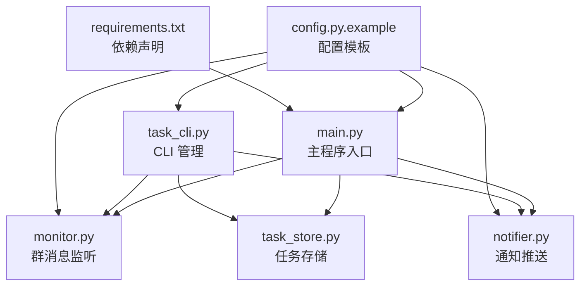
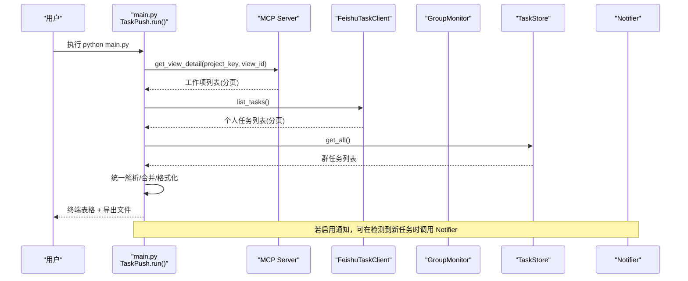
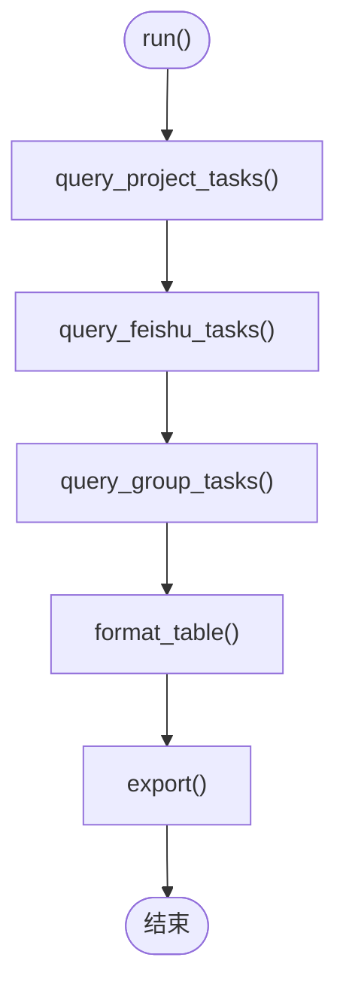
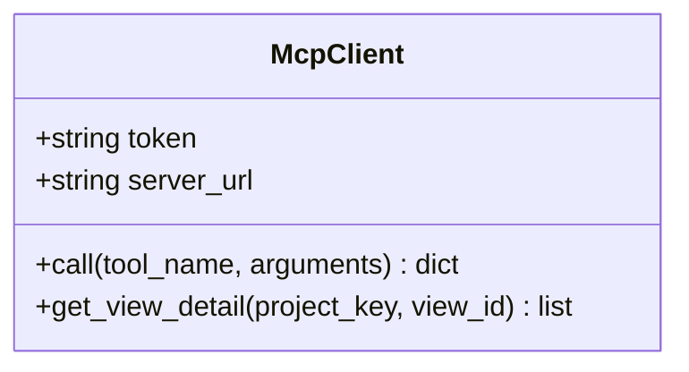
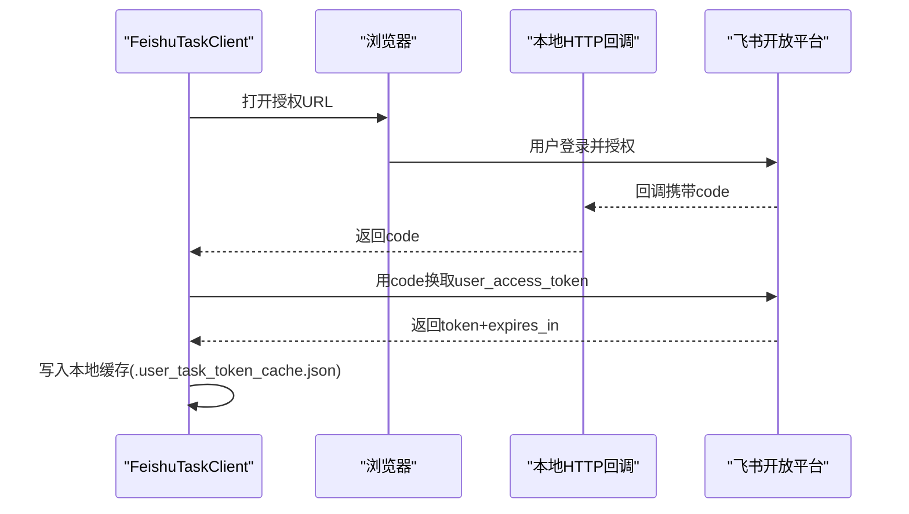
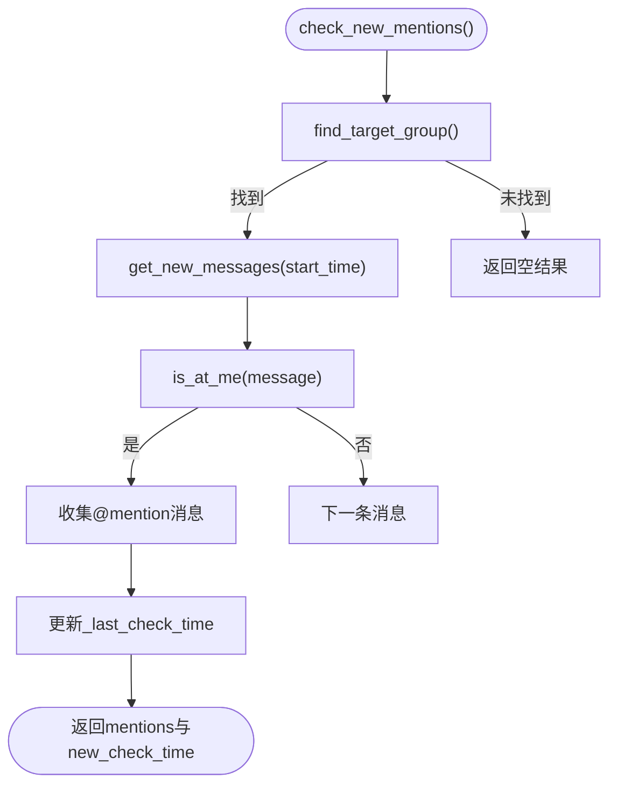
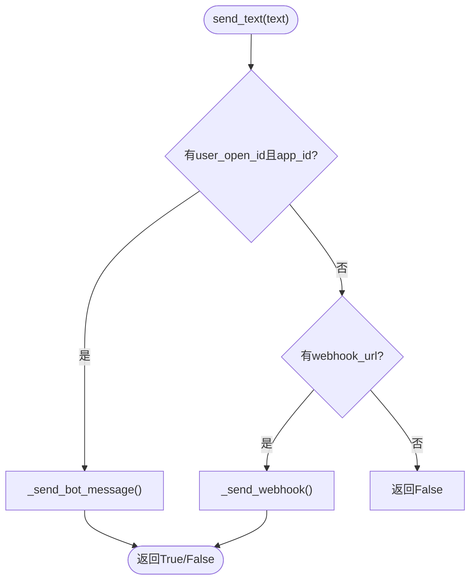
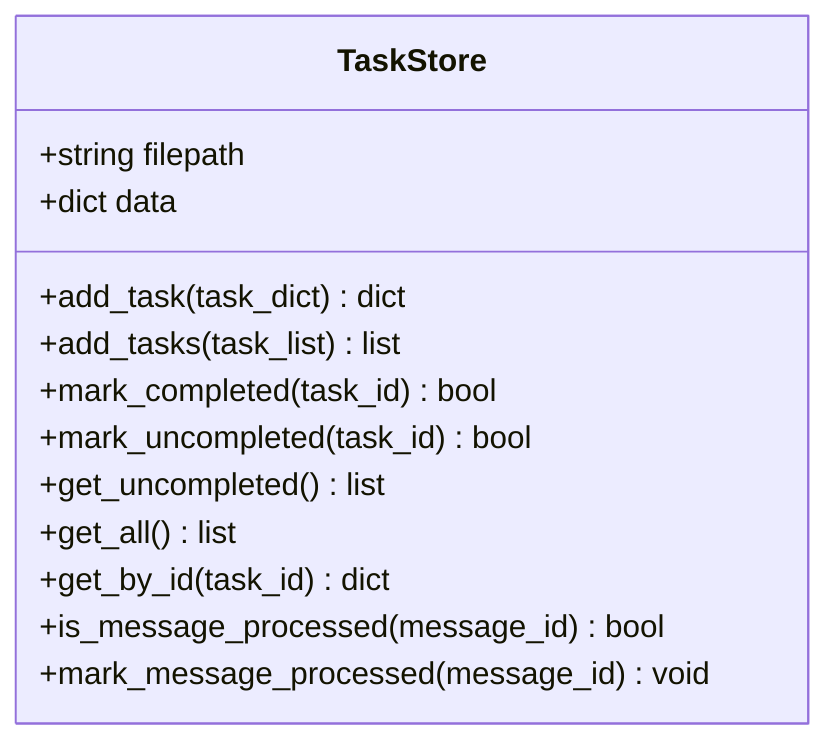
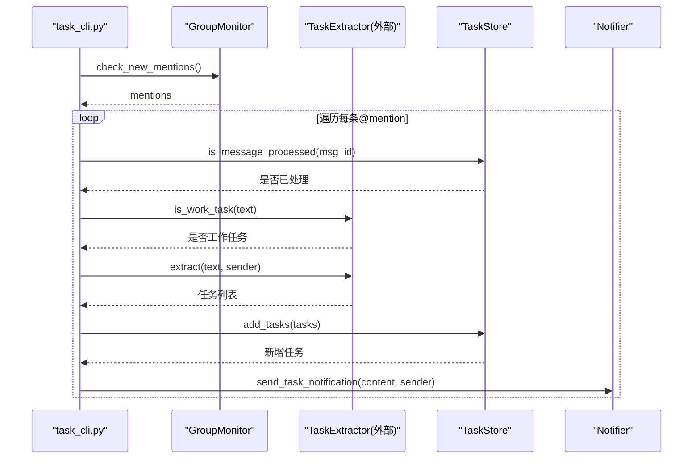
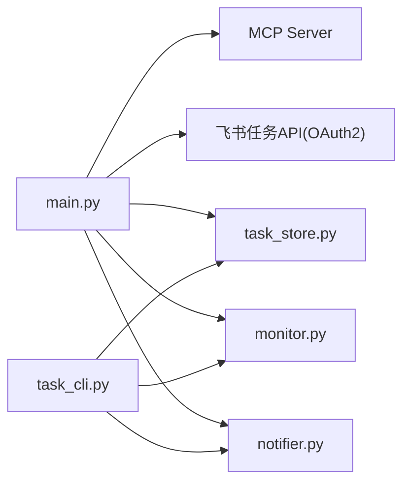

# 飞书任务推送技能

<cite>
**本文引用的文件**   
- [README.md](file://README.md)
- [SKILL.md](file://feishu_task_push_skill/SKILL.md)
- [TECHNICAL_DOC.md](file://feishu_task_push_skill/TECHNICAL_DOC.md)
- [main.py](file://feishu_task_push_skill/main.py)
- [monitor.py](file://feishu_task_push_skill/monitor.py)
- [notifier.py](file://feishu_task_push_skill/notifier.py)
- [task_cli.py](file://feishu_task_push_skill/task_cli.py)
- [task_store.py](file://feishu_task_push_skill/task_store.py)
- [config.py.example](file://feishu_task_push_skill/config.py.example)
- [requirements.txt](file://feishu_task_push_skill/requirements.txt)
</cite>

## 目录
1. [引言](#引言)
2. [项目结构](#项目结构)
3. [核心组件](#核心组件)
4. [架构总览](#架构总览)
5. [详细组件分析](#详细组件分析)
6. [依赖关系分析](#依赖关系分析)
7. [性能与可靠性](#性能与可靠性)
8. [故障排查指南](#故障排查指南)
9. [结论](#结论)
10. [附录：配置项说明](#附录配置项说明)

## 引言
本仓库中的“飞书任务推送技能”是一个面向个人工作流的任务聚合与通知工具。它从三个数据源拉取工作任务，进行智能过滤后统一输出，并支持通过飞书机器人私聊或 Webhook 推送新任务提醒。同时提供命令行工具用于管理群消息中提取的任务状态（查看、完成、撤销）。

该技能的目标是：
- 整合多源任务：飞书项目、飞书任务模块、群消息 @mention
- 智能过滤闲聊，仅保留真正的工作任务
- 以 Markdown 和 JSON 导出每日任务清单
- 通过应用机器人私聊发送新任务通知
- 提供轻量 CLI 管理本地任务存储

## 项目结构
当前与“飞书任务推送技能”直接相关的代码位于 `feishu_task_push_skill` 目录，主要文件职责如下：
- main.py：主程序入口，负责聚合三类任务、格式化输出与导出
- monitor.py：轮询目标群消息，检测 @mention 并提取文本
- notifier.py：通过应用机器人私聊或 Webhook 发送通知
- task_cli.py：命令行工具，管理群任务（list/done/undo/check）
- task_store.py：基于 JSON 的本地任务持久化与去重
- config.py.example：配置模板（需复制为 config.py 填写真实值）
- requirements.txt：运行依赖（requests）

图表来源
- [main.py:1-573](file://feishu_task_push_skill/main.py#L1-L573)
- [monitor.py:1-346](file://feishu_task_push_skill/monitor.py#L1-L346)
- [notifier.py:1-105](file://feishu_task_push_skill/notifier.py#L1-L105)
- [task_cli.py:1-150](file://feishu_task_push_skill/task_cli.py#L1-L150)
- [task_store.py:1-99](file://feishu_task_push_skill/task_store.py#L1-L99)
- [config.py.example:1-55](file://feishu_task_push_skill/config.py.example#L1-L55)
- [requirements.txt:1-2](file://feishu_task_push_skill/requirements.txt#L1-L2)

章节来源
- [SKILL.md:1-112](file://feishu_task_push_skill/SKILL.md#L1-L112)
- [TECHNICAL_DOC.md:1-389](file://feishu_task_push_skill/TECHNICAL_DOC.md#L1-L389)

## 核心组件
- 主程序 TaskPush：协调三大任务源（飞书项目、飞书任务、群任务），统一解析、格式化与导出
- MCP 客户端 McpClient：调用飞书项目 MCP Server 获取视图工作项
- 飞书任务客户端 FeishuTaskClient：OAuth2 user_access_token 授权，拉取个人任务列表
- 群消息监听 GroupMonitor：轮询群消息，检测 @mention，提取纯文本
- 通知推送 Notifier：通过应用机器人私聊或 Webhook 发送消息
- 任务存储 TaskStore：JSON 持久化，支持完成状态、消息去重
- CLI 工具 task_cli.py：list/done/undo/check 子命令

章节来源
- [main.py:63-107](file://feishu_task_push_skill/main.py#L63-L107)
- [main.py:112-265](file://feishu_task_push_skill/main.py#L112-L265)
- [main.py:270-559](file://feishu_task_push_skill/main.py#L270-L559)
- [monitor.py:19-346](file://feishu_task_push_skill/monitor.py#L19-L346)
- [notifier.py:11-105](file://feishu_task_push_skill/notifier.py#L11-L105)
- [task_store.py:13-99](file://feishu_task_push_skill/task_store.py#L13-L99)
- [task_cli.py:11-150](file://feishu_task_push_skill/task_cli.py#L11-L150)

## 架构总览
系统由“数据接入层 + 业务处理层 + 输出与通知层”构成：
- 数据接入层
  - MCP Server 接口（飞书项目）
  - 飞书开放平台 OAuth2（飞书任务、群消息）
- 业务处理层
  - 任务解析与合并（统一字段、链接生成、状态判断）
  - 智能过滤（关键词规则；可选 AI 模型）
- 输出与通知层
  - Markdown/JSON 导出
  - 应用机器人私聊 / Webhook 通知
  - CLI 管理本地任务

图表来源
- [main.py:270-559](file://feishu_task_push_skill/main.py#L270-L559)
- [main.py:63-107](file://feishu_task_push_skill/main.py#L63-L107)
- [main.py:112-265](file://feishu_task_push_skill/main.py#L112-L265)
- [task_store.py:13-99](file://feishu_task_push_skill/task_store.py#L13-L99)
- [notifier.py:11-105](file://feishu_task_push_skill/notifier.py#L11-L105)

## 详细组件分析

### 主程序 TaskPush（main.py）
- 职责
  - 聚合三类任务：飞书项目、飞书任务、群任务
  - 统一解析为标准化字段（来源、标题、类型、状态、节点、负责人、更新时间、链接等）
  - 生成 Markdown 表格（进行中/已完成两页）并导出 JSON
- 关键流程
  - 查询飞书项目：通过 McpClient.get_view_detail 分页拉取，按负责人筛选
  - 查询飞书任务：通过 FeishuTaskClient.list_tasks 分页拉取，自动 OAuth2 授权与 token 刷新
  - 查询群任务：从 TaskStore 读取已保存的群任务
  - 格式化与导出：format_table/export
- 复杂度与性能
  - 分页拉取避免一次性大响应
  - 本地 JSON 存储减少重复网络请求
  - 链接模板化，避免额外 API 查询

图表来源
- [main.py:270-559](file://feishu_task_push_skill/main.py#L270-L559)

章节来源
- [main.py:63-107](file://feishu_task_push_skill/main.py#L63-L107)
- [main.py:112-265](file://feishu_task_push_skill/main.py#L112-L265)
- [main.py:270-559](file://feishu_task_push_skill/main.py#L270-L559)

### MCP 客户端（飞书项目）
- 职责
  - 调用飞书项目 MCP Server 的 tools/call 接口，获取指定视图下的工作项
  - 自动分页，累计所有工作项
- 错误处理
  - 当 result.isError 为真时抛出异常，包含错误文本

图表来源
- [main.py:63-107](file://feishu_task_push_skill/main.py#L63-L107)

章节来源
- [main.py:63-107](file://feishu_task_push_skill/main.py#L63-L107)

### 飞书任务客户端（OAuth2）
- 职责
  - 使用 app_access_token 换取 user_access_token
  - 本地缓存 token，支持 refresh_token 自动刷新
  - 分页拉取个人任务列表
- 授权流程
  - 启动本地 HTTP 服务接收回调 code
  - 浏览器打开授权页面，完成后回调脚本自动交换 token
- 容错
  - 兼容不同缓存格式（token/access_token）
  - 过期前 5 分钟提前刷新

图表来源
- [main.py:112-265](file://feishu_task_push_skill/main.py#L112-L265)

章节来源
- [main.py:112-265](file://feishu_task_push_skill/main.py#L112-L265)

### 群消息监听（monitor.py）
- 职责
  - 查找目标群的 chat_id
  - 轮询新消息，检测是否 @了目标用户
  - 提取纯文本内容，便于后续任务提取
- @mention 检测策略
  - 优先 open_id 精确匹配（不受改名影响）
  - 备用名字匹配（MENTION_NAMES）
  - 富文本 at 元素检查
  - 文本回退匹配
- 时间窗口
  - 首次运行检查最近 1 天
  - 后续运行基于上次检查时间增量拉取

图表来源
- [monitor.py:153-346](file://feishu_task_push_skill/monitor.py#L153-L346)

章节来源
- [monitor.py:19-346](file://feishu_task_push_skill/monitor.py#L19-L346)

### 通知推送（notifier.py）
- 职责
  - 通过应用机器人私聊发送文本消息
  - 备选方案：Webhook 机器人发送消息
- 优先级
  - 若配置了 user_open_id 与 app_id，优先私聊
  - 否则尝试 Webhook

图表来源
- [notifier.py:11-105](file://feishu_task_push_skill/notifier.py#L11-L105)

章节来源
- [notifier.py:11-105](file://feishu_task_push_skill/notifier.py#L11-L105)

### 任务存储（task_store.py）
- 职责
  - JSON 文件持久化任务与已处理消息记录
  - 支持添加任务、标记完成/未完成、查询未完成/全部
  - 消息去重（processed_messages），限制历史长度
- 数据结构
  - tasks：任务数组，含 id/content/sender/source_message_id/source_group/created_at/completed/completed_at
  - processed_messages：已处理消息 ID 列表

图表来源
- [task_store.py:13-99](file://feishu_task_push_skill/task_store.py#L13-L99)

章节来源
- [task_store.py:13-99](file://feishu_task_push_skill/task_store.py#L13-L99)

### CLI 工具（task_cli.py）
- 子命令
  - list [--all]：列出未完成任务或所有任务
  - done <index>：标记任务完成
  - undo <index>：取消完成
  - check：检查群消息中的新 @mention，提取任务并推送通知
- 集成
  - 使用 GroupMonitor 拉取 @mention
  - 使用 TaskExtractor（未在仓库中实现，默认使用规则或 AI 模型）进行任务识别与提取
  - 使用 TaskStore 持久化任务
  - 使用 Notifier 发送通知

图表来源
- [task_cli.py:67-123](file://feishu_task_push_skill/task_cli.py#L67-L123)
- [monitor.py:319-341](file://feishu_task_push_skill/monitor.py#L319-L341)
- [task_store.py:49-68](file://feishu_task_push_skill/task_store.py#L49-L68)
- [notifier.py:100-105](file://feishu_task_push_skill/notifier.py#L100-L105)

章节来源
- [task_cli.py:11-150](file://feishu_task_push_skill/task_cli.py#L11-L150)

## 依赖关系分析
- 内部依赖
  - main.py 依赖 McpClient、FeishuTaskClient、TaskStore、GroupMonitor、TaskExtractor（未实现）、Notifier
  - task_cli.py 依赖 GroupMonitor、TaskExtractor、TaskStore、Notifier
  - monitor.py 依赖 requests、http.server、urllib.parse
  - notifier.py 依赖 requests
  - task_store.py 依赖 json、os、datetime
- 外部依赖
  - 飞书开放平台 API（OAuth2、IM、Task）
  - 飞书项目 MCP Server
  - 可选 LLM API（AI_API_KEY/AI_BASE_URL/AI_MODEL）

图表来源
- [main.py:1-573](file://feishu_task_push_skill/main.py#L1-L573)
- [task_cli.py:1-150](file://feishu_task_push_skill/task_cli.py#L1-L150)
- [monitor.py:1-346](file://feishu_task_push_skill/monitor.py#L1-L346)
- [notifier.py:1-105](file://feishu_task_push_skill/notifier.py#L1-L105)
- [task_store.py:1-99](file://feishu_task_push_skill/task_store.py#L1-L99)

章节来源
- [requirements.txt:1-2](file://feishu_task_push_skill/requirements.txt#L1-L2)

## 性能与可靠性
- 分页与增量
  - MCP 视图与工作项分页拉取，避免单次大响应
  - 飞书任务分页拉取，page_token 控制
  - 群消息按 start_time 增量拉取，降低无效请求
- Token 管理
  - user_access_token 本地缓存，支持 refresh_token 自动刷新
  - monitor 独立缓存 .monitor_token_cache.json，复用 task token 缓存
- 本地存储
  - group_tasks.json 持久化任务，避免重复解析
  - processed_messages 去重，限制历史长度（最近 5000 条）
- 可观测性
  - 终端打印进度与统计信息
  - 导出 Markdown/JSON 便于归档与分析

[本节为通用指导，不直接分析具体文件]

## 故障排查指南
- 飞书项目查询失败（ProjectNotFound）
  - 检查 VIEW_ID 与 PROJECT_KEY 是否正确
  - 确认 MCP Token 有效
  - 在飞书项目中确认视图存在
- 飞书任务 Token 过期
  - 自动刷新：脚本会自动用 refresh_token 刷新
  - 手动刷新：删除 .user_task_token_cache.json，重新运行 main.py
- 群消息监听不到 @mention
  - 权限未发布：在飞书开放平台发布新版本
  - open_id 不匹配：检查 TARGET_OPEN_ID
  - 系统消息误判：查看 monitor.py 日志确认消息格式
- 机器人无法发送私聊
  - 用户需要先给机器人发消息建立会话
  - 检查 NOTIFY_USER_OPEN_ID 与 APP_ID/APP_SECRET
- 智能过滤误判
  - 调整关键词规则或配置 AI_API_KEY 使用 LLM 智能判断

章节来源
- [TECHNICAL_DOC.md:293-331](file://feishu_task_push_skill/TECHNICAL_DOC.md#L293-L331)
- [SKILL.md:89-104](file://feishu_task_push_skill/SKILL.md#L89-L104)

## 结论
“飞书任务推送技能”通过 MCP Server 与飞书开放平台 API 整合多源任务，结合本地存储与 CLI 管理，形成一套轻量、可扩展的个人任务聚合与通知方案。其优势在于：
- 多数据源统一输出，便于集中管理
- 灵活的认证与 token 管理机制
- 本地持久化与消息去重，提升稳定性
- 可扩展的智能过滤（规则或 AI）

建议后续优化方向：
- 完善 TaskExtractor 实现，增强任务识别准确率
- 增加更多通知渠道（邮件、文档等）
- 引入定时任务（如 cron/systemd）实现自动化巡检

[本节为总结性内容，不直接分析具体文件]

## 附录：配置项说明
以下为 config.py.example 中的关键配置项及其作用：
- 飞书项目 MCP
  - MCP_TOKEN：飞书项目开发者设置中的 MCP Token
  - MCP_SERVER_URL：MCP Server 地址
  - VIEW_ID：Epic 视图 ID
  - PROJECT_KEY：项目 key（URL 中的 simple_name）
  - TARGET_PERSON_NAME：目标负责人显示名
  - TARGET_USER_KEY：飞书项目中的用户 key
- 飞书开放平台
  - APP_ID / APP_SECRET：应用凭证
  - OAUTH_REDIRECT_URI：回调地址
  - OAUTH_SCOPE：授权范围（任务读取、群消息读写等）
- 群消息监听
  - TARGET_GROUP_NAME：目标群名称（必须与飞书中完全一致）
  - TARGET_OPEN_ID：目标用户的 open_id（用于 @mention 检测）
  - MENTION_NAMES：备用名字列表（文本回退匹配）
- 通知推送
  - NOTIFY_USER_OPEN_ID：接收私聊通知的用户 open_id
  - WEBHOOK_URL：可选 Webhook 地址
- AI 任务提取（可选）
  - AI_API_KEY / AI_BASE_URL / AI_MODEL：LLM 配置
- 输出配置
  - OUTPUT_DIR：导出文件目录

章节来源
- [config.py.example:1-55](file://feishu_task_push_skill/config.py.example#L1-L55)