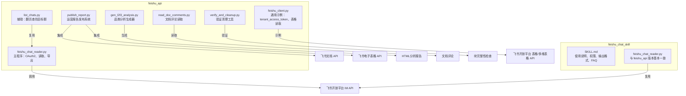
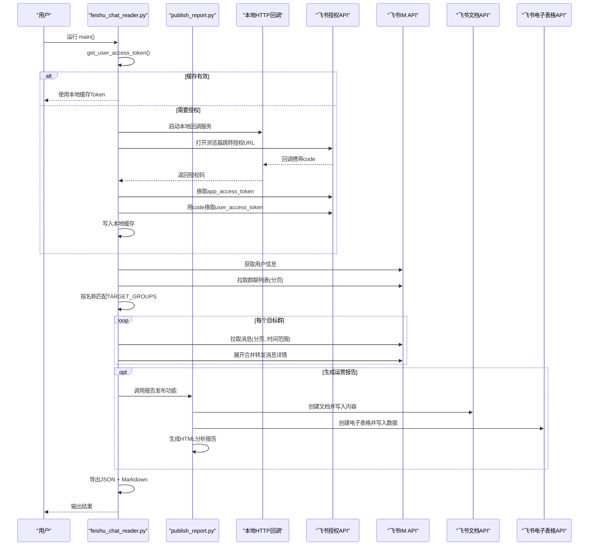
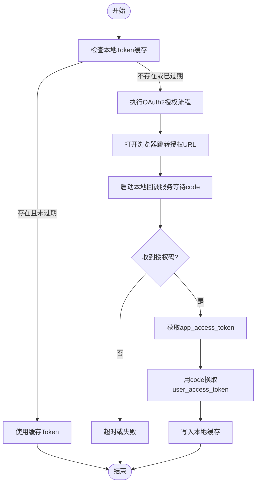
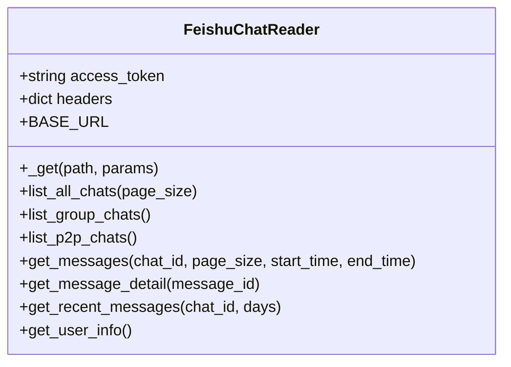
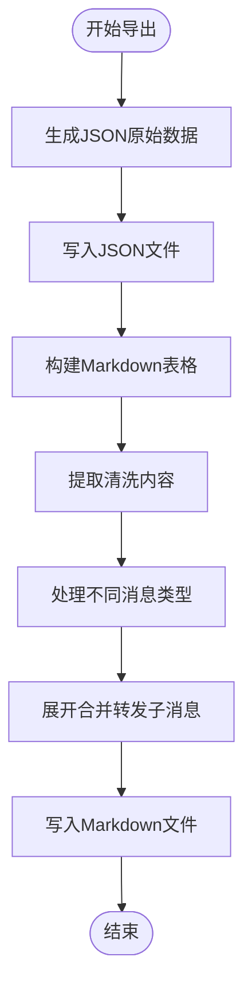
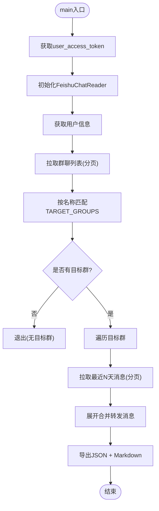
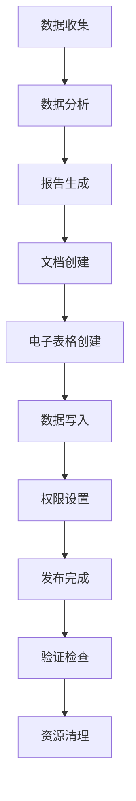
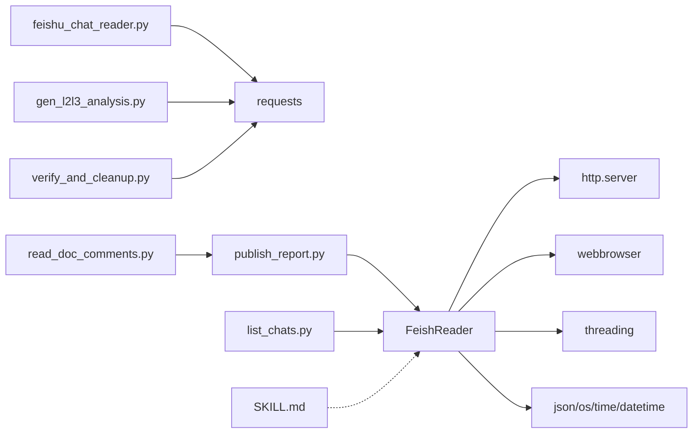

# 飞书聊天消息读取器

<cite>
**本文引用的文件**   
- [feishu_chat_reader.py](file://feishu_api/feishu_chat_reader.py)
- [publish_report.py](file://feishu_api/publish_report.py)
- [gen_l2l3_analysis.py](file://feishu_api/gen_l2l3_analysis.py)
- [read_doc_comments.py](file://feishu_api/read_doc_comments.py)
- [verify_and_cleanup.py](file://feishu_api/verify_and_cleanup.py)
- [list_chats.py](file://feishu_api/list_chats.py)
- [feishu_client.py](file://feishu_api/feishu_client.py)
- [SKILL.md](file://feishu_chat_skill/SKILL.md)
- [README.md](file://README.md)
</cite>

## 更新摘要
**变更内容**   
- 新增了与运营报告系统的深度集成，支持自动化的报告发布和数据收集流程
- 增强了飞书文档和电子表格的自动化处理能力
- 扩展了数据分析和报告生成的功能模块
- 完善了权限管理和协作机制

## 目录
1. [简介](#简介)
2. [项目结构](#项目结构)
3. [核心组件](#核心组件)
4. [架构总览](#架构总览)
5. [详细组件分析](#详细组件分析)
6. [运营报告系统集成](#运营报告系统集成)
7. [依赖关系分析](#依赖关系分析)
8. [性能与限制](#性能与限制)
9. [故障排查](#故障排查)
10. [结论](#结论)
11. [附录：配置与运行](#附录配置与运行)

## 简介
本仓库包含一个"飞书聊天消息读取器"，用于按指定群名读取目标群的消息记录，支持 OAuth2 用户授权、本地 Token 缓存、合并转发消息展开，并将结果导出为 JSON（原始数据）和 Markdown（清洗后的表格）。该工具通过飞书开放平台 IM API 获取聊天列表与消息内容，使用 user_access_token 方式读取当前授权用户的数据。

**新增功能**：现已增强与运营报告系统的深度集成，支持自动化的报告发布和数据收集流程，包括飞书文档创建、电子表格写入、图片上传、权限管理等完整功能。

此外，仓库还包含一个通用的飞书 API 示例脚本，用于演示如何获取 tenant_access_token 并读取电子表格或多维表格；以及一份技能说明文档，描述该读取器的使用方法、权限要求与常见问题。

## 项目结构
围绕"飞书聊天消息读取器"的相关代码主要分布在两个目录：
- feishu_api：实现完整的读取流程、OAuth2 授权、消息读取与格式化、导出功能，并提供运营报告系统集成功能。
- feishu_chat_skill：提供技能说明文档与一份与 feishu_api 中逻辑基本一致的读取器实现，便于作为独立技能或模板使用。

**图表来源**
- [feishu_chat_reader.py:168-329](file://feishu_api/feishu_chat_reader.py#L168-L329)
- [publish_report.py:1-476](file://feishu_api/publish_report.py#L1-L476)
- [gen_l2l3_analysis.py:1-570](file://feishu_api/gen_l2l3_analysis.py#L1-L570)
- [list_chats.py:1-49](file://feishu_api/list_chats.py#L1-L49)
- [feishu_client.py:16-77](file://feishu_api/feishu_client.py#L16-L77)
- [SKILL.md:1-101](file://feishu_chat_skill/SKILL.md#L1-L101)

章节来源
- [feishu_chat_reader.py:1-690](file://feishu_api/feishu_chat_reader.py#L1-L690)
- [publish_report.py:1-476](file://feishu_api/publish_report.py#L1-L476)
- [gen_l2l3_analysis.py:1-570](file://feishu_api/gen_l2l3_analysis.py#L1-L570)
- [list_chats.py:1-49](file://feishu_api/list_chats.py#L1-L49)
- [feishu_client.py:1-98](file://feishu_api/feishu_client.py#L1-L98)
- [SKILL.md:1-101](file://feishu_chat_skill/SKILL.md#L1-L101)

## 核心组件
- OAuth2 授权与 Token 缓存
  - 本地 HTTP 回调服务接收授权码，换取 app_access_token 与 user_access_token，并写入本地缓存文件，有效期内自动复用。
- FeishuChatReader 类
  - 封装飞书 IM API 的 GET 请求，提供聊天列表与消息读取能力，包括分页、时间范围过滤、合并转发消息展开等。
- 消息格式化与导出
  - 将不同消息类型解析为可读文本，支持 text、post、image、file、audio、media、sticker、interactive、system、merge_forward 等类型。
  - 导出 JSON（原始数据）与 Markdown（清洗后表格），Markdown 中包含序号、时间、类型、发送者与内容列。
- 目标群筛选
  - 仅读取 TARGET_GROUPS 中配置的群名，其他群与私聊不会读取。
- **新增** 运营报告系统集成
  - 自动创建飞书文档和电子表格，支持批量数据写入、图片上传、权限管理等功能。
  - 支持 HTML 分析报告生成，包含交互式图表和数据可视化。
- 辅助脚本 list_chats.py
  - 用于翻页列出所有群聊，帮助确认目标群的 chat_id 与名称是否匹配。

章节来源
- [feishu_chat_reader.py:34-163](file://feishu_api/feishu_chat_reader.py#L34-L163)
- [feishu_chat_reader.py:168-329](file://feishu_api/feishu_chat_reader.py#L168-L329)
- [feishu_chat_reader.py:333-439](file://feishu_api/feishu_chat_reader.py#L333-L439)
- [feishu_chat_reader.py:441-690](file://feishu_api/feishu_chat_reader.py#L441-L690)
- [publish_report.py:1-476](file://feishu_api/publish_report.py#L1-L476)
- [gen_l2l3_analysis.py:1-570](file://feishu_api/gen_l2l3_analysis.py#L1-L570)
- [list_chats.py:1-49](file://feishu_api/list_chats.py#L1-L49)

## 架构总览
整体流程如下：
1. 启动程序，尝试从本地缓存读取 user_access_token；若过期或缺失，则进入 OAuth2 授权流程。
2. 打开浏览器跳转到飞书授权页面，用户在本地回调端口完成授权，程序获取授权码。
3. 用授权码换取 user_access_token，并写入本地缓存。
4. 初始化 FeishuChatReader，获取当前用户信息。
5. 拉取群聊列表，按名称精确匹配 TARGET_GROUPS。
6. 对每个目标群，拉取最近 N 天的消息，自动展开合并转发消息。
7. **新增** 可选地生成运营报告，包括飞书文档创建、电子表格写入、HTML 分析报告生成。
8. 导出 JSON 与 Markdown 结果。

**图表来源**
- [feishu_chat_reader.py:57-163](file://feishu_api/feishu_chat_reader.py#L57-L163)
- [feishu_chat_reader.py:168-329](file://feishu_api/feishu_chat_reader.py#L168-L329)
- [publish_report.py:386-476](file://feishu_api/publish_report.py#L386-L476)
- [feishu_chat_reader.py:598-690](file://feishu_api/feishu_chat_reader.py#L598-L690)

## 详细组件分析

### OAuth2 授权与 Token 缓存
- 本地回调处理器
  - 监听本地端口，接收授权码，设置到类属性以便主流程获取。
- 获取 user_access_token
  - 优先从本地缓存读取，若未过期则直接复用；否则执行完整授权流程。
- 授权流程
  - 打开浏览器访问飞书授权 URL。
  - 启动本地 HTTP 服务等待回调。
  - 用 app_id/app_secret 获取 app_access_token。
  - 用 code 换取 user_access_token。
  - 将 token 与过期时间写入本地缓存文件。

**图表来源**
- [feishu_chat_reader.py:34-163](file://feishu_api/feishu_chat_reader.py#L34-L163)

章节来源
- [feishu_chat_reader.py:34-163](file://feishu_api/feishu_chat_reader.py#L34-L163)

### FeishuChatReader 类
- 基础请求封装
  - 统一处理 GET 请求，打印错误响应以便调试。
- 聊天列表
  - list_all_chats：获取所有聊天（群聊+私聊），自动分页。
  - list_group_chats：只获取群聊，自动分页。
  - list_p2p_chats：过滤出私聊。
- 消息读取
  - get_messages：按 chat_id 拉取消息，支持分页与时间范围过滤。
  - get_message_detail：获取单条消息详情，用于展开合并转发消息。
  - get_recent_messages：拉取最近 N 天消息，并自动展开合并转发消息。
- 用户信息
  - get_user_info：获取当前授权用户基本信息。

**图表来源**
- [feishu_chat_reader.py:168-329](file://feishu_api/feishu_chat_reader.py#L168-L329)

章节来源
- [feishu_chat_reader.py:168-329](file://feishu_api/feishu_chat_reader.py#L168-L329)

### 消息格式化与导出
- format_message
  - 将消息体解析为可读文本，支持多种消息类型，并对合并转发消息进行子消息拼接。
- _extract_clean_content
  - 提取清洗后的纯文本内容，用于 Markdown 表格展示。
- export_to_file
  - 导出 JSON（原始数据）与 Markdown（清洗后表格），Markdown 中包含表头与多行数据，合并转发的子消息会作为缩进行显示。

**图表来源**
- [feishu_chat_reader.py:333-439](file://feishu_api/feishu_chat_reader.py#L333-L439)
- [feishu_chat_reader.py:453-530](file://feishu_api/feishu_chat_reader.py#L453-L530)
- [feishu_chat_reader.py:533-596](file://feishu_api/feishu_chat_reader.py#L533-L596)

章节来源
- [feishu_chat_reader.py:333-439](file://feishu_api/feishu_chat_reader.py#L333-L439)
- [feishu_chat_reader.py:453-530](file://feishu_api/feishu_chat_reader.py#L453-L530)
- [feishu_chat_reader.py:533-596](file://feishu_api/feishu_chat_reader.py#L533-L596)

### 目标群筛选与主流程
- TARGET_GROUPS
  - 配置要读取的群名列表，程序仅读取这些群的消息。
- READ_DAYS
  - 控制读取最近多少天的消息。
- main
  - 获取用户信息、拉取群聊列表、按名称匹配目标群、逐个拉取消息、导出结果。

**图表来源**
- [feishu_chat_reader.py:441-449](file://feishu_api/feishu_chat_reader.py#L441-L449)
- [feishu_chat_reader.py:598-690](file://feishu_api/feishu_chat_reader.py#L598-L690)

章节来源
- [feishu_chat_reader.py:441-449](file://feishu_api/feishu_chat_reader.py#L441-L449)
- [feishu_chat_reader.py:598-690](file://feishu_api/feishu_chat_reader.py#L598-L690)

### 辅助脚本 list_chats.py
- 作用
  - 使用 user_access_token 拉取所有群聊，帮助确认目标群名称与 chat_id。
- 特点
  - 简单直接的请求与分页逻辑，便于快速定位目标群。

章节来源
- [list_chats.py:1-49](file://feishu_api/list_chats.py#L1-L49)

### 通用示例 feishu_client.py
- 作用
  - 演示如何使用 tenant_access_token 读取飞书电子表格与多维表格。
- 注意
  - 该脚本与聊天读取器使用的认证方式不同（tenant_access_token vs user_access_token），适用于不同的业务场景。

章节来源
- [feishu_client.py:16-77](file://feishu_api/feishu_client.py#L16-L77)

## 运营报告系统集成

### 概述
新增的运营报告系统集成提供了完整的自动化报告发布和数据收集流程，包括飞书文档创建、电子表格写入、HTML 分析报告生成等功能。

### 核心功能模块

#### 1. 飞书文档管理 (publish_report.py)
- 文档创建与内容写入
  - 自动创建飞书文档，支持标题、文本、链接、图片等多种内容类型。
  - 支持批量追加内容块，提高 API 调用效率。
- 电子表格操作
  - 创建和管理电子表格，支持多工作表管理。
  - 批量写入 CSV 数据，支持大数据量分块处理。
- 权限管理
  - 自动设置文档和电子表格的分享权限。
  - 支持协作者管理，确保授权用户具有适当权限。

#### 2. 数据分析生成器 (gen_l2l3_analysis.py)
- 二级/三级品类分析
  - 自动生成 HTML 格式的分析报告，包含交互式图表。
  - 支持多维度数据分析：整体概览、下钻分析、趋势分析、对比分析、交叉分析。
- 数据可视化
  - 集成 Chart.js 库，生成丰富的图表类型：环形图、柱状图、折线图、散点图等。
  - 支持响应式设计，适配不同屏幕尺寸。

#### 3. 文档评论读取 (read_doc_comments.py)
- 评论数据收集
  - 自动读取飞书文档的全部评论及回复。
  - 支持分页获取大量评论数据。
- 数据处理与导出
  - 将评论数据转换为可读格式，便于后续分析。

#### 4. 验证与清理工具 (verify_and_cleanup.py)
- 文档完整性验证
  - 校验已发布文档的块结构和内容完整性。
  - 统计不同类型的块数量，确保数据正确性。
- 资源清理
  - 自动删除遗留的测试文档和电子表格。
  - 维护系统资源的整洁性。

### 工作流程

**图表来源**
- [publish_report.py:386-476](file://feishu_api/publish_report.py#L386-L476)
- [gen_l2l3_analysis.py:451-570](file://feishu_api/gen_l2l3_analysis.py#L451-L570)
- [read_doc_comments.py:19-66](file://feishu_api/read_doc_comments.py#L19-L66)
- [verify_and_cleanup.py:26-72](file://feishu_api/verify_and_cleanup.py#L26-L72)

章节来源
- [publish_report.py:1-476](file://feishu_api/publish_report.py#L1-L476)
- [gen_l2l3_analysis.py:1-570](file://feishu_api/gen_l2l3_analysis.py#L1-L570)
- [read_doc_comments.py:1-66](file://feishu_api/read_doc_comments.py#L1-L66)
- [verify_and_cleanup.py:1-72](file://feishu_api/verify_and_cleanup.py#L1-L72)

## 依赖关系分析
- 内部依赖
  - feishu_chat_reader.py 定义 OAuth2 授权、FeishuChatReader 类、消息格式化与导出函数，并在 main 中串联整个流程。
  - publish_report.py 依赖 feishu_chat_reader.py 的 OAuth2 功能，提供运营报告发布能力。
  - gen_l2l3_analysis.py 生成 HTML 分析报告，与 publish_report.py 协同工作。
  - read_doc_comments.py 和 verify_and_cleanup.py 提供辅助功能，增强系统完整性。
  - list_chats.py 复用 get_user_access_token 以获取 user_access_token，然后直接调用飞书 IM API 拉取群聊列表。
  - feishu_chat_skill/SKILL.md 提供使用说明，不直接依赖代码，但描述了与 feishu_api 版本一致的功能。
- 外部依赖
  - requests：发起 HTTP 请求。
  - http.server：本地回调服务。
  - webbrowser：打开浏览器跳转授权页面。
  - threading：在授权流程中启动本地回调服务线程。
  - json、os、time、datetime：标准库用于数据处理与时间操作。
  - csv、io：CSV 文件处理和输入输出操作。
  - argparse：命令行参数解析。

**图表来源**
- [feishu_chat_reader.py:17-28](file://feishu_api/feishu_chat_reader.py#L17-L28)
- [publish_report.py:12-16](file://feishu_api/publish_report.py#L12-L16)
- [gen_l2l3_analysis.py:19-22](file://feishu_api/gen_l2l3_analysis.py#L19-L22)
- [read_doc_comments.py:3-8](file://feishu_api/read_doc_comments.py#L3-L8)
- [verify_and_cleanup.py:3-8](file://feishu_api/verify_and_cleanup.py#L3-L8)
- [list_chats.py:1-49](file://feishu_api/list_chats.py#L1-L49)
- [SKILL.md:1-101](file://feishu_chat_skill/SKILL.md#L1-L101)

章节来源
- [feishu_chat_reader.py:17-28](file://feishu_api/feishu_chat_reader.py#L17-L28)
- [publish_report.py:12-16](file://feishu_api/publish_report.py#L12-L16)
- [gen_l2l3_analysis.py:19-22](file://feishu_api/gen_l2l3_analysis.py#L19-L22)
- [read_doc_comments.py:3-8](file://feishu_api/read_doc_comments.py#L3-L8)
- [verify_and_cleanup.py:3-8](file://feishu_api/verify_and_cleanup.py#L3-L8)
- [list_chats.py:1-49](file://feishu_api/list_chats.py#L1-L49)
- [SKILL.md:1-101](file://feishu_chat_skill/SKILL.md#L1-L101)

## 性能与限制
- 分页拉取
  - 聊天列表与消息均支持分页，避免一次性拉取大量数据导致内存与网络压力。
- 频率限制
  - 在展开合并转发消息时加入短暂休眠，降低触发频率限制的风险。
  - 运营报告发布过程中也加入了适当的延迟，避免 API 限流。
- Token 缓存
  - 本地缓存有效期为 user_access_token 的剩余时间，减少重复授权开销。
- 消息类型处理
  - 对富文本、图片、文件、语音、视频、表情包、卡片、系统消息、合并转发等进行差异化处理，提升可读性。
- **新增** 批量处理优化
  - 运营报告系统中的文档内容追加采用批量提交策略，提高 API 调用效率。
  - 电子表格数据写入支持分块处理，避免单次请求过大。

[本节为通用指导，不直接分析具体文件]

## 故障排查
- 重定向 URL 错误
  - 确保在飞书应用「安全设置」中添加回调地址 http://localhost:8899/callback。
- 返回 0 个群聊
  - 检查权限是否已发布生效，确认应用权限包含 im:chat:readonly。
  - 群名必须与飞书中完全一致（区分大小写和空格）。
- Token 过期
  - Token 缓存有效期约 2 小时，过期后会自动重新弹出浏览器授权。
- API 错误
  - 查看控制台输出的完整响应，确认错误码与提示信息。
- **新增** 运营报告相关故障
  - 文档创建失败：检查飞书文档 API 权限和连接状态。
  - 电子表格写入错误：确认数据格式正确，检查行列数是否符合预期。
  - 权限设置问题：验证用户是否具有相应的文档和电子表格操作权限。
  - HTML 报告生成异常：检查 Chart.js CDN 连接和数据格式正确性。

章节来源
- [SKILL.md:89-101](file://feishu_chat_skill/SKILL.md#L89-L101)
- [feishu_chat_reader.py:177-186](file://feishu_api/feishu_chat_reader.py#L177-L186)
- [publish_report.py:90-115](file://feishu_api/publish_report.py#L90-L115)

## 结论
该"飞书聊天消息读取器"提供了从授权、拉取、格式化到导出的完整闭环，适合用于按指定群名读取聊天记录并进行后续分析。其设计清晰、模块化良好，具备分页、缓存、消息类型扩展与可观测性（日志输出）等特性。

**重大升级**：通过与运营报告系统的深度集成，现在支持自动化的报告发布和数据收集流程，包括飞书文档创建、电子表格写入、HTML 分析报告生成等完整功能。配合辅助脚本与技能文档，用户可以快速上手并完成常见任务，同时享受自动化报告生成的便利。

[本节为总结性内容，不直接分析具体文件]

## 附录：配置与运行
- 创建飞书应用并申请权限
  - 在飞书开放平台创建应用，申请 im:chat、im:chat:readonly、im:message、im:message:readonly 权限。
  - **新增** 如需使用运营报告功能，还需申请 docx、sheets 等相关权限。
- 配置回调地址
  - 添加 http://localhost:8899/callback 到应用「安全设置」。
- 安装依赖
  - 根据 requirements.txt 安装依赖。
- 配置凭证
  - 复制 config.py.example 为 config.py，填入 APP_ID 与 APP_SECRET。
- 配置目标群
  - 修改 TARGET_GROUPS 为你要读取的群名。
- 运行程序
  - 首次运行会打开浏览器完成授权，随后拉取目标群最近 N 天的消息并导出 JSON 与 Markdown。
- **新增** 运营报告功能运行
  - 运行 `python publish_report.py` 自动生成飞书文档和电子表格。
  - 运行 `python gen_l2l3_analysis.py` 生成 HTML 分析报告。
  - 使用 `python read_doc_comments.py` 读取文档评论数据。
  - 使用 `python verify_and_cleanup.py` 验证文档完整性或清理遗留资源。

章节来源
- [SKILL.md:10-76](file://feishu_chat_skill/SKILL.md#L10-L76)
- [feishu_chat_reader.py:441-449](file://feishu_api/feishu_chat_reader.py#L441-L449)
- [feishu_chat_reader.py:598-690](file://feishu_api/feishu_chat_reader.py#L598-L690)
- [publish_report.py:18-24](file://feishu_api/publish_report.py#L18-L24)
- [gen_l2l3_analysis.py:24-29](file://feishu_api/gen_l2l3_analysis.py#L24-L29)
- [read_doc_comments.py:64-66](file://feishu_api/read_doc_comments.py#L64-L66)
- [verify_and_cleanup.py:70-72](file://feishu_api/verify_and_cleanup.py#L70-L72)