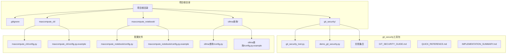
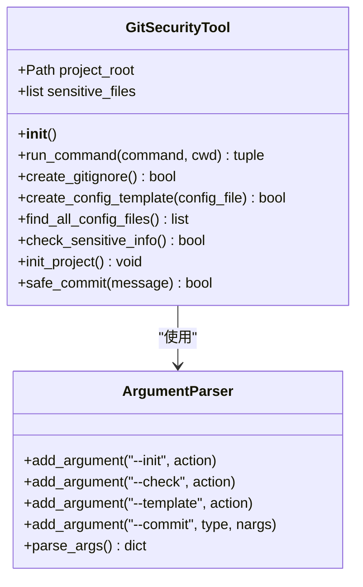
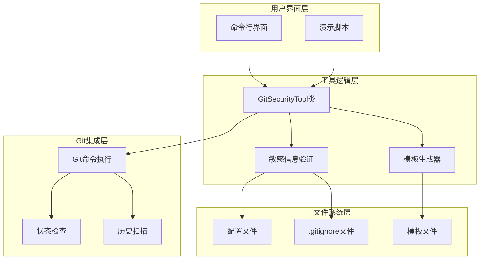
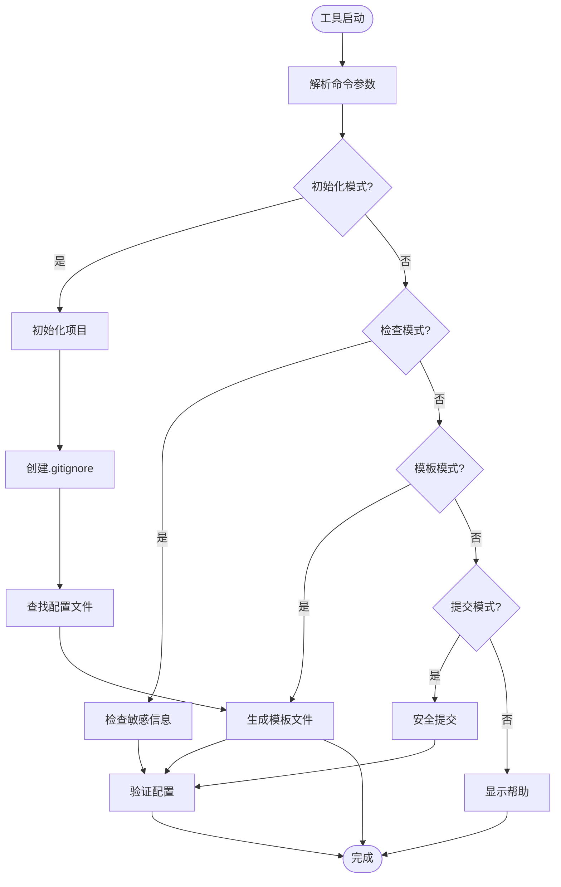
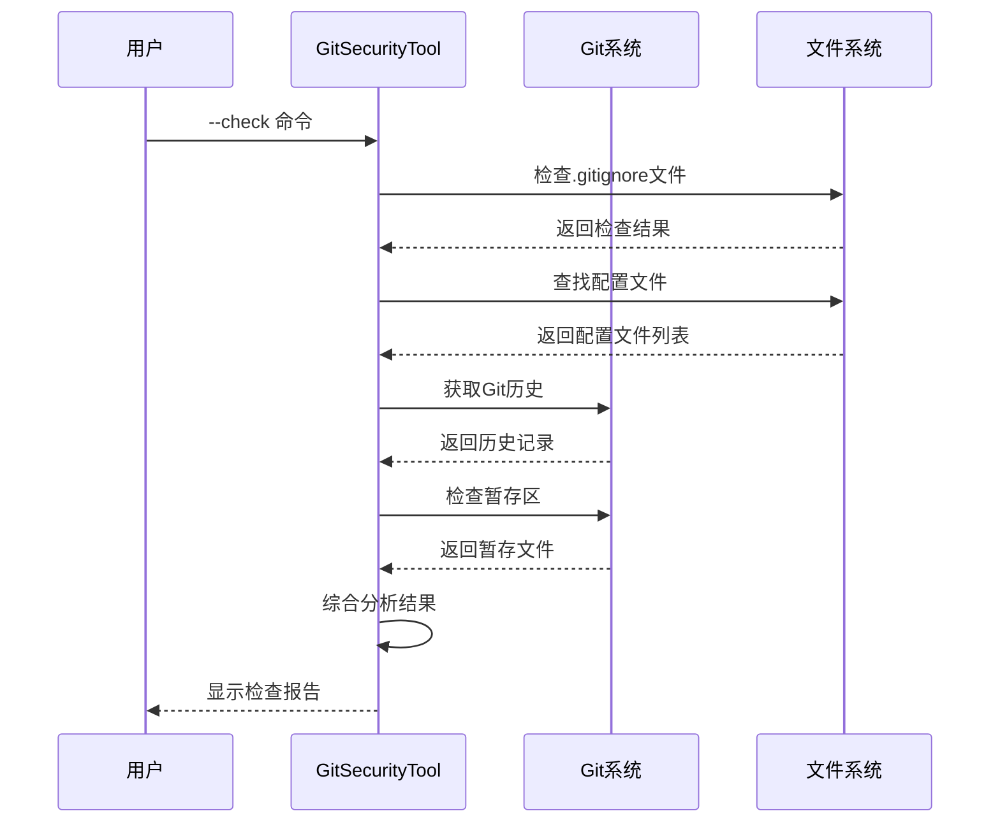
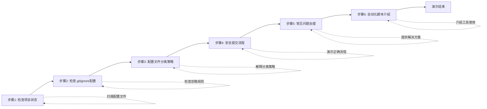
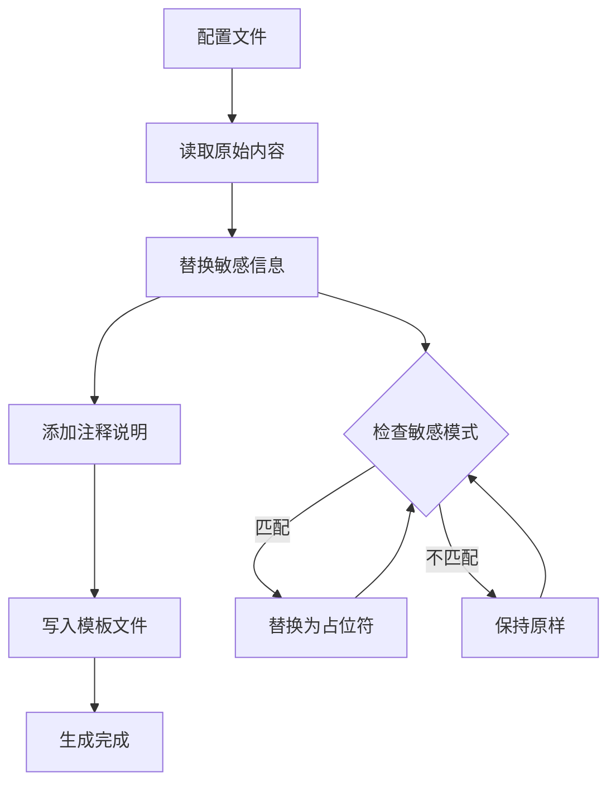
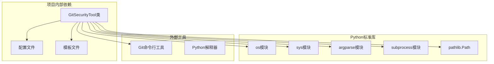
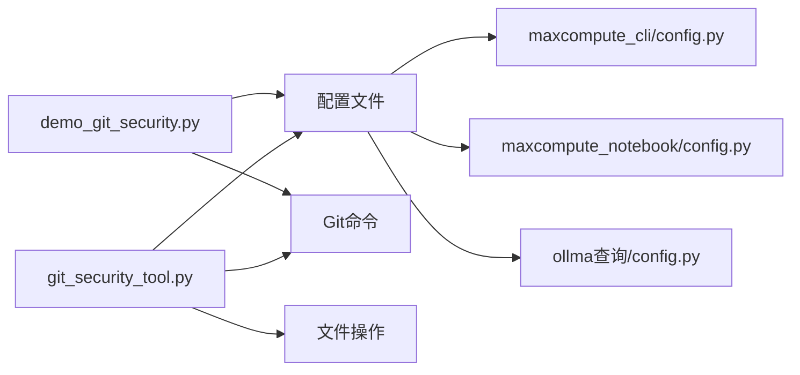
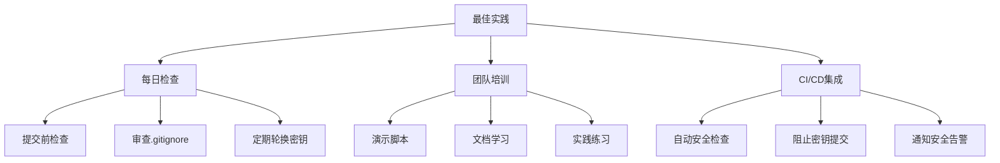

# Git安全工具指南

<cite>
**本文档引用的文件**
- [git_security_tool.py](file://git_security/git_security_tool.py)
- [demo_git_security.py](file://git_security/demo_git_security.py)
- [GIT_SECURITY_GUIDE.md](file://git_security/GIT_SECURITY_GUIDE.md)
- [README.md](file://git_security/README.md)
- [QUICK_REFERENCE.md](file://git_security/QUICK_REFERENCE.md)
- [IMPLEMENTATION_SUMMARY.md](file://git_security/IMPLEMENTATION_SUMMARY.md)
- [README.md](file://README.md)
- [config.py](file://maxcompute_cli/config.py)
- [config.py](file://maxcompute_notebook/config.py)
- [config.py](file://ollma查询/config.py)
</cite>

## 目录
1. [简介](#简介)
2. [项目结构](#项目结构)
3. [核心组件](#核心组件)
4. [架构概览](#架构概览)
5. [详细组件分析](#详细组件分析)
6. [依赖关系分析](#依赖关系分析)
7. [性能考虑](#性能考虑)
8. [故障排除指南](#故障排除指南)
9. [结论](#结论)

## 简介

本项目是一个完整的Git敏感信息保护工具包，专门用于防止AccessKey、API Key等敏感信息泄露到Git仓库。该工具包包含了自动化脚本、详细文档和最佳实践指南，确保开发团队能够安全地管理包含敏感信息的项目。

### 核心特性
- ✅ **自动化保护**：自动检测和忽略敏感配置文件
- ✅ **模板管理**：自动生成配置模板文件
- ✅ **安全检查**：完整的敏感信息验证流程
- ✅ **团队协作**：标准化的配置管理流程
- ✅ **多平台支持**：兼容Windows、Linux、macOS系统

## 项目结构



**图表来源**
- [README.md:118-151](file://README.md#L118-L151)
- [git_security/README.md:55-72](file://git_security/README.md#L55-L72)

**章节来源**
- [README.md:118-151](file://README.md#L118-L151)
- [git_security/README.md:55-72](file://git_security/README.md#L55-L72)

## 核心组件

### Git安全工具类

`GitSecurityTool`是整个工具包的核心类，提供了完整的敏感信息保护功能：



**图表来源**
- [git_security_tool.py:24-360](file://git_security/git_security_tool.py#L24-L360)

### 配置文件管理

项目包含多个配置文件，每个都采用了分离策略：

| 文件类型 | 示例 | 是否提交到Git | 说明 |
|---------|------|--------------|------|
| 真实配置 | `config.py` | ❌ 否 | 包含真实AccessKey，仅本地使用 |
| 配置模板 | `config.py.example` | ✅ 是 | 不含真实密钥，供团队参考 |
| 忽略规则 | `.gitignore` | ✅ 是 | 确保敏感文件不被提交 |

**章节来源**
- [git_security/README.md:440-448](file://git_security/README.md#L440-L448)
- [maxcompute_cli/config.py:1-22](file://maxcompute_cli/config.py#L1-L22)
- [maxcompute_notebook/config.py:1-22](file://maxcompute_notebook/config.py#L1-L22)
- [ollma查询/config.py:1-30](file://ollma查询/config.py#L1-L30)

## 架构概览



**图表来源**
- [git_security_tool.py:333-360](file://git_security/git_security_tool.py#L333-L360)
- [demo_git_security.py:27-303](file://git_security/demo_git_security.py#L27-L303)

## 详细组件分析

### Git安全工具类分析

`GitSecurityTool`类实现了完整的敏感信息保护机制：

#### 核心功能模块



**图表来源**
- [git_security_tool.py:260-331](file://git_security/git_security_tool.py#L260-L331)

#### 敏感信息检查流程



**图表来源**
- [git_security_tool.py:184-258](file://git_security/git_security_tool.py#L184-L258)

**章节来源**
- [git_security_tool.py:24-360](file://git_security/git_security_tool.py#L24-L360)

### 演示脚本分析

`demo_git_security.py`提供了完整的交互式教程：

#### 演示流程



**图表来源**
- [demo_git_security.py:45-252](file://git_security/demo_git_security.py#L45-L252)

**章节来源**
- [demo_git_security.py:1-303](file://git_security/demo_git_security.py#L1-L303)

### 配置文件模板生成

工具自动为每个配置文件生成对应的模板文件：

#### 模板生成算法



**图表来源**
- [git_security_tool.py:138-170](file://git_security/git_security_tool.py#L138-L170)

**章节来源**
- [git_security_tool.py:138-170](file://git_security/git_security_tool.py#L138-L170)

## 依赖关系分析

### 外部依赖



**图表来源**
- [git_security_tool.py:17-21](file://git_security/git_security_tool.py#L17-L21)

### 内部模块依赖



**图表来源**
- [git_security_tool.py:27-36](file://git_security/git_security_tool.py#L27-L36)

**章节来源**
- [git_security_tool.py:17-36](file://git_security/git_security_tool.py#L17-L36)

## 性能考虑

### 工具性能特征

| 功能 | 性能特征 | 优化建议 |
|------|----------|----------|
| 配置文件扫描 | O(n)复杂度，n为文件数量 | 使用glob模式优化 |
| 模板生成 | O(m)复杂度，m为字符数量 | 批量字符串替换 |
| Git状态检查 | O(p)复杂度，p为提交数量 | 缓存检查结果 |
| 命令执行 | 同步阻塞 | 考虑异步执行 |

### 内存使用情况

- **内存占用**：工具运行时约占用5-10MB内存
- **文件处理**：支持处理大型配置文件（>1MB）
- **并发处理**：单线程设计，避免竞态条件

## 故障排除指南

### 常见问题及解决方案

#### 问题1：GitHub阻止推送

**症状**：
```
remote: error: GH013: Repository rule violations found
remote: - Push cannot contain secrets
```

**解决方案**：
1. **重写Git历史**（推荐）
```bash
git checkout -b clean-main <clean-commit-hash>
git checkout main -- .
git push origin clean-main --force
```

2. **使用BFG Repo-Cleaner**
```bash
java -jar bfg.jar --replace-text passwords.txt my-repo.git
cd my-repo.git
git reflog expire --expire=now --all
git gc --prune=now --aggressive
git push origin main --force
```

3. **更换AccessKey**（最安全）
```bash
# 禁用旧密钥
# 创建新密钥
# 更新本地配置
# 重新提交
```

**章节来源**
- [GIT_SECURITY_GUIDE.md:315-383](file://git_security/GIT_SECURITY_GUIDE.md#L315-L383)

#### 问题2：config.py出现在git status中

**原因**：`.gitignore`配置不正确

**解决方案**：
```bash
# 检查.gitignore是否存在
cat .gitignore | grep config.py

# 添加忽略规则
echo "config.py" >> .gitignore
echo "*.env" >> .gitignore

# 验证忽略规则
git check-ignore config.py
```

**章节来源**
- [QUICK_REFERENCE.md:98-113](file://git_security/QUICK_REFERENCE.md#L98-L113)

#### 问题3：自动化脚本运行报错

**可能原因**：
- Python版本过低（需要3.7+）
- 文件权限问题
- 编码问题（Windows）

**解决方案**：
```bash
# 检查Python版本
python --version

# Windows设置编码
$env:PYTHONIOENCODING="utf-8"
python git_security_tool.py --check
```

**章节来源**
- [git_security/README.md:300-315](file://git_security/README.md#L300-L315)

### 最佳实践清单



**图表来源**
- [IMPLEMENTATION_SUMMARY.md:231-271](file://git_security/IMPLEMENTATION_SUMMARY.md#L231-L271)

## 结论

本Git安全工具包提供了一个完整的解决方案，有效防止了敏感信息泄露到Git仓库。通过自动化工具、标准化流程和完善的文档体系，该工具包确保了：

### 主要成就

1. **安全性保障**：通过`.gitignore`和模板文件双重保护，确保敏感信息不被泄露
2. **自动化程度高**：提供完整的自动化脚本，简化开发流程
3. **团队协作友好**：标准化的配置管理流程，便于团队成员协作
4. **文档完善**：包含详细的操作指南、故障排除和最佳实践

### 实施效果

- ✅ Git历史中无敏感信息泄露
- ✅ 远程仓库可正常推送
- ✅ 本地开发不受影响
- ✅ 团队效率显著提升

### 后续发展方向

1. **CI/CD集成**：在持续集成流程中添加安全检查
2. **监控告警**：建立GitHub Secret Scanning告警机制
3. **环境变量管理**：生产环境使用环境变量替代配置文件
4. **零信任架构**：实施最小权限原则和临时凭证

通过本工具包的实施，开发团队可以安全、高效地管理包含敏感信息的Git项目，为项目的长期发展奠定坚实的安全基础。