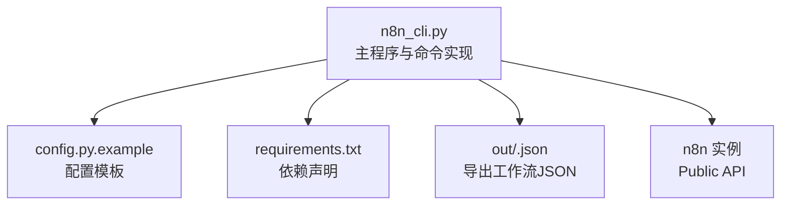
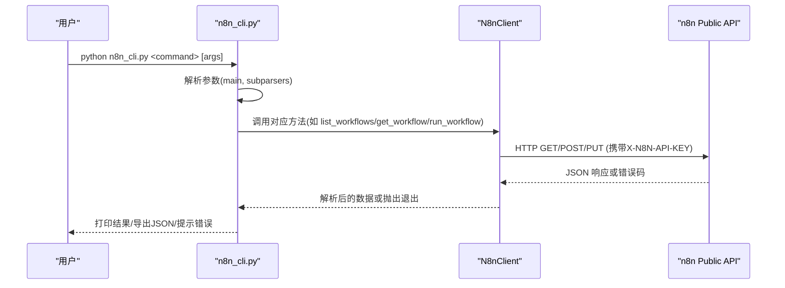
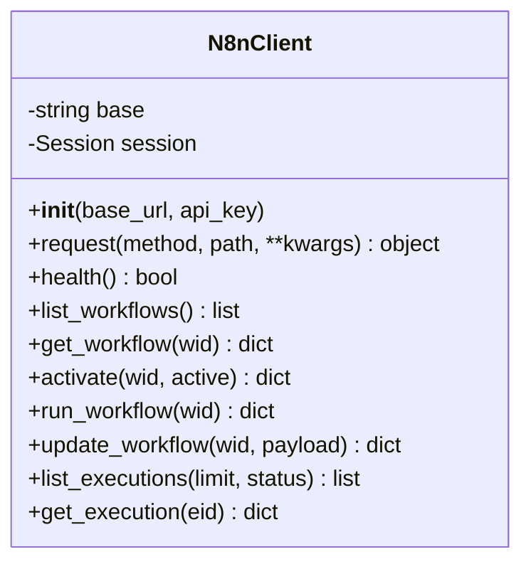
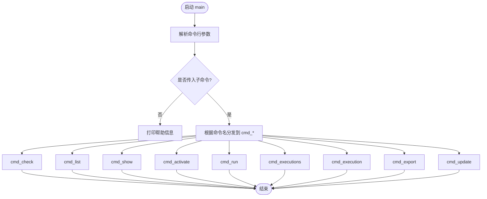
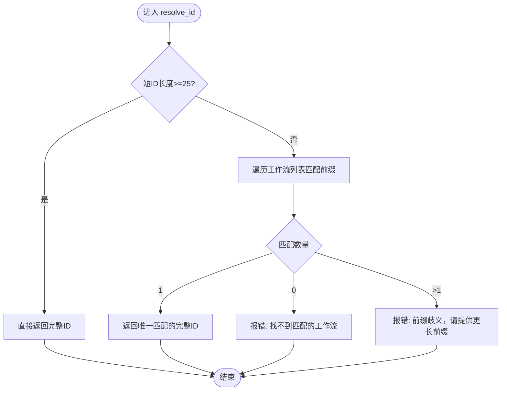
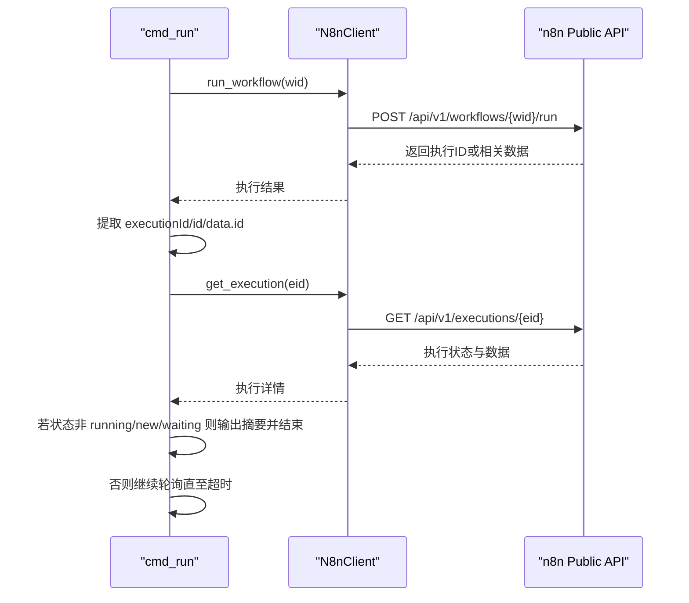
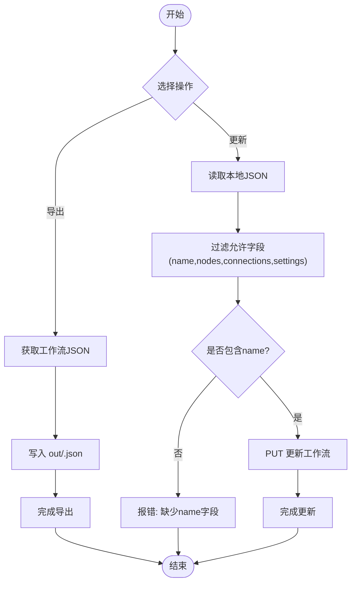
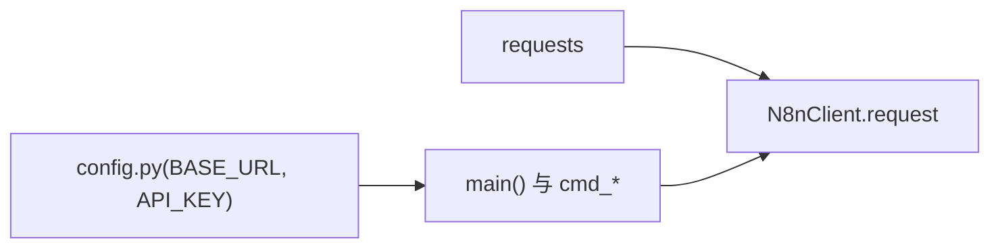

# n8n工作流CLI工具

<cite>
**本文引用的文件**   
- [n8n_cli.py](file://n8n_cli/n8n_cli.py)
- [config.py.example](file://n8n_cli/config.py.example)
- [requirements.txt](file://n8n_cli/requirements.txt)
</cite>

## 目录
1. [简介](#简介)
2. [项目结构](#项目结构)
3. [核心组件](#核心组件)
4. [架构总览](#架构总览)
5. [详细组件分析](#详细组件分析)
6. [依赖关系分析](#依赖关系分析)
7. [性能与可靠性](#性能与可靠性)
8. [故障排查指南](#故障排查指南)
9. [结论](#结论)
10. [附录：命令参考](#附录命令参考)

## 简介
本仓库中的 n8n_cli 是一个基于 Python 的命令行工具，用于通过企业版 n8n 提供的公共 API 远程管理 n8n 工作流。它无需在本地安装 n8n，即可执行以下操作：检查连接与鉴权、列出工作流、查看工作流详情、激活/停用工作流、触发执行并等待结果、查询执行记录、导出/更新工作流 JSON。

该工具适合运维人员、数据工程师或自动化平台使用者，在日常工作中快速对远端 n8n 实例进行轻量级管理与排障。

## 项目结构
n8n_cli 目录采用“单脚本 + 配置模板 + 依赖声明”的极简组织方式：
- n8n_cli.py：主程序，包含 HTTP 客户端封装、命令解析与各子命令实现。
- config.py.example：配置模板，提供 BASE_URL、API_KEY 等参数。
- requirements.txt：声明第三方依赖 requests。
- out：默认导出目录，存放导出的工作流 JSON 文件。

图表来源
- [n8n_cli.py:1-312](file://n8n_cli/n8n_cli.py#L1-L312)
- [config.py.example:1-16](file://n8n_cli/config.py.example#L1-L16)
- [requirements.txt:1-2](file://n8n_cli/requirements.txt#L1-L2)

章节来源
- [n8n_cli.py:1-312](file://n8n_cli/n8n_cli.py#L1-L312)
- [config.py.example:1-16](file://n8n_cli/config.py.example#L1-L16)
- [requirements.txt:1-2](file://n8n_cli/requirements.txt#L1-L2)

## 核心组件
- N8nClient：封装与 n8n Public API 的 HTTP 通信，统一处理鉴权头、超时、错误码与响应体解析。
- 命令处理器：基于 argparse 的子命令体系，将用户输入映射到具体业务函数（check/list/show/activate/run/executions/execution/export/update）。
- ID 解析器 resolve_id：支持使用短前缀自动匹配完整工作流 ID，提升易用性。
- 配置加载：从同目录 config.py 读取 BASE_URL 与 API_KEY。

关键职责划分：
- 网络层：N8nClient.request 负责请求发送、状态码判断与异常输出。
- 业务层：各 cmd_* 函数组合 N8nClient 方法完成具体任务。
- 交互层：main 函数负责参数解析与命令分发。

章节来源
- [n8n_cli.py:51-110](file://n8n_cli/n8n_cli.py#L51-L110)
- [n8n_cli.py:114-260](file://n8n_cli/n8n_cli.py#L114-L260)
- [n8n_cli.py:263-311](file://n8n_cli/n8n_cli.py#L263-L311)

## 架构总览
下图展示 CLI 与 n8n 实例之间的交互流程：用户通过命令行调用，程序解析参数后构造 HTTP 请求，n8n 返回工作流或执行记录数据，CLI 再格式化输出或写入文件。

图表来源
- [n8n_cli.py:51-110](file://n8n_cli/n8n_cli.py#L51-L110)
- [n8n_cli.py:263-311](file://n8n_cli/n8n_cli.py#L263-L311)

## 详细组件分析

### N8nClient 类
N8nClient 是 CLI 的网络抽象，集中管理会话、请求头、超时与错误处理，并提供工作流与执行记录的常用接口。

图表来源
- [n8n_cli.py:51-110](file://n8n_cli/n8n_cli.py#L51-L110)

要点说明：
- 会话与会话头：使用 requests.Session 复用连接，设置 X-N8N-API-KEY 与 Accept 头。
- 统一请求封装：request 方法统一处理 401/404/其他 4xx 错误，并尝试输出错误详情。
- 健康检查：health 直接访问 /healthz 判断实例可达性。
- 工作流接口：list/get/activate/run/update。
- 执行记录接口：list/get。

章节来源
- [n8n_cli.py:51-110](file://n8n_cli/n8n_cli.py#L51-L110)

### 命令解析与分发
main 函数使用 argparse 定义子命令与参数，并将命令名映射到对应的处理函数。

图表来源
- [n8n_cli.py:263-311](file://n8n_cli/n8n_cli.py#L263-L311)

章节来源
- [n8n_cli.py:263-311](file://n8n_cli/n8n_cli.py#L263-L311)

### 工作流ID解析逻辑
resolve_id 支持短前缀匹配，提高命令输入的便捷性；当匹配不唯一或缺失时给出明确错误提示并退出。

图表来源
- [n8n_cli.py:34-46](file://n8n_cli/n8n_cli.py#L34-L46)

章节来源
- [n8n_cli.py:34-46](file://n8n_cli/n8n_cli.py#L34-L46)

### 触发执行与等待完成
run 命令会触发工作流执行，并在 --wait 模式下轮询执行状态，直到非运行态或超时。

图表来源
- [n8n_cli.py:173-196](file://n8n_cli/n8n_cli.py#L173-L196)
- [n8n_cli.py:199-205](file://n8n_cli/n8n_cli.py#L199-L205)

章节来源
- [n8n_cli.py:173-196](file://n8n_cli/n8n_cli.py#L173-L196)
- [n8n_cli.py:199-205](file://n8n_cli/n8n_cli.py#L199-L205)

### 导出与更新工作流
export 将远程工作流 JSON 保存到本地 out 目录；update 从本地 JSON 文件更新远程工作流，仅允许提交服务端 schema 允许的字段。

图表来源
- [n8n_cli.py:239-260](file://n8n_cli/n8n_cli.py#L239-L260)

章节来源
- [n8n_cli.py:239-260](file://n8n_cli/n8n_cli.py#L239-L260)

## 依赖关系分析
- 外部依赖：requests >= 2.28.0，用于 HTTP 请求。
- 内部依赖：config.py（由 config.py.example 复制而来）提供 BASE_URL 与 API_KEY。
- 标准库：argparse、json、os、sys、time。

图表来源
- [requirements.txt:1-2](file://n8n_cli/requirements.txt#L1-L2)
- [config.py.example:1-16](file://n8n_cli/config.py.example#L1-L16)
- [n8n_cli.py:19-28](file://n8n_cli/n8n_cli.py#L19-L28)

章节来源
- [requirements.txt:1-2](file://n8n_cli/requirements.txt#L1-L2)
- [config.py.example:1-16](file://n8n_cli/config.py.example#L1-L16)
- [n8n_cli.py:19-28](file://n8n_cli/n8n_cli.py#L19-L28)

## 性能与可靠性
- 连接复用：使用 requests.Session 减少握手开销，提升多次 API 调用的效率。
- 超时控制：HTTP 请求默认超时 30 秒，健康检查 15 秒，避免长时间阻塞。
- 错误收敛：统一错误处理，对 401/404/其他 4xx 进行友好提示，便于快速定位问题。
- 轮询限制：run --wait 最多轮询 60 次、每次间隔 2 秒，总计约 120 秒，防止无限等待。
- 字段白名单：update 仅提交 ALLOWED_KEYS，降低因多余字段导致的 400 错误风险。

[本节为通用指导，不直接分析具体代码文件]

## 故障排查指南
常见问题与定位建议：
- 鉴权失败（401）：检查 config.py 中 API_KEY 是否正确，确认已在 n8n Settings → n8n API 中创建有效密钥。
- 资源不存在（404）：确认工作流 ID 或执行 ID 正确，必要时使用 list 或 executions 命令核对。
- 工作流 ID 歧义：当短前缀匹配多个工作流时，请使用更长的前缀或完整 ID。
- 更新失败（400）：确保 JSON 文件包含 name 字段，且只包含允许字段（name、nodes、connections、settings）。
- 执行未结束：run --wait 超时后，可使用 execution 命令查看最终状态与节点错误信息。

章节来源
- [n8n_cli.py:60-78](file://n8n_cli/n8n_cli.py#L60-L78)
- [n8n_cli.py:34-46](file://n8n_cli/n8n_cli.py#L34-L46)
- [n8n_cli.py:173-196](file://n8n_cli/n8n_cli.py#L173-L196)
- [n8n_cli.py:250-260](file://n8n_cli/n8n_cli.py#L250-L260)

## 结论
n8n_cli 以最小依赖和清晰职责划分，提供了对远端 n8n 工作流的轻量管理能力。其设计强调易用性与可维护性：统一的 HTTP 客户端、清晰的命令分层、友好的错误提示与合理的超时策略，使其成为日常运维与排障的有效工具。对于需要批量管理或集成到自动化流程的场景，可在现有基础上扩展更多命令与输出格式。

[本节为总结性内容，不直接分析具体代码文件]

## 附录：命令参考
- check：检查连接与鉴权，验证 /healthz 与工作流可见性。
- list：列出所有工作流，显示 ID 前缀、状态、节点数与名称。
- show <id> [--json]：查看工作流详情，包括节点与连线关系；--json 输出完整 JSON。
- activate <id> [--deactivate]：激活或停用指定工作流。
- run <id> [--wait]：触发执行；--wait 模式轮询直至完成或超时。
- executions [--limit N] [--status error|success|waiting]：列出最近执行记录，可按状态过滤。
- execution <id> [--json]：查看某次执行详情；--json 输出完整 JSON。
- export <id> [file]：导出工作流 JSON 到 out 目录或自定义路径。
- update <id> <file>：从本地 JSON 文件更新远程工作流，要求包含 name 字段。

章节来源
- [n8n_cli.py:1-17](file://n8n_cli/n8n_cli.py#L1-L17)
- [n8n_cli.py:114-260](file://n8n_cli/n8n_cli.py#L114-L260)
- [n8n_cli.py:263-311](file://n8n_cli/n8n_cli.py#L263-L311)