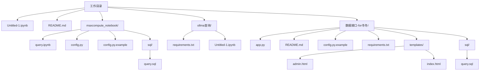
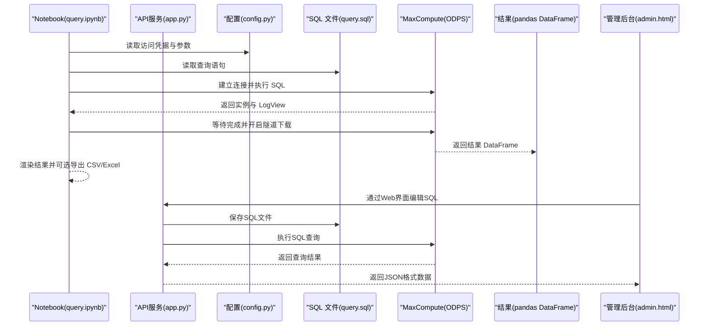
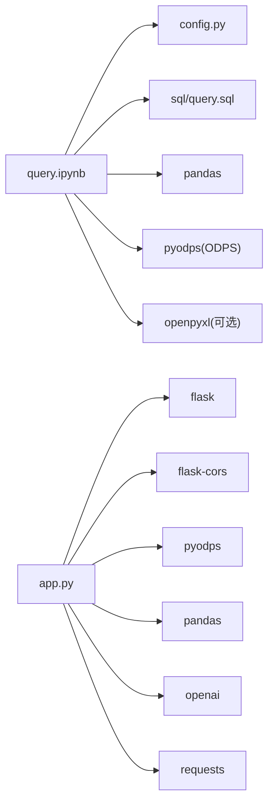

# 快速开始

<cite>
**本文引用的文件**
- [README.md](file://README.md)
- [Untitled-1.ipynb](file://Untitled-1.ipynb)
- [maxcompute_notebook/query.ipynb](file://maxcompute_notebook/query.ipynb)
- [maxcompute_notebook/config.py](file://maxcompute_notebook/config.py)
- [maxcompute_notebook/config.py.example](file://maxcompute_notebook/config.py.example)
- [maxcompute_notebook/sql/query.sql](file://maxcompute_notebook/sql/query.sql)
- [ollma查询/requirements.txt](file://ollma查询/requirements.txt)
- [ollma查询/Untitled-1.ipynb](file://ollma查询/Untitled-1.ipynb)
- [数据接口-for冬冬/README.md](file://数据接口-for冬冬/README.md)
- [数据接口-for冬冬/app.py](file://数据接口-for冬冬/app.py)
- [数据接口-for冬冬/config.py.example](file://数据接口-for冬冬/config.py.example)
- [数据接口-for冬冬/requirements.txt](file://数据接口-for冬冬/requirements.txt)
- [数据接口-for冬冬/templates/admin.html](file://数据接口-for冬冬/templates/admin.html)
- [数据接口-for冬冬/sql/query.sql](file://数据接口-for冬冬/sql/query.sql)
- [数据接口-for冬冬/deploy.sh](file://数据接口-for冬冬/deploy.sh)
- [数据接口-for冬冬/gunicorn_config.py](file://数据接口-for冬冬/gunicorn_config.py)
- [数据接口-for冬冬/data-api.service](file://数据接口-for冬冬/data-api.service)
</cite>

## 更新摘要
**变更内容**
- 新增数据接口API服务的完整快速入门指南
- 添加API服务启动、配置和基本使用方法
- 扩展项目结构说明，包含新的API服务组件
- 增加生产环境部署和故障排查指南

## 目录
1. [简介](#简介)
2. [项目结构](#项目结构)
3. [核心组件](#核心组件)
4. [架构总览](#架构总览)
5. [详细组件分析](#详细组件分析)
6. [依赖关系分析](#依赖关系分析)
7. [性能注意事项](#性能注意事项)
8. [故障排查指南](#故障排查指南)
9. [结论](#结论)
10. [附录](#附录)

## 简介
本指南面向初学者，帮助你在本地快速搭建并运行基于 Jupyter Notebook 的 MaxCompute 查询工具和数据接口API服务。你将学会：
- 设置 Python 3.13.2 环境
- 安装并启动 Jupyter Notebook
- 配置 MaxCompute 访问凭据
- 运行第一个 Notebook 实例
- 启动和使用数据接口API服务
- 导入并使用业务逻辑（SQL）
- 处理常见初始化问题
- 查看简单数据处理示例
- 部署生产环境API服务

## 项目结构
当前工作目录包含一个基础 Notebook 文件、完整的 MaxCompute Notebook 工程、AI 辅助查询示例，以及全新的数据接口API服务。



**图表来源**
- [README.md](file://README.md)
- [maxcompute_notebook/query.ipynb](file://maxcompute_notebook/query.ipynb)
- [maxcompute_notebook/config.py](file://maxcompute_notebook/config.py)
- [maxcompute_notebook/config.py.example](file://maxcompute_notebook/config.py.example)
- [maxcompute_notebook/sql/query.sql](file://maxcompute_notebook/sql/query.sql)
- [ollma查询/requirements.txt](file://ollma查询/requirements.txt)
- [ollma查询/Untitled-1.ipynb](file://ollma查询/Untitled-1.ipynb)
- [数据接口-for冬冬/README.md](file://数据接口-for冬冬/README.md)
- [数据接口-for冬冬/app.py](file://数据接口-for冬冬/app.py)
- [数据接口-for冬冬/config.py.example](file://数据接口-for冬冬/config.py.example)
- [数据接口-for冬冬/requirements.txt](file://数据接口-for冬冬/requirements.txt)
- [数据接口-for冬冬/templates/admin.html](file://数据接口-for冬冬/templates/admin.html)
- [数据接口-for冬冬/sql/query.sql](file://数据接口-for冬冬/sql/query.sql)

**章节来源**
- [README.md](file://README.md)

## 核心组件
- **Jupyter Notebook 环境**：用于交互式查询与数据展示
- **MaxCompute Notebook（query.ipynb）**：封装连接、执行、耗时统计与结果导出
- **数据接口API服务**：提供RESTful API接口，供外部AI平台调用
- **配置文件（config.py 与 config.py.example）**：存放访问凭据与参数
- **SQL 文件（sql/query.sql）**：存放查询语句
- **管理后台界面**：Web界面用于SQL编辑和管理
- **依赖清单（ollma查询/requirements.txt）**：AI 辅助查询示例所需的第三方库

**章节来源**
- [maxcompute_notebook/query.ipynb](file://maxcompute_notebook/query.ipynb)
- [maxcompute_notebook/config.py](file://maxcompute_notebook/config.py)
- [maxcompute_notebook/config.py.example](file://maxcompute_notebook/config.py.example)
- [maxcompute_notebook/sql/query.sql](file://maxcompute_notebook/sql/query.sql)
- [数据接口-for冬冬/app.py](file://数据接口-for冬冬/app.py)
- [数据接口-for冬冬/README.md](file://数据接口-for冬冬/README.md)
- [ollma查询/requirements.txt](file://ollma查询/requirements.txt)

## 架构总览
下图展示了整个系统的端到端流程：Notebook 读取配置与 SQL，连接 MaxCompute，执行 SQL 并通过隧道加速下载结果；同时API服务提供REST接口供外部系统调用。



**图表来源**
- [maxcompute_notebook/query.ipynb](file://maxcompute_notebook/query.ipynb)
- [数据接口-for冬冬/app.py](file://数据接口-for冬冬/app.py)
- [数据接口-for冬冬/templates/admin.html](file://数据接口-for冬冬/templates/admin.html)
- [maxcompute_notebook/config.py](file://maxcompute_notebook/config.py)
- [maxcompute_notebook/sql/query.sql](file://maxcompute_notebook/sql/query.sql)

## 详细组件分析

### 组件一：环境准备与 Python 3.13.2
- 使用 Python 3.13.2 作为内核，确保 Notebook 的语言信息与内核名称匹配
- 若尚未安装 Python 3.13.2，请前往官方渠道下载并配置 PATH
- 验证安装：在终端输入 Python 版本命令，确认显示 3.13.2

**章节来源**
- [Untitled-1.ipynb](file://Untitled-1.ipynb)

### 组件二：Jupyter Notebook 安装与启动
- 安装 Jupyter Notebook（可使用 pip 或 conda）
- 启动方式：在工程根目录执行 Notebook 启动命令
- 验证：浏览器打开后能看到 Notebook 列表，选择目标 Notebook 打开

**章节来源**
- [README.md](file://README.md)

### 组件三：配置 MaxCompute 凭据
- 复制示例配置文件为真实配置文件
- 编辑真实配置文件，填入你的 AccessKey ID、AccessKey Secret、项目名与 Endpoint
- 注意：真实配置文件不应提交到版本库，项目中已有忽略规则

**章节来源**
- [README.md](file://README.md)
- [maxcompute_notebook/config.py.example](file://maxcompute_notebook/config.py.example)
- [maxcompute_notebook/config.py](file://maxcompute_notebook/config.py)

### 组件四：运行第一个 Notebook 实例
- 打开目标 Notebook 文件（例如 query.ipynb）
- 在"设置"单元格中导入依赖并加载配置
- 在"连接"单元格中建立 MaxCompute 连接
- 在"执行查询"单元格中运行查询，观察耗时与 LogView 链接
- 在"导出结果"单元格中将结果保存为 CSV/Excel

**章节来源**
- [README.md](file://README.md)
- [maxcompute_notebook/query.ipynb](file://maxcompute_notebook/query.ipynb)

### 组件五：导入与使用业务逻辑（SQL）
- Notebook 会从外部 SQL 文件加载查询语句
- 修改 SQL 文件即可切换不同的查询逻辑
- 结果将以 DataFrame 形式展示，并支持导出

**章节来源**
- [maxcompute_notebook/query.ipynb](file://maxcompute_notebook/query.ipynb)
- [maxcompute_notebook/sql/query.sql](file://maxcompute_notebook/sql/query.sql)

### 组件六：数据接口API服务快速入门

#### 本地开发模式
```bash
cd 数据接口-for冬冬
python app.py
```

访问地址：
- **API文档首页**: http://localhost:5000/
- **数分管理后台**: http://localhost:5000/admin
- **接口列表**: http://localhost:5000/api/queries

#### API Key 认证配置
编辑 `config.py` 文件，配置API Key认证：
```python
# API Key 认证配置
API_KEY = "your-api-key-here"  # 留空字符串 "" 表示不启用认证（本地开发用）
```

#### 基本使用方法
1. **编写SQL**：访问管理后台 http://localhost:5000/admin
2. **保存并发布**：点击「保存并发布」→ 自动生成接口 `/api/query/{名称}`
3. **调用接口**：使用HTTP GET请求获取数据

**章节来源**
- [数据接口-for冬冬/README.md](file://数据接口-for冬冬/README.md)
- [数据接口-for冬冬/app.py](file://数据接口-for冬冬/app.py)
- [数据接口-for冬冬/config.py.example](file://数据接口-for冬冬/config.py.example)

### 组件七：生产环境部署

#### Gunicorn + Nginx 部署（推荐）
```bash
# 安装 gunicorn
pip install gunicorn

# 启动服务（4个worker进程）
gunicorn -w 4 -b 0.0.0.0:5000 app:app

# 或使用 systemd 管理服务
sudo systemctl start data-api
```

#### Docker 部署
```dockerfile
FROM python:3.11-slim

WORKDIR /app
COPY requirements.txt .
RUN pip install --no-cache-dir -r requirements.txt

COPY . .

EXPOSE 5000
CMD ["gunicorn", "-w", "4", "-b", "0.0.0.0:5000", "app:app"]
```

#### 一键部署脚本
```bash
# 使用提供的部署脚本
chmod +x deploy.sh
sudo bash deploy.sh
```

**章节来源**
- [数据接口-for冬冬/README.md](file://数据接口-for冬冬/README.md)
- [数据接口-for冬冬/deploy.sh](file://数据接口-for冬冬/deploy.sh)
- [数据接口-for冬冬/gunicorn_config.py](file://数据接口-for冬冬/gunicorn_config.py)
- [数据接口-for冬冬/data-api.service](file://数据接口-for冬冬/data-api.service)

### 组件八：AI 辅助查询示例（可选）
- 该目录提供基于 Streamlit/OpenAI/pyodps/pandas 的示例
- 安装依赖后可运行示例 Notebook
- 适合探索如何结合 AI 与 MaxCompute 进行辅助查询

**章节来源**
- [ollma查询/requirements.txt](file://ollma查询/requirements.txt)
- [ollma查询/Untitled-1.ipynb](file://ollma查询/Untitled-1.ipynb)

## 依赖关系分析
- Notebook 依赖于配置模块与 SQL 文件
- API服务依赖于 Flask、Flask-CORS、PyODPS、Pandas
- 配置模块依赖于 MaxCompute SDK（ODPS）
- 结果导出依赖 pandas，可选依赖 openpyxl（用于 Excel）



**图表来源**
- [maxcompute_notebook/query.ipynb](file://maxcompute_notebook/query.ipynb)
- [maxcompute_notebook/config.py](file://maxcompute_notebook/config.py)
- [maxcompute_notebook/sql/query.sql](file://maxcompute_notebook/sql/query.sql)
- [数据接口-for冬冬/app.py](file://数据接口-for冬冬/app.py)
- [数据接口-for冬冬/requirements.txt](file://数据接口-for冬冬/requirements.txt)

**章节来源**
- [maxcompute_notebook/query.ipynb](file://maxcompute_notebook/query.ipynb)

## 性能注意事项
- 启用 Instance Tunnel 加速数据传输，显著降低下载耗时
- 查询耗时分为 SQL 执行耗时与结果下载耗时，便于定位瓶颈
- API服务支持并发请求处理，建议使用Gunicorn多进程部署
- 如需进一步优化，可参考 LogView 链接分析执行计划

**章节来源**
- [README.md](file://README.md)
- [maxcompute_notebook/query.ipynb](file://maxcompute_notebook/query.ipynb)
- [数据接口-for冬冬/gunicorn_config.py](file://数据接口-for冬冬/gunicorn_config.py)

## 故障排查指南
- **无法启动或内核不可用**
  - 确认 Python 3.13.2 已正确安装并加入 PATH
  - 在终端执行 Python 版本命令验证
- **访问凭据错误或连接失败**
  - 检查 config.py 中的 AccessKey ID/Secret、项目名与 Endpoint
  - 确认已复制示例配置为真实配置
- **查询超时**
  - 检查 SQL 超时时间配置
  - 优化 SQL，减少扫描数据量
- **导出 Excel 失败**
  - 安装 openpyxl 后重试
- **笔记本语法错误（示例）**
  - 示例 Notebook 中包含无效的命令行代码，属于示例错误，不影响主流程
- **API服务启动失败**
  - 检查端口5000是否被占用
  - 确认所有依赖包已正确安装
  - 查看应用日志输出
- **API Key认证失败**
  - 确认config.py中API_KEY配置正确
  - 检查请求头中是否正确传入X-API-Key
- **跨域访问问题**
  - 确认Flask-CORS已正确配置
  - 检查浏览器控制台是否有CORS错误

**章节来源**
- [README.md](file://README.md)
- [ollma查询/Untitled-1.ipynb](file://ollma查询/Untitled-1.ipynb)
- [数据接口-for冬冬/README.md](file://数据接口-for冬冬/README.md)

## 结论
通过本指南，你已完成：
- Python 3.13.2 环境与 Jupyter Notebook 的安装与验证
- MaxCompute 凭据配置与连接测试
- 第一个 Notebook 实例的运行与结果导出
- 数据接口API服务的启动与基本使用
- 生产环境部署与故障排查
- 业务逻辑（SQL）的导入与使用
- 常见问题的识别与解决

现在你可以基于此快速开展数据分析与查询任务，并通过API服务为外部AI平台提供数据支持。

## 附录
- **快速操作清单**
  - 安装 Python 3.13.2
  - 安装 Jupyter Notebook
  - 复制 config.py.example 为 config.py 并填写凭据
  - 在工程根目录启动 Notebook
  - 打开 query.ipynb，依次运行各单元格
  - 查看结果并导出 CSV/Excel
  - 启动API服务：cd 数据接口-for冬冬 && python app.py
  - 访问管理后台：http://localhost:5000/admin
  - 创建SQL查询并发布为API接口
- **参考文件**
  - [README.md](file://README.md)
  - [maxcompute_notebook/query.ipynb](file://maxcompute_notebook/query.ipynb)
  - [maxcompute_notebook/config.py](file://maxcompute_notebook/config.py)
  - [maxcompute_notebook/config.py.example](file://maxcompute_notebook/config.py.example)
  - [maxcompute_notebook/sql/query.sql](file://maxcompute_notebook/sql/query.sql)
  - [ollma查询/requirements.txt](file://ollma查询/requirements.txt)
  - [ollma查询/Untitled-1.ipynb](file://ollma查询/Untitled-1.ipynb)
  - [数据接口-for冬冬/README.md](file://数据接口-for冬冬/README.md)
  - [数据接口-for冬冬/app.py](file://数据接口-for冬冬/app.py)
  - [数据接口-for冬冬/config.py.example](file://数据接口-for冬冬/config.py.example)
  - [数据接口-for冬冬/requirements.txt](file://数据接口-for冬冬/requirements.txt)
  - [数据接口-for冬冬/templates/admin.html](file://数据接口-for冬冬/templates/admin.html)
  - [数据接口-for冬冬/sql/query.sql](file://数据接口-for冬冬/sql/query.sql)
  - [数据接口-for冬冬/deploy.sh](file://数据接口-for冬冬/deploy.sh)
  - [数据接口-for冬冬/gunicorn_config.py](file://数据接口-for冬冬/gunicorn_config.py)
  - [数据接口-for冬冬/data-api.service](file://数据接口-for冬冬/data-api.service)