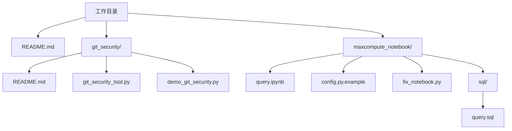
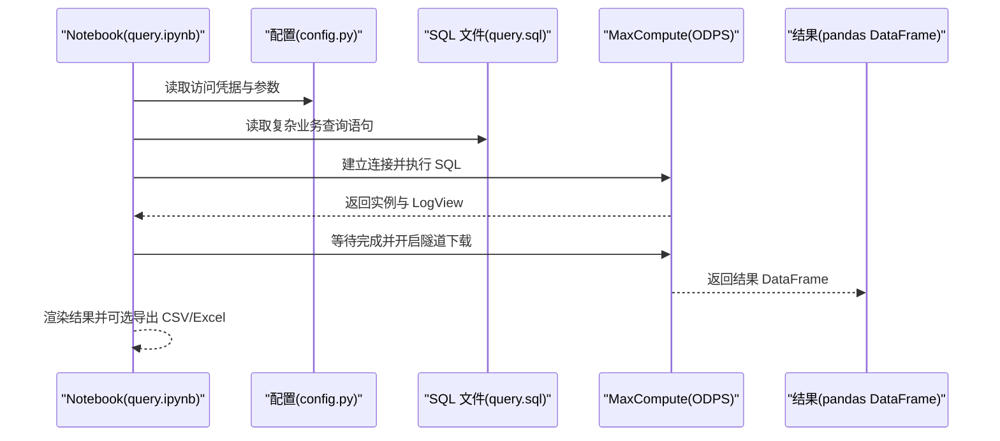
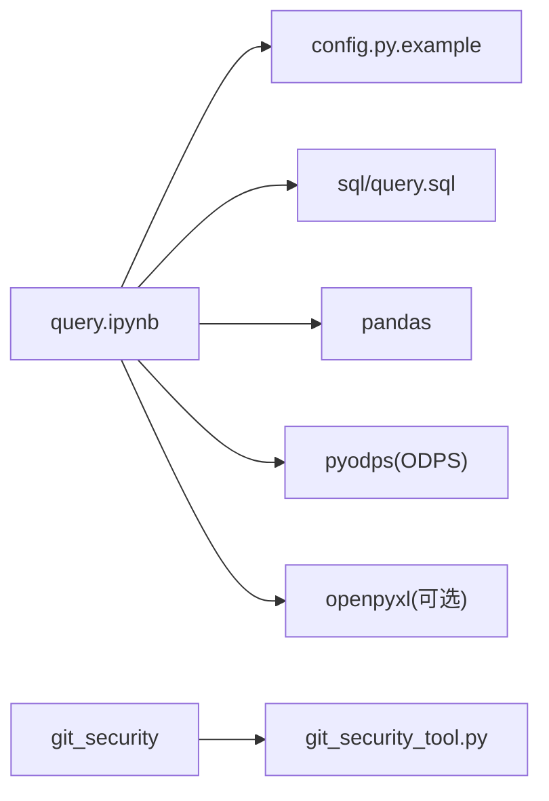

# 快速开始

<cite>
**本文引用的文件**
- [README.md](file://README.md)
- [maxcompute_notebook/query.ipynb](file://maxcompute_notebook/query.ipynb)
- [maxcompute_notebook/config.py.example](file://maxcompute_notebook/config.py.example)
- [maxcompute_notebook/sql/query.sql](file://maxcompute_notebook/sql/query.sql)
- [git_security/README.md](file://git_security/README.md)
</cite>

## 更新摘要
**变更内容**
- 更新了MaxCompute Notebook功能的增强特性说明，包括完整的产品属性、类别层次结构和改进的数据质量
- 简化了项目结构描述，移除了不存在的数据接口API服务相关内容
- 增强了SQL查询示例的详细说明，展示实际业务场景
- 优化了环境配置和故障排查指南

## 目录
1. [简介](#简介)
2. [项目结构](#项目结构)
3. [核心组件](#核心组件)
4. [架构总览](#架构总览)
5. [详细组件分析](#详细组件分析)
6. [依赖关系分析](#依赖关系分析)
7. [性能注意事项](#性能注意事项)
8. [故障排查指南](#故障排查指南)
9. [结论](#结论)
10. [附录](#附录)

## 简介
本指南面向初学者，帮助你在本地快速搭建并运行基于 Jupyter Notebook 的 MaxCompute 查询工具。你将学会：
- 设置 Python 3.13.2 环境
- 安装并启动 Jupyter Notebook
- 配置 MaxCompute 访问凭据
- 运行第一个 Notebook 实例
- 导入并使用业务逻辑（SQL）
- 处理常见初始化问题
- 查看简单数据处理示例

## 项目结构
当前工作目录包含完整的 MaxCompute Notebook 工程、Git 敏感信息保护工具和相关的配置文件。

**图表来源**
- [README.md](file://README.md)
- [maxcompute_notebook/query.ipynb](file://maxcompute_notebook/query.ipynb)
- [maxcompute_notebook/config.py.example](file://maxcompute_notebook/config.py.example)
- [maxcompute_notebook/sql/query.sql](file://maxcompute_notebook/sql/query.sql)
- [git_security/README.md](file://git_security/README.md)

**章节来源**
- [README.md](file://README.md)

## 核心组件
- **Jupyter Notebook 环境**：用于交互式查询与数据展示
- **MaxCompute Notebook（query.ipynb）**：封装连接、执行、耗时统计与结果导出
- **Git 敏感信息保护工具**：确保配置安全，防止密钥泄露
- **配置文件（config.py.example）**：存放访问凭据与参数模板
- **SQL 文件（sql/query.sql）**：存放复杂业务查询语句，包含产品属性、类别层次等
- **Python 3.13.2 内核**：支持最新的Python特性和性能优化

**章节来源**
- [maxcompute_notebook/query.ipynb](file://maxcompute_notebook/query.ipynb)
- [maxcompute_notebook/config.py.example](file://maxcompute_notebook/config.py.example)
- [maxcompute_notebook/sql/query.sql](file://maxcompute_notebook/sql/query.sql)
- [git_security/README.md](file://git_security/README.md)

## 架构总览
下图展示了整个系统的端到端流程：Notebook 读取配置与 SQL，连接 MaxCompute，执行复杂的业务查询并通过隧道加速下载结果。

**图表来源**
- [maxcompute_notebook/query.ipynb](file://maxcompute_notebook/query.ipynb)
- [maxcompute_notebook/config.py.example](file://maxcompute_notebook/config.py.example)
- [maxcompute_notebook/sql/query.sql](file://maxcompute_notebook/sql/query.sql)

## 详细组件分析

### 组件一：环境准备与 Python 3.13.2
- 使用 Python 3.13.2 作为内核，确保 Notebook 的语言信息与内核名称匹配
- 若尚未安装 Python 3.13.2，请前往官方渠道下载并配置 PATH
- 验证安装：在终端输入 `python --version` 命令，确认显示 3.13.2

**章节来源**
- [maxcompute_notebook/query.ipynb:447-464](file://maxcompute_notebook/query.ipynb#L447-L464)

### 组件二：Jupyter Notebook 安装与启动
- 安装 Jupyter Notebook（可使用 pip 或 conda）
- 启动方式：在 maxcompute_notebook 目录执行 `jupyter notebook query.ipynb`
- 验证：浏览器打开后能看到 Notebook 列表，选择目标 Notebook 打开

**章节来源**
- [README.md:72-77](file://README.md#L72-L77)

### 组件三：配置 MaxCompute 凭据
- 复制示例配置文件为真实配置文件：`cp config.py.example config.py`
- 编辑真实配置文件，填入你的 AccessKey ID、AccessKey Secret、项目名与 Endpoint
- 注意：真实配置文件不应提交到版本库，项目中已有忽略规则

**章节来源**
- [README.md:54-61](file://README.md#L54-L61)
- [maxcompute_notebook/config.py.example:6-10](file://maxcompute_notebook/config.py.example#L6-L10)

### 组件四：运行第一个 Notebook 实例
- 打开目标 Notebook 文件（query.ipynb）
- 在"设置"单元格中导入依赖并加载配置
- 在"连接"单元格中建立 MaxCompute 连接
- 在"执行查询"单元格中运行查询，观察耗时与 LogView 链接
- 在"导出结果"单元格中将结果保存为 CSV/Excel

**章节来源**
- [README.md:72-77](file://README.md#L72-L77)
- [maxcompute_notebook/query.ipynb:19-78](file://maxcompute_notebook/query.ipynb#L19-L78)

### 组件五：导入与使用业务逻辑（SQL）
- Notebook 会从外部 SQL 文件加载复杂业务查询语句
- SQL 文件包含完整的产品属性、类别层次结构和数据质量优化
- 修改 SQL 文件即可切换不同的查询逻辑
- 结果将以 DataFrame 形式展示，并支持导出

**更新** 增强了SQL查询功能，包含以下特性：
- 完整的产品属性映射（一级品类、二级品类、三级品类）
- 供应商代码与确认色号的关联查询
- 面料类型、规格、价格等多维度属性
- 数据质量过滤和优化条件

**章节来源**
- [maxcompute_notebook/query.ipynb:73-77](file://maxcompute_notebook/query.ipynb#L73-L77)
- [maxcompute_notebook/sql/query.sql:1-247](file://maxcompute_notebook/sql/query.sql#L1-L247)

### 组件六：Git 敏感信息保护
- 项目集成了完整的 Git 敏感信息保护机制
- 自动检测并阻止敏感信息提交到版本库
- 提供自动化检查和修复工具

**章节来源**
- [README.md:81-114](file://README.md#L81-L114)
- [git_security/README.md](file://git_security/README.md)

## 依赖关系分析
- Notebook 依赖于配置模块与 SQL 文件
- 配置模块依赖于 MaxCompute SDK（ODPS）
- 结果导出依赖 pandas，可选依赖 openpyxl（用于 Excel）
- Git 安全工具提供额外的安全保障

**图表来源**
- [maxcompute_notebook/query.ipynb](file://maxcompute_notebook/query.ipynb)
- [maxcompute_notebook/config.py.example](file://maxcompute_notebook/config.py.example)
- [maxcompute_notebook/sql/query.sql](file://maxcompute_notebook/sql/query.sql)
- [git_security/git_security_tool.py](file://git_security/git_security_tool.py)

**章节来源**
- [maxcompute_notebook/query.ipynb](file://maxcompute_notebook/query.ipynb)

## 性能注意事项
- 启用 Instance Tunnel 加速数据传输，显著降低下载耗时
- 查询耗时分为 SQL 执行耗时与结果下载耗时，便于定位瓶颈
- 如需进一步优化，可参考 LogView 链接分析执行计划
- SQL 查询已针对大数据集进行优化，包含分区过滤和条件优化

**章节来源**
- [README.md:165-209](file://README.md#L165-L209)
- [maxcompute_notebook/query.ipynb:362-396](file://maxcompute_notebook/query.ipynb#L362-L396)

## 故障排查指南
- **无法启动或内核不可用**
  - 确认 Python 3.13.2 已正确安装并加入 PATH
  - 在终端执行 `python --version` 命令验证
- **访问凭据错误或连接失败**
  - 检查 config.py 中的 AccessKey ID/Secret、项目名与 Endpoint
  - 确认已复制示例配置为真实配置
- **查询超时**
  - 检查 SQL 超时时间配置
  - 优化 SQL，减少扫描数据量
- **导出 Excel 失败**
  - 安装 openpyxl 后重试
- **Git 推送被阻止**
  - 使用提供的安全工具检查敏感信息
  - 运行 `python git_security/git_security_tool.py --check`

**章节来源**
- [README.md:270-316](file://README.md#L270-L316)

## 结论
通过本指南，你已完成：
- Python 3.13.2 环境与 Jupyter Notebook 的安装与验证
- MaxCompute 凭据配置与连接测试
- 第一个 Notebook 实例的运行与结果导出
- 业务逻辑（SQL）的导入与使用
- Git 敏感信息保护机制的配置
- 常见问题的识别与解决

现在你可以基于此快速开展数据分析与查询任务，利用增强的MaxCompute Notebook功能进行复杂业务查询。

## 附录
- **快速操作清单**
  - 安装 Python 3.13.2
  - 安装 Jupyter Notebook
  - 复制 config.py.example 为 config.py 并填写凭据
  - 在 maxcompute_notebook 目录启动 Notebook
  - 打开 query.ipynb，依次运行各单元格
  - 查看结果并导出 CSV/Excel
  - 使用 Git 安全工具检查敏感信息
- **参考文件**
  - [README.md](file://README.md)
  - [maxcompute_notebook/query.ipynb](file://maxcompute_notebook/query.ipynb)
  - [maxcompute_notebook/config.py.example](file://maxcompute_notebook/config.py.example)
  - [maxcompute_notebook/sql/query.sql](file://maxcompute_notebook/sql/query.sql)
  - [git_security/README.md](file://git_security/README.md)