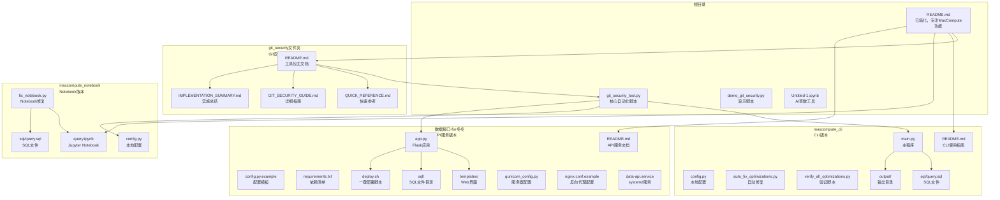
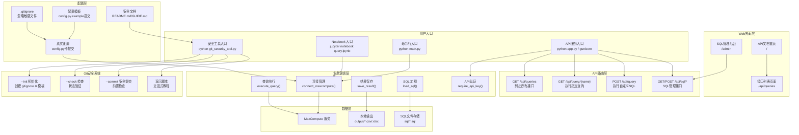
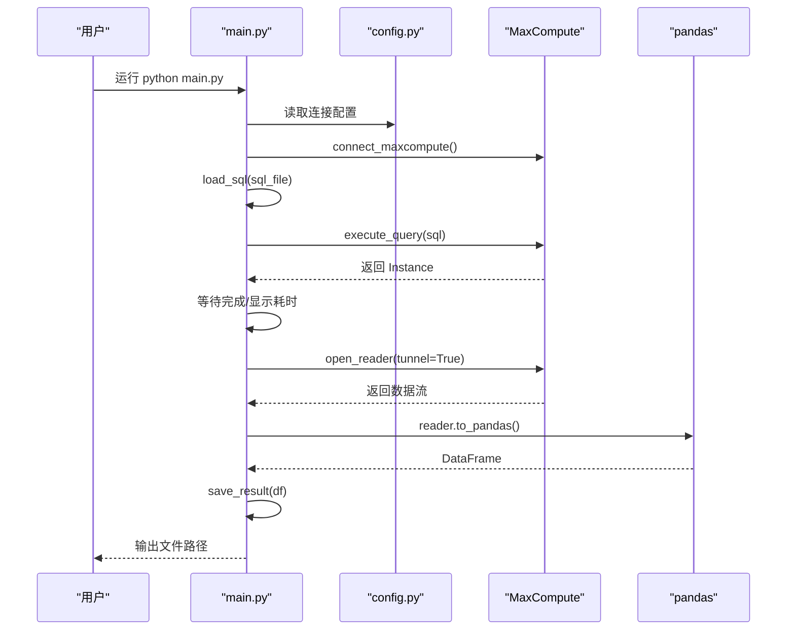
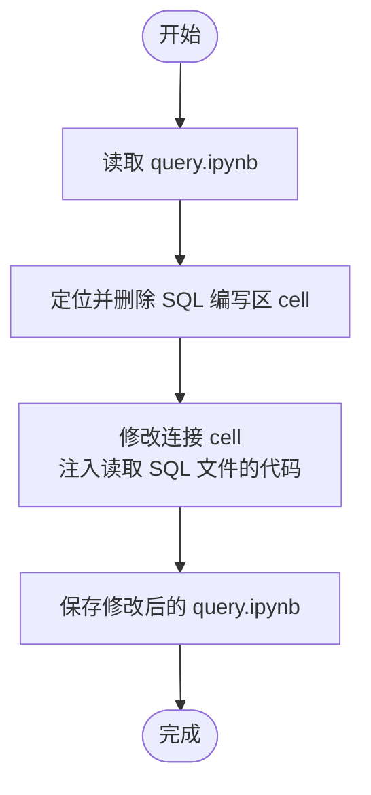
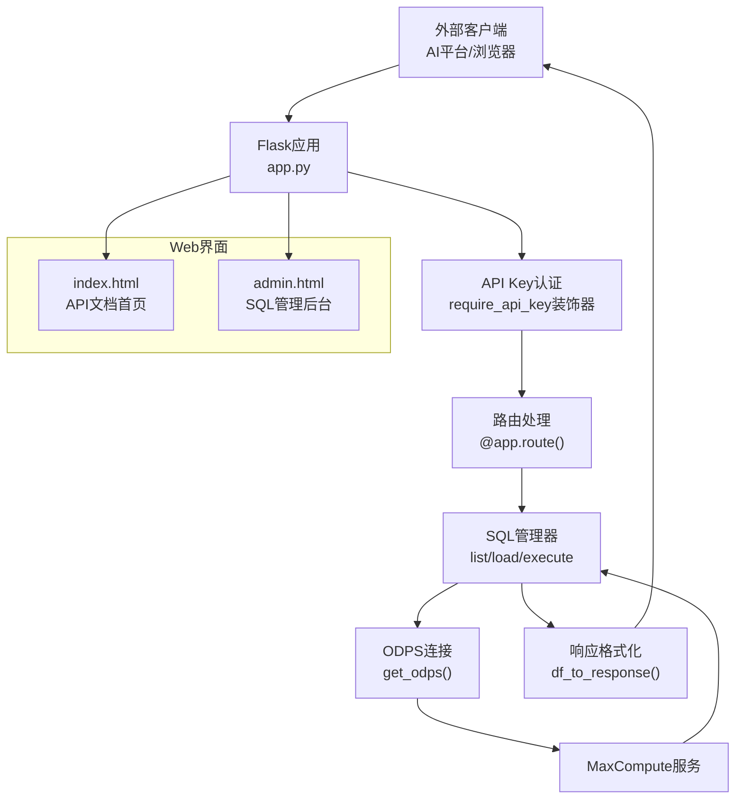
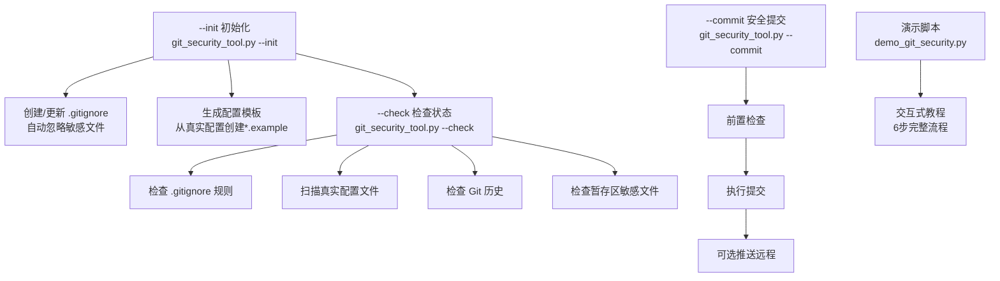
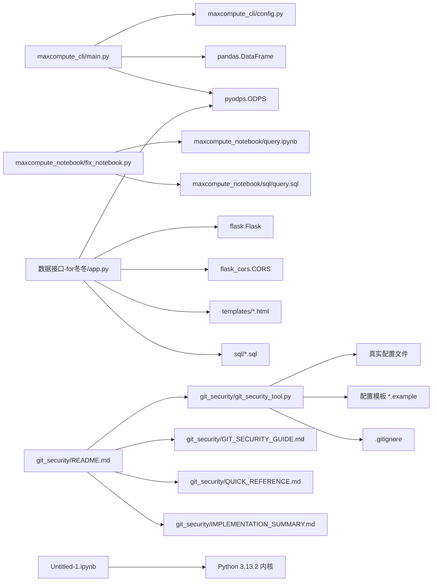

# 项目概述

<cite>
**本文引用的文件**
- [README.md](file://README.md)
- [git_security/README.md](file://git_security/README.md)
- [git_security/GIT_SECURITY_GUIDE.md](file://git_security/GIT_SECURITY_GUIDE.md)
- [git_security/QUICK_REFERENCE.md](file://git_security/QUICK_REFERENCE.md)
- [git_security/IMPLEMENTATION_SUMMARY.md](file://git_security/IMPLEMENTATION_SUMMARY.md)
- [maxcompute_cli/README.md](file://maxcompute_cli/README.md)
- [maxcompute_cli/main.py](file://maxcompute_cli/main.py)
- [maxcompute_cli/config.py](file://maxcompute_cli/config.py)
- [maxcompute_cli/auto_fix_optimizations.py](file://maxcompute_cli/auto_fix_optimizations.py)
- [maxcompute_cli/verify_all_optimizations.py](file://maxcompute_cli/verify_all_optimizations.py)
- [maxcompute_cli/query.sql](file://maxcompute_cli/query.sql)
- [maxcompute_notebook/config.py](file://maxcompute_notebook/config.py)
- [maxcompute_notebook/fix_notebook.py](file://maxcompute_notebook/fix_notebook.py)
- [maxcompute_notebook/sql/query.sql](file://maxcompute_notebook/sql/query.sql)
- [git_security_tool.py](file://git_security/git_security_tool.py)
- [demo_git_security.py](file://git_security/demo_git_security.py)
- [Untitled-1.ipynb](file://Untitled-1.ipynb)
- [数据接口-for冬冬/README.md](file://数据接口-for冬冬/README.md)
- [数据接口-for冬冬/app.py](file://数据接口-for冬冬/app.py)
- [数据接口-for冬冬/config.py.example](file://数据接口-for冬冬/config.py.example)
- [数据接口-for冬冬/requirements.txt](file://数据接口-for冬冬/requirements.txt)
- [数据接口-for冬冬/templates/index.html](file://数据接口-for冬冬/templates/index.html)
- [数据接口-for冬冬/templates/admin.html](file://数据接口-for冬冬/templates/admin.html)
- [数据接口-for冬冬/deploy.sh](file://数据接口-for冬冬/deploy.sh)
- [数据接口-for冬冬/gunicorn_config.py](file://数据接口-for冬冬/gunicorn_config.py)
- [数据接口-for冬冬/nginx.conf.example](file://数据接口-for冬冬/nginx.conf.example)
- [数据接口-for冬冬/data-api.service](file://数据接口-for冬冬/data-api.service)
</cite>

## 更新摘要
**变更内容**
- 新增数据接口API服务组件：完整的Flask REST API服务，支持外部AI平台调用MaxCompute数据
- 扩展项目使用模式：从原有的CLI和Notebook两种形态扩展到三种使用模式（CLI、Notebook、API服务）
- 增强项目架构：新增Web管理后台、API认证机制、生产环境部署方案
- 完善技术栈：新增Flask框架、CORS支持、Gunicorn服务器、Nginx反向代理配置

## 目录
1. [引言](#引言)
2. [项目结构](#项目结构)
3. [核心组件](#核心组件)
4. [架构总览](#架构总览)
5. [详细组件分析](#详细组件分析)
6. [依赖关系分析](#依赖关系分析)
7. [性能考虑](#性能考虑)
8. [故障排除指南](#故障排除指南)
9. [结论](#结论)
10. [附录](#附录)

## 引言
本项目是一个基于 Jupyter Notebook 的极简数据分析与 MaxCompute 查询工具，现已扩展为三种使用形态：**命令行版本（CLI）**、**Notebook 版本**和**数据接口API服务**。所有版本均支持从外部 SQL 文件读取查询语句并执行，结果自动保存到本地文件或通过REST API提供。项目采用全新的Git安全系统架构，将敏感信息保护机制完全迁移到独立的git_security文件夹中，提供完整的自动化工具链和文档体系。

- **项目目标**：为数据分析与机器学习开发提供便捷、可复用、安全的查询工具链，支持多种使用场景
- **核心功能**：SQL 查询执行、结果导出、REST API服务、性能监控、完整的Git敏感信息保护
- **适用场景**：数据分析、数据挖掘、报表生成、模型训练数据准备、Python 生态集成、AI平台数据服务

## 项目结构
项目采用zip包模块化架构，并实现了Git安全系统的完全重构，主要由以下三大部分组成：
- **CLI 版本**：独立的 Python 脚本集合，包含配置、主程序、SQL 文件、输出目录与验证/修复工具
- **Notebook 版本**：Jupyter Notebook 环境，配合配置与 SQL 文件，支持交互式查询与结果可视化
- **数据接口API服务**：基于Flask的REST API服务，提供Web管理后台和HTTP接口访问
- **Git安全工具包**：完整的自动化工具链，包含主文档、详细指南、快速参考和演示脚本

**图表来源**
- [README.md:118-151](file://README.md#L118-L151)
- [git_security/README.md:55-72](file://git_security/README.md#L55-L72)
- [maxcompute_cli/README.md:122-134](file://maxcompute_cli/README.md#L122-L134)
- [maxcompute_notebook/fix_notebook.py:1-56](file://maxcompute_notebook/fix_notebook.py#L1-L56)
- [数据接口-for冬冬/README.md:210-225](file://数据接口-for冬冬/README.md#L210-L225)

**章节来源**
- [README.md:118-151](file://README.md#L118-L151)
- [git_security/README.md:55-72](file://git_security/README.md#L55-L72)
- [maxcompute_cli/README.md:122-134](file://maxcompute_cli/README.md#L122-L134)
- [数据接口-for冬冬/README.md:210-225](file://数据接口-for冬冬/README.md#L210-L225)

## 核心组件
本项目现包含四大核心组件：

### 1) Jupyter Notebook 环境
- **作用**：提供交互式数据分析与可视化能力，适合探索性分析与快速原型开发
- **关键文件**：query.ipynb、config.py、sql/query.sql
- **特点**：支持从外部 SQL 文件读取查询语句，便于与 CLI 版本共享 SQL 逻辑

### 2) 业务逻辑模块（CLI）
- **作用**：封装 MaxCompute 连接、SQL 加载、查询执行、结果保存与性能监控
- **关键文件**：main.py、config.py、verify_all_optimizations.py、auto_fix_optimizations.py
- **特点**：启用 Instance Tunnel 加速、显示 LogView 链接、输出详细耗时统计

### 3) 数据接口API服务（全新组件）
- **作用**：提供REST API服务，供外部AI平台通过HTTP请求获取MaxCompute数据
- **关键文件**：app.py、config.py.example、templates/、sql/
- **特点**：Flask Web框架、API Key认证、Web管理后台、生产环境部署支持

### 4) Git敏感信息保护系统（全新重构）
- **作用**：提供完整的自动化工具链，确保AccessKey等密钥不被意外提交到版本库
- **关键文件**：git_security_tool.py、demo_git_security.py、README.md、GIT_SECURITY_GUIDE.md
- **特点**：模块化设计、完整的文档体系、一键初始化和检查功能

**技术栈概览**
- **Python 3.13.2 内核**（Notebook 环境）
- **pyodps**（MaxCompute Python SDK）
- **pandas**（数据处理）
- **Jupyter Notebook**（交互式开发）
- **Flask 3.0**（Web框架）
- **Gunicorn**（生产环境WSGI服务器）
- **Nginx**（反向代理）
- **Git**（版本控制与安全保护）

**章节来源**
- [maxcompute_cli/main.py:22-96](file://maxcompute_cli/main.py#L22-L96)
- [maxcompute_cli/config.py:5-22](file://maxcompute_cli/config.py#L5-L22)
- [maxcompute_notebook/config.py:5-22](file://maxcompute_notebook/config.py#L5-L22)
- [maxcompute_notebook/fix_notebook.py:22-49](file://maxcompute_notebook/fix_notebook.py#L22-L49)
- [数据接口-for冬冬/app.py:1-350](file://数据接口-for冬冬/app.py#L1-350)
- [数据接口-for冬冬/config.py.example:1-33](file://数据接口-for冬冬/config.py.example#L1-33)
- [README.md:155-188](file://README.md#L155-L188)
- [git_security/README.md:162-192](file://git_security/README.md#L162-L192)

## 架构总览
系统采用"配置分离 + 自动化工具 + 多形态入口"的架构设计，其中Git安全系统已完全重构并独立管理，确保安全性与易用性并重。新增的API服务提供了完整的Web管理和HTTP接口访问能力。

**图表来源**
- [maxcompute_cli/main.py:22-96](file://maxcompute_cli/main.py#L22-L96)
- [maxcompute_cli/config.py:5-22](file://maxcompute_cli/config.py#L5-L22)
- [数据接口-for冬冬/app.py:153-350](file://数据接口-for冬冬/app.py#L153-350)
- [git_security/README.md:162-192](file://git_security/README.md#L162-192)
- [git_security/GIT_SECURITY_GUIDE.md:201-313](file://git_security/GIT_SECURITY_GUIDE.md#L201-313)

## 详细组件分析

### 组件一：CLI 业务逻辑模块
CLI 版本提供从 SQL 文件读取查询语句并执行的完整流程，具备性能优化与安全特性。

**图表来源**
- [maxcompute_cli/main.py:22-96](file://maxcompute_cli/main.py#L22-L96)
- [maxcompute_cli/config.py:5-22](file://maxcompute_cli/config.py#L5-L22)

关键实现要点
- 连接管理：统一读取 AccessKey、Project、Endpoint 等配置
- SQL 加载：支持注释过滤与多行 SQL 处理
- 查询执行：启用 Instance Tunnel 加速、显示 LogView 链接、统计执行耗时
- 结果保存：自动创建输出目录、按时间戳命名文件、支持 CSV/Excel

**章节来源**
- [maxcompute_cli/main.py:22-96](file://maxcompute_cli/main.py#L22-L96)
- [maxcompute_cli/config.py:5-22](file://maxcompute_cli/config.py#L5-L22)

### 组件二：Notebook 环境与模块化改造
Notebook 版本通过脚本将 SQL 编写区移除并注入外部 SQL 文件读取逻辑，实现与 CLI 版本的配置共享。

**图表来源**
- [maxcompute_notebook/fix_notebook.py:3-56](file://maxcompute_notebook/fix_notebook.py#L3-L56)

关键实现要点
- 删除 Markdown + Code 两处 SQL 编写区 cell
- 在连接 cell 中追加读取外部 SQL 文件的代码
- 保持原有执行逻辑不变，仅替换数据源

**章节来源**
- [maxcompute_notebook/fix_notebook.py:3-56](file://maxcompute_notebook/fix_notebook.py#L3-L56)

### 组件三：数据接口API服务（全新组件）
新增的Flask REST API服务提供完整的Web管理和HTTP接口访问能力，支持外部AI平台直接调用MaxCompute数据。

**图表来源**
- [数据接口-for冬冬/app.py:31-350](file://数据接口-for冬冬/app.py#L31-350)
- [数据接口-for冬冬/templates/index.html:1-214](file://数据接口-for冬冬/templates/index.html#L1-214)
- [数据接口-for冬冬/templates/admin.html:1-286](file://数据接口-for冬冬/templates/admin.html#L1-286)

关键实现要点
- **API认证机制**：支持Header和URL参数两种方式传递API Key
- **RESTful接口设计**：标准化的HTTP接口，支持GET/POST方法
- **Web管理后台**：可视化的SQL编辑和管理界面
- **跨域支持**：内置flask-cors支持外部平台调用
- **生产环境部署**：完整的Gunicorn+Nginx+systemd部署方案

**章节来源**
- [数据接口-for冬冬/app.py:31-350](file://数据接口-for冬冬/app.py#L31-350)
- [数据接口-for冬冬/README.md:1-270](file://数据接口-for冬冬/README.md#L1-270)

### 组件四：Git敏感信息保护工具包（全新重构）
项目提供完整的自动化工具链，确保敏感配置不被提交到版本库。该系统已完全迁移到git_security文件夹中，包含完整的文档体系。

**图表来源**
- [git_security/GIT_SECURITY_GUIDE.md:201-313](file://git_security/GIT_SECURITY_GUIDE.md#L201-313)
- [git_security/README.md:162-192](file://git_security/README.md#L162-192)
- [git_security/QUICK_REFERENCE.md:18-64](file://git_security/QUICK_REFERENCE.md#L18-L64)

关键实现要点
- 自动创建 .gitignore 并添加敏感文件忽略规则
- 从真实配置生成模板文件，避免密钥泄露
- 提供安全提交流程，支持一键检查与提交
- 完整的文档体系：主文档、详细指南、快速参考、实施总结

**章节来源**
- [git_security/GIT_SECURITY_GUIDE.md:201-313](file://git_security/GIT_SECURITY_GUIDE.md#L201-313)
- [git_security/README.md:162-192](file://git_security/README.md#L162-192)
- [git_security/QUICK_REFERENCE.md:18-64](file://git_security/QUICK_REFERENCE.md#L18-L64)

## 依赖关系分析
组件间的耦合与协作关系如下，体现了新增API服务后的全新架构：

**图表来源**
- [maxcompute_cli/main.py:14-19](file://maxcompute_cli/main.py#L14-L19)
- [maxcompute_notebook/fix_notebook.py:4-53](file://maxcompute_notebook/fix_notebook.py#L4-L53)
- [数据接口-for冬冬/app.py:21-29](file://数据接口-for冬冬/app.py#L21-29)
- [git_security/README.md:55-72](file://git_security/README.md#L55-72)
- [Untitled-1.ipynb:13-21](file://Untitled-1.ipynb#L13-L21)

**章节来源**
- [maxcompute_cli/main.py:14-19](file://maxcompute_cli/main.py#L14-L19)
- [maxcompute_notebook/fix_notebook.py:4-53](file://maxcompute_notebook/fix_notebook.py#L4-L53)
- [数据接口-for冬冬/app.py:21-29](file://数据接口-for冬冬/app.py#L21-29)
- [git_security/README.md:55-72](file://git_security/README.md#L55-72)
- [Untitled-1.ipynb:13-21](file://Untitled-1.ipynb#L13-L21)

## 性能考虑
- **Instance Tunnel 加速**：通过实例隧道加速数据传输，使查询速度与 DataWorks 保持一致
- **耗时监控**：分别统计 SQL 执行耗时、数据下载耗时与总耗时，便于性能分析
- **日志链接**：提供 LogView 链接，可在控制台查看详细执行计划与性能指标
- **配置优化**：合理设置 SQL 超时时间与最大返回行数，平衡性能与稳定性
- **API服务优化**：支持Gunicorn多进程部署、Nginx反向代理、连接池管理

最佳实践
- SQL 优化：添加分区过滤条件、减少扫描数据量、避免 SELECT *
- 定期清理：定期清理 output 目录中的历史结果文件
- 日志记录：可扩展日志模块，记录查询执行过程与异常信息
- 安全检查：每次提交前运行git_security_tool.py --check确保无敏感信息泄露
- API限流：在生产环境中设置合理的请求频率限制和并发控制

**章节来源**
- [README.md:202-246](file://README.md#L202-L246)
- [maxcompute_cli/README.md:110-119](file://maxcompute_cli/README.md#L110-L119)
- [maxcompute_cli/README.md:202-238](file://maxcompute_cli/README.md#L202-L238)
- [数据接口-for冬冬/gunicorn_config.py:1-36](file://数据接口-for冬冬/gunicorn_config.py#L1-36)

## 故障排除指南
常见问题与解决方案

- **GitHub 阻止推送**
  - 症状：远程拒绝包含密钥的推送
  - 解决：使用git_security_tool.py --check检查状态，必要时重写 Git 历史或使用 BFG 清理工具

- **连接失败**
  - 症状：AccessKeyIdNotFound 或 Invalid credentials
  - 解决：检查 config.py 中 AccessKey 配置、确认账号权限

- **查询超时**
  - 症状：Timeout 或长时间无响应
  - 解决：增加 SQL_TIMEOUT、优化 SQL、减少返回数据量

- **速度仍然较慢**
  - 症状：即使启用 Tunnel 仍较慢
  - 解决：查看 LogView 执行计划、优化 SQL、调整 MAX_RESULT_ROWS

- **Tunnel 连接失败**
  - 症状：无法连接到 Tunnel Endpoint
  - 解决：检查网络连通性、添加防火墙白名单

- **API服务启动失败**
  - 症状：端口占用或依赖缺失
  - 解决：检查5000端口占用、安装requirements.txt依赖、查看Flask日志

- **API认证失败**
  - 症状：401/403错误
  - 解决：检查API Key配置、确认请求头或URL参数正确

- **跨域访问问题**
  - 症状：浏览器控制台CORS错误
  - 解决：确认flask-cors已启用、检查Nginx配置

- **Git安全检查失败**
  - 症状：git_security_tool.py --check报告敏感信息
  - 解决：运行git_security_tool.py --init重新初始化，或使用--template仅生成模板

**章节来源**
- [README.md:311-357](file://README.md#L311-L357)
- [maxcompute_cli/README.md:160-200](file://maxcompute_cli/README.md#L160-L200)
- [数据接口-for冬冬/README.md:239-270](file://数据接口-for冬冬/README.md#L239-L270)
- [git_security/GIT_SECURITY_GUIDE.md:315-383](file://git_security/GIT_SECURITY_GUIDE.md#L315-L383)

## 结论
本项目通过 CLI、Notebook 和 API服务三种形态，结合全新重构的Git敏感信息保护机制，构建了一个安全、高效、易用的 MaxCompute 查询工具链。新增的数据接口API服务组件为项目带来了完整的Web管理和HTTP接口访问能力，使得外部AI平台可以直接通过REST API获取MaxCompute数据。Git安全系统已完全迁移到独立的git_security文件夹中，提供了完整的自动化工具链和文档体系，确保团队在日常开发中能够轻松遵循安全提交流程，定期运行安全检查，持续改进查询性能与代码质量。

## 附录

### 实际使用示例

#### CLI 版本
- 配置 AccessKey：复制模板并填写真实密钥
- 编写 SQL：在 sql/query.sql 中编写查询语句
- 执行查询：运行 python main.py
- 查看结果：在 output 目录中查看导出文件

#### Notebook 版本
- 配置 AccessKey：复制模板并填写真实密钥
- 执行查询：在 Jupyter 中运行 query.ipynb
- 结果可视化：利用 pandas 与可视化库进行分析

#### API服务版本（新增）
- 本地开发：`cd 数据接口-for冬冬 && python app.py`
- 访问文档：http://localhost:5000/
- 管理后台：http://localhost:5000/admin
- 调用接口：`curl http://localhost:5000/api/query/sales_report`
- 生产部署：`bash deploy.sh`

#### 安全提交（Git安全系统）
- 初始化：`python git_security/git_security_tool.py --init`
- 检查：`python git_security/git_security_tool.py --check`
- 提交：`python git_security/git_security_tool.py --commit "feat: 描述"`
- 演示：`python git_security/demo_git_security.py`

**章节来源**
- [README.md:17-61](file://README.md#L17-L61)
- [maxcompute_cli/README.md:15-61](file://maxcompute_cli/README.md#L15-L61)
- [数据接口-for冬冬/README.md:22-76](file://数据接口-for冬冬/README.md#L22-76)
- [git_security/README.md:9-52](file://git_security/README.md#L9-L52)
- [git_security/GIT_SECURITY_GUIDE.md:44-78](file://git_security/GIT_SECURITY_GUIDE.md#L44-L78)