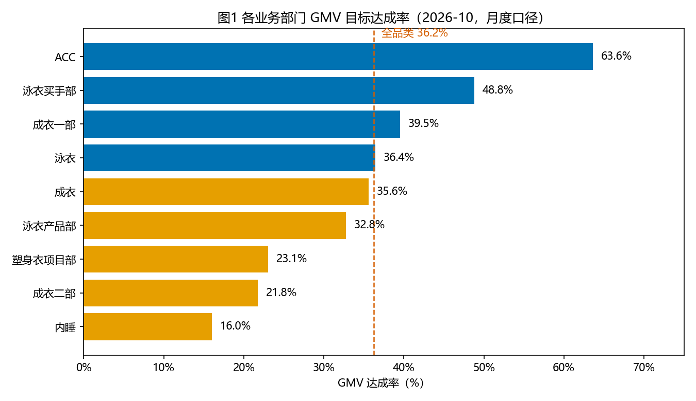
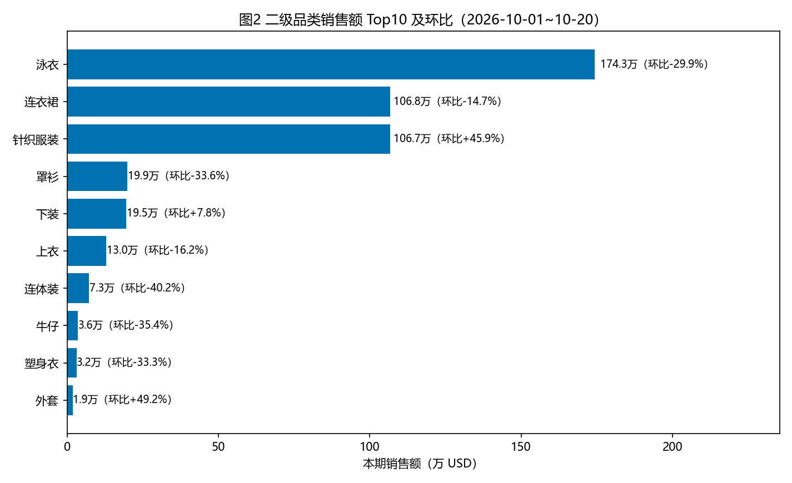
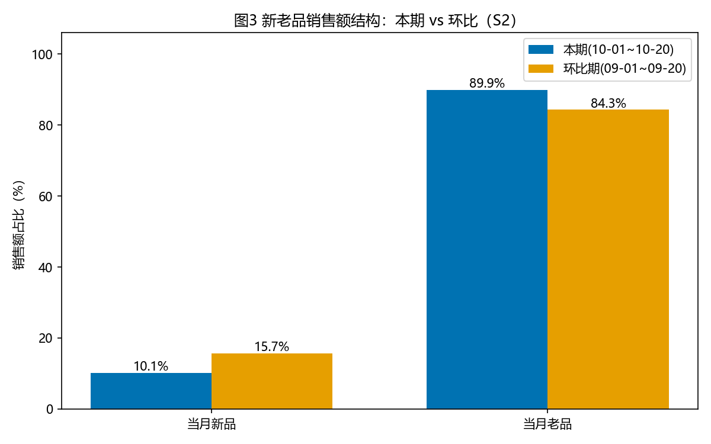
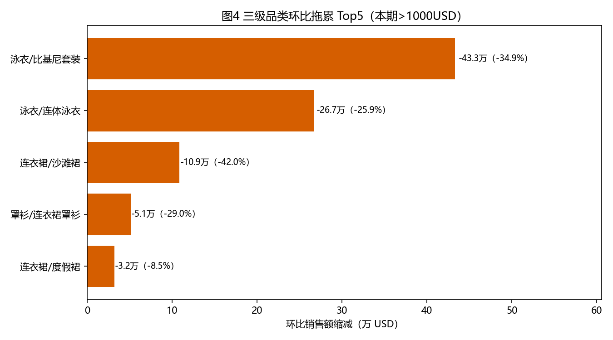

# 经营分析报告2026-10-21

## 1. 分析说明

- 时间窗：2026-10-01 ~ 2026-10-20。
- 双口径声明：
  - 第 2 章「目标达成」为 **2026-10 月度口径**（当月 1 日起累计）；该口径无环比/同比列，**本章仅展示当期**。
  - 第 3~6 章拆解与结构为**本窗口口径**（2026-10-01~10-20）；环比 = 2026-09-01~09-20（起止日各回拨 1 个月），同比 = 2025-10-01~10-20（起止日各回拨 1 年）。
- 数据范围：线上在架商品（在线调整口径），排除赠品与无库存测试款；目标为「正常目标」类型；金额单位为美元（USD）。
- 汇总说明：除单独注明外，整体/大类/品类/新老品的汇总数均由明细行加总；环比期原始值由「本期值 ÷ (1 + 环比率)」还原，环比率缺失或 ≤ −100% 的行按环比期 = 0 处理（销售额口径涉及 4/52 行，影响可忽略）。

## 2. 目标达成总览

**表2-1 全品类目标达成（2026-10 月度口径）**

| 指标 | 目标 | 实际 | 达成率 |
|---|---:|---:|---:|
| GMV | 12,861,919.87 | 4,661,511.27 | 36.2% |
| 上新数 | 450 | 353 | 78.4% |
| 大爆款数 | 7 | 1 | 14.3% |
| 大爆款率 | 0.01 | 0.00 | 18.9% |
| 成功数 | 167 | 71 | 42.5% |
| 成功率 | 0.37 | 0.20 | 54.2% |
| 新品GMV | 1,629,879.02 | 466,658.79 | 28.6% |
| 新品款均成本 | 45.23 | 45.59 | 100.8% |
| 新品款效 | 3,621.95 | 1,321.98 | 36.5% |
| 法国线上新数 | 0 | 0 | 0.0% |
| 爆款数 | 31 | 6 | 19.4% |
| 爆款率 | 0.07 | 0.02 | 25.6% |
| 超爆款数 | 2 | 0 | 0.0% |
| 超爆款率 | 0.00 | 0.00 | 0.0% |

**表2-2 分部门达成（2026-10 月度口径）**

| 部门 | GMV目标 | GMV实际 | GMV达成率 | 新品GMV实际 | 上新数目标 | 上新数实际 | 上新数达成率 |
|---|---:|---:|---:|---:|---:|---:|---:|
| 成衣一部 | 6,178,413.79 | 2,443,475.36 | 39.5% | 209,045.65 | 197 | 168 | 85.3% |
| 成衣二部 | 1,761,990.01 | 383,542.20 | 21.8% | 70,632.22 | 169 | 92 | 54.4% |
| 品牌设计部 | 0.00 | 42.50 | 0.0% | 0.00 | 0 | 0 | 0.0% |
| 新渠道产品部 | 0.00 | 0.00 | 0.0% | 0.00 | 0 | 0 | 0.0% |
| 成衣 | 7,940,403.80 | 2,827,017.56 | 35.6% | 279,677.86 | 366 | 260 | 71.0% |
| 泳衣产品部 | 3,695,661.00 | 1,210,745.18 | 32.8% | 76,815.86 | 32 | 31 | 96.9% |
| 泳衣买手部 | 1,094,318.56 | 534,365.78 | 48.8% | 93,815.00 | 28 | 32 | 114.3% |
| 泳衣 | 4,789,979.56 | 1,745,110.96 | 36.4% | 170,630.85 | 60 | 63 | 105.0% |
| 内睡 | 111,687.65 | 17,888.09 | 16.0% | 5,397.21 | 11 | 8 | 72.7% |
| ACC | 19,848.86 | 12,625.65 | 63.6% | 3,479.93 | 13 | 13 | 100.0% |
| 塑身衣项目部 | 255,181.46 | 58,826.51 | 23.1% | 7,472.93 | 16 | 9 | 56.2% |
| 全品类 | 12,861,919.87 | 4,661,511.27 | 36.2% | 466,658.79 | 450 | 353 | 78.4% |

本分析期（2026-10-01~2026-10-20），整体月度（2026-10）GMV 目标为 12,861,919.87 美元，实际完成 4,661,511.27 美元，达成率 36.2%，较目标缺口 8,200,408.60 美元（−63.8%）。
分业务部门看：达成最好的是 ACC（达成率 63.6%），最弱的是内睡（达成率 16.0%）（品牌设计部、新渠道产品部当期未设目标，不参与比较）。
分大类看：贡献最大的是成衣（实际 2,827,017.56 美元，占比 60.6%），拖累最大的是成衣（相对目标缺口 5,113,386.24 美元）；环比降幅最大的大类为泳衣（−29.9%，窗口口径）。

## 3. 新老品与业务部门结构

**表3 新老品 × 业务部门（窗口 2026-10-01~10-20，覆盖成衣两部与泳衣两部）**

| 大类 | 业务部门 | 是否当月新品 | 销售额(USD) | 销售额环比 | 销售额占比 | 在架SKC | 在架SKC环比 | 详情页UV | CVR | 款效 |
|---|---|---|---:|---:|---:|---:|---:|---:|---:|---:|
| 成衣 | 成衣一部 | 当月新品 | 107,587.00 | -58.1% | 5.0% | 88 | -26.7% | 104,466 | 3.08% | 1,631.60 |
| 成衣 | 成衣一部 | 当月老品 | 648,825.77 | +15.3% | 29.9% | 365 | -13.1% | 433,927 | 5.63% | 3,047.36 |
| 成衣 | 成衣二部 | 当月新品 | 35,952.74 | -29.3% | 1.7% | 43 | +152.9% | 30,687 | 3.22% | 1,021.16 |
| 成衣 | 成衣二部 | 当月老品 | 142,072.52 | -2.1% | 6.5% | 114 | -3.4% | 160,513 | 7.42% | 1,580.05 |
| 泳衣 | 泳衣买手部 | 当月新品 | 93,815.00 | -28.5% | 4.3% | 32 | +3.2% | 94,996 | 2.76% | 2,931.72 |
| 泳衣 | 泳衣买手部 | 当月老品 | 301,961.16 | -27.5% | 13.9% | 312 | -20.2% | 366,345 | 3.31% | 2,280.66 |
| 泳衣 | 泳衣产品部 | 当月新品 | 76,815.86 | -45.7% | 3.5% | 31 | -13.9% | 88,318 | 2.18% | 2,477.93 |
| 泳衣 | 泳衣产品部 | 当月老品 | 763,737.03 | -28.6% | 35.2% | 780 | -8.8% | 908,832 | 2.83% | 2,243.59 |

新老品结构：当期（窗口口径）新品销售额 466,658.79 美元（占比 10.1%），老品 4,134,941.89 美元（占比 89.9%）。
环比看，新品占比降 5.5 个百分点，老品占比升 5.5 个百分点。
分业务部门：泳衣买手部新品占比最高（23.7%），泳衣产品部老品依赖度最高（老品占比 90.9%）。
与目标达成结合：达成落后的部门中，成衣二部（达成率 21.8%）表现为新品不足——当月新品销售额环比 −29.3%、款效环比 −65.9%；泳衣产品部（达成率 32.8%）表现为老品下滑——老品销售额环比 −28.6%，且新品占比仅 9.1%。

## 4. 品类拆解

**表A 二级品类拆解**（维度=二级品类，共 26 行，全量展示；环比期数值由本期 ÷ (1+环比) 还原）

| 二级品类 | 大类 | 销售额(USD) | 销售额环比 | 销售额占比 | 销量 | 销量环比 | 详情页UV | UV环比 | CVR |
|---|---|---:|---:|---:|---:|---:|---:|---:|---:|
| 泳衣 | 泳衣 | 1,743,361.14 | -29.9% | 37.9% | 50,428 | -28.7% | 1,962,150 | -36.1% | 2.57% |
| 连衣裙 | 成衣 | 1,068,267.12 | -14.7% | 23.2% | 30,750 | -15.1% | 1,022,292 | -25.3% | 3.01% |
| 针织服装 | 成衣 | 1,067,166.66 | +45.9% | 23.2% | 30,803 | +46.9% | 826,845 | +22.9% | 3.73% |
| 罩衫 | 成衣 | 198,594.80 | -33.6% | 4.3% | 6,956 | -35.1% | 168,709 | -39.0% | 4.12% |
| 下装 | 成衣 | 194,673.23 | +7.8% | 4.2% | 6,423 | +6.6% | 193,767 | -7.6% | 3.31% |
| 上衣 | 成衣 | 130,188.22 | -16.2% | 2.8% | 4,850 | -16.8% | 131,027 | -24.6% | 3.70% |
| 连体装 | 成衣 | 73,182.49 | -40.2% | 1.6% | 2,222 | -39.0% | 82,834 | -42.7% | 2.68% |
| 牛仔 | 成衣 | 36,108.75 | -35.4% | 0.8% | 930 | -36.7% | 33,084 | -42.0% | 2.81% |
| 塑身衣 | 内睡 | 31,566.54 | -33.3% | 0.7% | 927 | -28.6% | 34,952 | -37.2% | 2.65% |
| 外套 | 成衣 | 18,882.83 | +49.2% | 0.4% | 417 | +62.9% | 15,397 | +6.9% | 2.71% |
| 家居服 | 内睡 | 10,844.86 | +153.1% | 0.2% | 324 | +134.8% | 13,091 | +149.5% | 2.47% |
| 两件套 | 成衣 | 9,095.16 | +68.2% | 0.2% | 250 | +35.1% | 8,105 | +22.3% | 3.08% |
| 靴子 | ACC | 8,214.71 | +117.7% | 0.2% | 167 | +108.7% | 5,295 | +41.3% | 3.15% |
| 睡衣 | 内睡 | 6,823.82 | +9.3% | 0.1% | 255 | +17.0% | 7,419 | -1.5% | 3.44% |
| 首饰 | ACC | 2,246.27 | +8.8% | 0.0% | 244 | +5.6% | 2,095 | -6.6% | 11.65% |
| 包袋 | ACC | 901.67 | -52.4% | 0.0% | 31 | -46.6% | 1,803 | -53.7% | 1.72% |
| 帽子 | ACC | 559.28 | +39.5% | 0.0% | 27 | +17.4% | 707 | +2.8% | 3.82% |
| 拖鞋 | ACC | 240.45 | -37.4% | 0.0% | 9 | -43.8% | 507 | -45.1% | 1.78% |
| 内衣 | 内睡 | 219.42 | -77.5% | 0.0% | 9 | -83.3% | 542 | -81.0% | 1.66% |
| 凉鞋 | ACC | 167.63 | +38.0% | 0.0% | 5 | +25.0% | 191 | -29.8% | 2.62% |
| 围巾 | ACC | 101.00 | -35.9% | 0.0% | 7 | -36.4% | 119 | -37.7% | 5.88% |
| 袜子 | ACC | 96.00 | N/A | 0.0% | 16 | N/A | 125 | +1983.3% | 12.80% |
| 太阳镜 | ACC | 81.63 | +152.7% | 0.0% | 5 | +150.0% | 159 | -5.4% | 3.14% |
| 腰带 | ACC | 17.00 | N/A | 0.0% | 1 | N/A | 53 | N/A | 1.89% |
| 发饰 | ACC | 0.00 | N/A | 0.0% | 0 | N/A | 0 | N/A | N/A |
| 高跟鞋 | ACC | 0.00 | N/A | 0.0% | 0 | N/A | 0 | N/A | N/A |

**表B 三级品类拆解**（维度=三级品类，共 113 行，按销售额降序取 Top20，其余 93 行合并为「其它」）

| 大类 | 二级品类 | 三级品类 | 销售额(USD) | 销售额环比 | 销售额占比 | 销量 | 销量环比 | 详情页UV | CVR |
|---|---|---|---:|---:|---:|---:|---:|---:|---:|
| 泳衣 | 泳衣 | 比基尼套装 | 805,579.36 | -34.9% | 17.5% | 24,377 | -33.8% | 928,743 | 2.62% |
| 泳衣 | 泳衣 | 连体泳衣 | 765,407.41 | -25.9% | 16.6% | 21,019 | -24.6% | 847,750 | 2.48% |
| 成衣 | 针织服装 | 毛衣 | 540,044.92 | +57.8% | 11.7% | 16,068 | +59.4% | 399,211 | 4.02% |
| 成衣 | 连衣裙 | 连衣裙 | 381,335.46 | -1.2% | 8.3% | 11,761 | +0.3% | 363,219 | 3.24% |
| 成衣 | 连衣裙 | 度假裙 | 347,659.49 | -8.5% | 7.6% | 9,546 | -9.8% | 307,395 | 3.11% |
| 成衣 | 针织服装 | 开衫 | 200,218.61 | +12.5% | 4.4% | 5,456 | +15.0% | 152,637 | 3.57% |
| 成衣 | 针织服装 | 毛衣裙 | 191,023.06 | +91.9% | 4.2% | 5,046 | +96.1% | 179,262 | 2.81% |
| 成衣 | 连衣裙 | 场合裙 | 156,918.45 | -13.5% | 3.4% | 4,225 | -15.3% | 169,178 | 2.50% |
| 成衣 | 连衣裙 | 沙滩裙 | 149,753.68 | -42.0% | 3.3% | 4,288 | -43.2% | 154,295 | 2.78% |
| 成衣 | 下装 | 半身裙 | 134,507.20 | +24.1% | 2.9% | 4,402 | +26.1% | 121,176 | 3.63% |
| 成衣 | 罩衫 | 连衣裙罩衫 | 125,082.05 | -29.0% | 2.7% | 4,237 | -28.7% | 111,012 | 3.82% |
| 泳衣 | 泳衣 | 坦基尼套装 | 122,184.07 | -18.1% | 2.7% | 3,371 | -15.5% | 122,977 | 2.74% |
| 成衣 | 针织服装 | 针织上衣 | 57,728.12 | +10.3% | 1.3% | 1,807 | +10.5% | 39,280 | 4.60% |
| 成衣 | 针织服装 | 毛衣裤 | 57,288.35 | +94.9% | 1.2% | 1,661 | +90.9% | 37,505 | 4.43% |
| 成衣 | 上衣 | t恤 | 44,749.18 | -23.4% | 1.0% | 1,781 | -21.8% | 43,049 | 4.14% |
| 成衣 | 上衣 | 女士上衣 | 44,166.48 | -4.9% | 1.0% | 1,580 | -1.4% | 46,135 | 3.42% |
| 成衣 | 下装 | 长裤 | 42,183.73 | -7.7% | 0.9% | 1,357 | -11.5% | 52,659 | 2.58% |
| 成衣 | 连体装 | 连体短裤 | 41,839.33 | -40.1% | 0.9% | 1,314 | -39.5% | 37,028 | 3.55% |
| 成衣 | 连衣裙 | 衬衫裙 | 31,960.73 | -19.1% | 0.7% | 913 | -20.5% | 27,657 | 3.30% |
| 成衣 | 连体装 | 连体长裤 | 31,343.16 | -39.8% | 0.7% | 908 | -37.6% | 45,806 | 1.98% |
| - | - | 其它（合并） | 330,627.82 | N/A | 7.2% | 10,939 | N/A | 325,294 | 3.36% |

## 5. 业绩原因分析

### 5.5.1 总览结论

- 整体承压：窗口销售额 4,601,600.68 美元，环比 −14.3%；月度口径 GMV 达成率 36.2%，缺口 8,200,408.60 美元（表2-1、表2-2）。
- 最大正贡献：针织服装环比 +45.9%、占比 +9.6pp，其中毛衣（+19.8万美元）、毛衣裙（+9.1万美元）、毛衣裤（+2.8万美元）合计增量约 31.7万美元（表A、表B）。
- 最大负贡献：泳衣环比 −29.9%（占比 −8.4pp），比基尼套装（−43.3万美元）与连体泳衣（−26.7万美元）为最大两个拖累项（表A、表B）。
- 量跌质升：详情页UV环比 −25.8%，但 CVR 提升至 3.02%（环比期 2.60%），退件率 6.97%（环比期 25.32%）大幅改善（表A 整体加总）。
- 新品失速：当月新品销售额环比 −44.6%、占比降至 10.1%（−5.5pp）；月度口径新品GMV达成率仅 28.6%，大爆款数 1/7（表2-1、表3）。

### 5.5.2 结构因素

- 品类结构迁移明显：针织服装销售额占比由 13.6% 升至 23.2%（+9.6pp），泳衣由 46.3% 降至 37.9%（−8.4pp），连衣裙持平（23.3%→23.2%）。秋冬季品类对夏季品类形成整体替代，是本窗口结构变化的主线（表A）。
- 新老品：老品销售额环比 −8.7%，新品 −44.6%，下滑主因是新品断档而非老盘崩塌；当年新品占比 71.1%（环比 +0.3pp）基本持平，说明全年新品盘稳定，弱在当月上新节奏与新品承接（表A 整体加总）。
- 部门层面：成衣一部老品 +15.3% 为表3 中唯一正增长行（CVR 5.63%，环比 +8.2%）；泳衣产品部老品 −28.6% 与成衣二部新品 −29.3% 是两大失血点（表3）。
- 对照目标：上新数达成 78.4%、新品款均成本达成 100.8% 均属正常，但成功率达成 54.2%、大爆款率达成 18.9%、新品款效达成 36.5%——未达标主因是打爆效率与大盘流量，而非上新数量或成本（表2-1）。

### 5.5.3 效率因素

- 销售额 = 流量 × 转化 × 价格 分解：详情页UV −25.8%、CVR +15.9%、平均价 −0.4%，三因子连乘约 −14.3%，与实际一致——下滑几乎全部来自流量收缩，转化是主要对冲项；商列浏览UV −21.9%，流量收缩在曝光端已先行发生（表A 整体加总）。
- 泳衣效率为大类最弱：详情页UV −36.1%（商列浏览UV −31.6%），CVR 2.57% 虽较环比期 2.30% 改善，但仍为四大类最低；退件率 8.00% 在大类中偏高（表A）。
- 供给端出现低效扩张：整体在架SKC −6.7%，但成衣二部当月新品在架SKC +152.9% 的同时详情页UV −50.3%、款效 −65.9%、销售额 −29.3%——铺货扩张未换来流量与产出；泳衣产品部老品在架 −8.8%、销售额 −28.6%，供给收缩与需求下滑共振（表3）。
- 退货不再吞噬增长：退件率 6.97%、退货率 6.56%（环比期分别为 25.32%、24.03%）——环比期约四分之一的销售额被退货侵蚀，本期该因素已基本出清，是 CVR 与净销售额修复的重要来源（表A 整体加总）。

### 5.5.4 可视化

图1：11 个部门/大类中仅 ACC 达成率超过 60%（但体量小，GMV 实际仅 1.26万美元）；主力部门成衣一部 39.5% 最高，内睡 16.0% 最低，成衣二部 21.8% 与塑身衣项目部 23.1% 显著落后。

图2：Top10 二级品类中针织服装为唯一大幅正增长项（+45.9%）；泳衣、连衣裙、罩衫为最大三个缩减项，其中泳衣贡献了整体缩减的主要部分。

图3：当月新品销售额占比由 15.7% 降至 10.1%，老品占比升至 89.9%，新品对增长的承接明显弱于环比期。

图4：缩减 Top5 全部来自泳衣与度假场景品类（比基尼套装 −43.3万、连体泳衣 −26.7万、沙滩裙 −10.9万、连衣裙罩衫 −5.1万、度假裙 −3.2万美元），季节切换是共同背景。

## 6. 改善策略与预估收益

| 优先级 | 策略 | 作用对象 | 依据（第 5 章结论 + 数字） | 预估收益口径 | 预估收益（区间） | 前置条件/风险 |
|--------|------|----------|---------------------------|--------------|------------------|---------------|
| P0 | 泳衣流量恢复专项：比基尼套装、连体泳衣主推款恢复站内外投放与活动坑位 | 泳衣（比基尼套装、连体泳衣） | 5.5.3：泳衣 UV −36.1%、CVR 为大类最低；表B：两个品类合计缩减约 70.0万美元 | 泳衣详情页UV恢复至环比期水平（约 307.1万，本期 196.2万）的增量 =（环比期UV − 本期UV）× 本期CVR 2.57% × 本期平均价 34.57美元 | 低档 ≈ 49.3万美元 / 中档 ≈ 98.6万美元（中档=全额，低档=50%） | 10月起泳衣进入秋冬季淡季，流量恢复受季节制约；投放 ROI 需先小规模验证 |
| P0 | 针织服装乘势扩量：毛衣、毛衣裙、毛衣裤追加备货与商列坑位倾斜 | 成衣/针织服装（毛衣、毛衣裙、毛衣裤） | 5.5.2：针织服装占比 +9.6pp、环比 +45.9%；表B：三品类合计增量约 31.7万美元；CVR 3.73% 高于整体 3.02% | 增量销售额 = 当期针织服装销售额 106.72万美元 × 增幅假设 10%（低）/ 20%（中） | 低档 ≈ 10.7万美元 / 中档 ≈ 21.3万美元 | 备货与物流周期；11 月竞品促销可能挤压增幅 |
| P1 | 成衣二部新品提质：收缩低效铺货，资源集中到主推款 | 成衣二部/当月新品 | 5.5.3：新品在架SKC +152.9% 但 UV −50.3%、款效 −65.9%、销售额 −29.3%；表2-2 达成率 21.8% | 方向性：先止损低效款占用的流量与坑位 | 待测 | 需款级数据定位低效 SKC 后再收缩 |
| P1 | 11 月有效上新与打爆计划：提高新品承接与主推资源 | 全品类新品（重点：泳衣产品部、成衣二部） | 5.5.1/5.5.2：当月新品占比 10.1%（−5.5pp）、新品销售额环比 −44.6%；新品GMV达成 28.6%、成功率达成 54.2%、大爆款 1/7 | 方向性：修复新品断档，恢复环比期 15%+ 的新品占比 | 待测 | 打爆依赖库存深度与投放预算，需与备货计划联动 |
| P2 | 保持退货/退件改善成果：尺码指引、评论与买家秀持续运营 | 全品类 | 5.5.3：退件率 6.97%（环比期 25.32%）、退货率 6.56%（环比期 24.03%） | 方向性：守住已改善的约 18pp 退件率，避免净销售额回吐 | 待测 | 属持续运营项，中断后易反弹 |

总述：优先执行两条 P0——泳衣流量恢复针对最大拖累项，针织扩量是确定性最高的增长极；保守合计增量约 60.0万美元、乐观约 119.9万美元，约相当于本窗口销售额的 13%~26%。P1 两条为 11 月经营质量铺垫（新品承接与款效修复），收益待款级数据测算后再量化。P2 以守住退货改善成果为底线，不额外投入大额资源。

## 7. 附录：关键指标口径

- 达成率 = 实际 / 目标（目标为「正常目标」类型）。
- 环比 =（本期 − 上月同期）/ 上月同期；上月同期 = 起止日各回拨 1 个月（本期 2026-10-01~10-20，环比期 2026-09-01~09-20）。
- 同比 =（本期 − 去年同期）/ 去年同期（同比期 2025-10-01~10-20）。
- 占比 = 该维度行 / 全部维度合计（按各自周期计算）；占比变化用百分点（pp）。
- CVR = 销量 / 详情页UV；平均价 = 销售额 / 销量；款效 = 销售额 / 在架SKC。
- 退件率 = 退货数量 / 销量；退货率 = 退款总额 / 销售额。
- 汇总口径：整体/大类/品类/新老品汇总均由明细行加总；环比期原始值由「本期值 ÷ (1 + 环比率)」还原，环比率缺失或 ≤ −100% 的行按环比期 = 0 处理（销售额口径涉及 4/52 行）。
- 口径差异：第 2 章为 2026-10 月度口径（仅当期）；第 3~6 章为 2026-10-01~10-20 窗口口径。两者数值不可直接混用。
